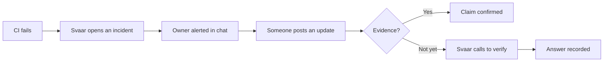
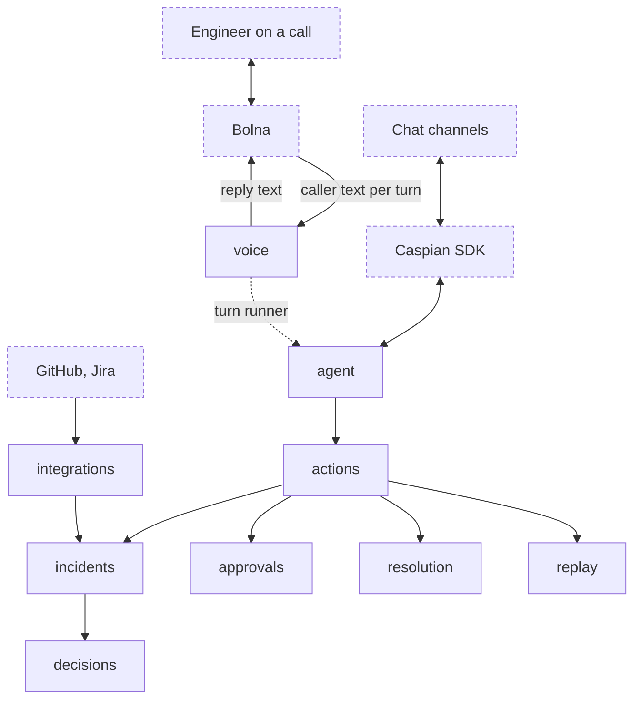

<h1 align="center">Svaar</h1>

  <b>The incident agent that checks the facts and picks up the phone.</b>

---

## Incidents run on trust. Most status updates have not earned it.

When production breaks, your team chat fills up fast. "Build is green." "Fix is merged." "Should be good now." Half of it is right. Some of it is hopeful. Nobody has time to check, so the incident drags on while everyone assumes someone else has it covered.

**Svaar makes sure every update is true.** It joins your team chat, watches your CI, checks what people say against what actually happened, and when the proof is missing, it calls the engineer and asks.

## Built for

- **On-call engineers** who want fewer pings and clearer handoffs.
- **Incident leads** who need one honest picture of where things stand.
- **Platform teams** who want accountability without adding process.

## What Svaar does for your team

### Spots failures the moment they happen
Svaar watches your GitHub Actions workflows. When a run fails, it groups related failures into a single incident, assigns a clear owner and alerts them privately. No duplicate tickets, no noisy channel.

### Checks every claim against real evidence
When someone says "the build passed" or "the fix is merged," Svaar records it and checks it against signed events from GitHub. A claim is marked confirmed only when the evidence backs it up. Silence or missing data never counts against anyone.

### Calls to confirm when the proof is missing
If the evidence is not there yet, an incident lead can ask Svaar to check. Svaar phones the engineer who made the claim, asks a short, focused question and records their answer. Every call has one purpose and nothing more.

### Follows up so nothing falls through the cracks
If an owner does not acknowledge an alert in time, Svaar escalates with a call. Cooldowns and daily limits make sure nobody gets spammed.

### Turns competing constraints into a workable plan
Release windows, staffing and capacity often pull in different directions mid-incident. Svaar weighs them, proposes a plan, validates it against your rules, and lets you test the scenario before anything changes.

## How it works

1. **Something breaks.** Svaar sees the failed CI run and opens an incident.
2. **The right person hears about it.** The owner gets a private alert in chat.
3. **Updates get checked.** Every status claim is matched against real evidence.
4. **Gaps get closed.** If the proof is missing, Svaar calls the engineer and asks.

### Architecture

Dashed boxes are outside Svaar.

## Safe by design

Svaar is built on one rule: **models propose, deterministic code enforces.**

- **AI suggests, rules decide.** The language model drafts replies and suggests actions. Every action is checked by plain, auditable code before anything happens.
- **Risky actions need a second yes.** Actions like rerunning or cancelling a workflow require the owner to confirm with a one-time code on a separate, verified channel.
- **Only verified people, only verified phones.** Teammates join with single-use invites and verify their own phone number. Svaar never calls an unverified number.
- **Fair by default.** An unanswered call, a busy line or missing data never marks someone as wrong.
- **Private by default.** Transcripts, phone numbers and messages are never written to logs.
- **Every action counts once.** Duplicate messages, webhooks and calls are detected and ignored, so nothing happens twice.

## Works with your stack

| | |
| --- | --- |
| **Chat** | Telegram |
| **CI** | GitHub Actions |
| **Voice** | Phone calls powered by Bolna |
| **AI** | Any OpenAI-compatible model with tool calling |

## Getting started

1. **Connect your chat** and invite your team.
2. **Connect GitHub** so Svaar can watch your workflows.
3. **Verify phones** so Svaar knows who to call.

That is it. The next time CI fails, Svaar is on it.

---

  <b>Svaar</b>: fewer assumptions, faster incidents.

