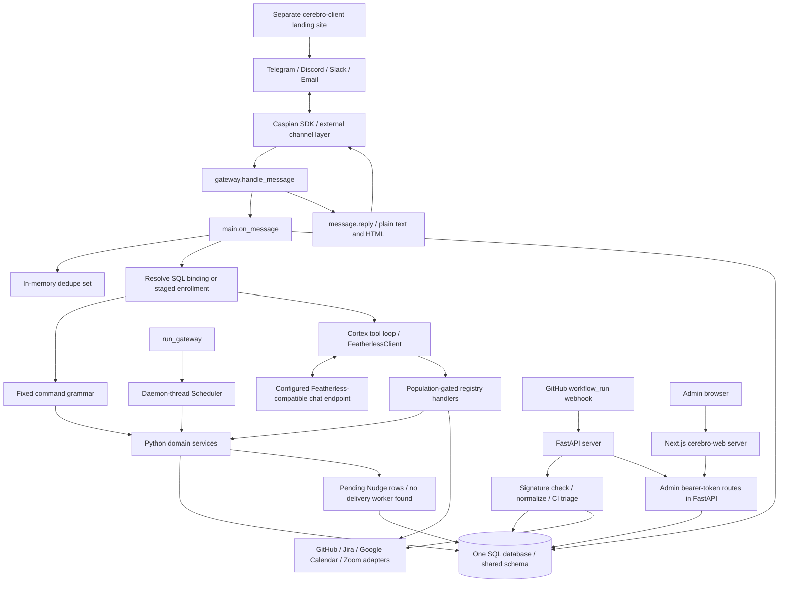

# Cerebro: source-grounded context for Svaar

This document is a standalone handoff for an agent that cannot read Cerebro's source. Paths are repository-relative. **Verified** means established by source inspection, not a claim that a deployed integration was exercised. **Partial** identifies implemented code with missing wiring or narrower behavior than its name suggests. **Recommendation** means a proposed Svaar design, not an existing Cerebro interface. Examples use fictional identifiers and data. Environment configuration is listed by variable name only; no local `.env` values are included.

## 1. Repository overview

### What Cerebro actually does

Cerebro is a Python workplace coordination agent with a Caspian messaging gateway, a population-gated LLM tool registry, SQL-backed operational records, periodic background processing, GitHub CI webhooks, and a separate administrative web application. It supports organizations, clients and staff, orders, tasks, meetings, summaries, reminders/deadlines, feedback routing, and CI actions. An order is a generic request record, not a commerce order with payment/inventory/carrier semantics.

The conversational core runs inside the messaging gateway process. FastAPI serves admin routes and GitHub webhooks; it does **not** expose the central agent as a chat service. There is one model loop with role-dependent tools and prompts, not a network of autonomous agents.

### Implemented capabilities and important qualifications

| Capability | Source-grounded status |
|---|---|
| Telegram, Discord, Slack, email inbound messages and immediate replies | Shared Caspian SDK bridge exists in `src/cerebro/gateway.py`; platform transport is delegated to the SDK. Actual account connectivity was not tested. |
| Cross-channel identity | SQL channel bindings resolve to a principal; enrollment joins identities using an asserted email within an org. No OTP or proof of email ownership is implemented. |
| Organization enrollment | Team code followed by name/email or TEAM/role/email. An unknown valid code creates an org. Codes route users; they are not a strict invitation authorization gate. |
| Role approval | DEV/LEAD/ADMIN claims initially enroll new users as OPS. A suitably ranked peer can approve via chat, or an admin bearer-token route can approve by claim ID. |
| Orders and tasks | Persist orders, update fields, split text into tasks, assign by designation/skills/load, ACK/BLOCKED transitions, and reminders. Automatic intake processes untouched OPEN orders. |
| Meetings | SQL meetings and RSVP; optional Google Meet event creation and free/busy, or Zoom meeting creation/deletion. Default scheduling uses an empty busy list. |
| Summaries | Request a summary order, accept text contributions, concatenate them into a digest after two contributions or a deadline, extract bullet/TODO tasks. Not transcription, semantic synthesis, or a meeting-keyed memory service. |
| Reminders and deadlines | SQL one-shot reminders and client-requested deadlines generate pending nudges. A reminder becoming `fired` does not prove channel delivery. |
| Notifications | Numerous workflows create `Nudge` rows. No application worker that sends pending nudges through Caspian was found. |
| CI | GitHub App REST adapter, cached runs, failure explanations, signed workflow webhooks, failure fingerprints, automatic rerun budget and issue creation, task blocking by branch convention. |
| Action confirmation | A separate nonce/hash/expiry executor exists. The live cortex dispatcher bypasses it and directly invokes registered handlers, including tier-2 CI mutations. |
| Audit | Conversation rows, crossing rows, challenge/refusal records, nudges, CI records. There is no complete immutable event log of every tool execution. |
| Admin dashboard | Real backend reads and selected mutations. Several controls only persist flags or re-read configuration. No built-in dashboard login gate was found. |

### Stack and entry points

`pyproject.toml` declares Python >=3.12, Poetry's build backend, FastAPI/Uvicorn, SQLAlchemy 2, Alembic, psycopg3, Pydantic/Pydantic Settings, httpx, Caspian SDK, PyJWT with crypto, python-dotenv, structlog, and redis. Redis is a declared dependency/configuration and Compose service but has no application usage in `src/cerebro`. No Celery/RQ implementation exists. `requirements.txt` and `poetry.lock` now accompany deployment. Dev tooling includes pytest/pytest-asyncio, Ruff, Black, mypy, and pre-commit.

`cerebro-web/package.json` defines the admin app: Next.js 14.2.35 App Router, React 18, TypeScript, Tailwind 3, and `server-only`; Node >=18.18. `cerebro-client/package.json` defines a separate Next.js/React/TypeScript/Tailwind public landing site. It links to messaging channels and has no agent backend.

| Entry point | Actual role | Startup |
|---|---|---|
| `src/cerebro/gateway.py::run_gateway` | Caspian message listener plus scheduler | `cerebro-gateway` or `python -m cerebro.gateway` |
| `src/cerebro/server.py::app`, `run_server` | HTTP admin and GitHub webhook server | `cerebro-webhook` or `python -m cerebro.server`; reads `PORT`, otherwise port 8000 |
| `src/cerebro/server.py::app` | ASGI development entry | `uvicorn cerebro.server:app --reload --port 8000` |
| `cerebro-web/src/app/page.tsx`, `cerebro-web/src/app/dashboard/page.tsx` | Team web routes; dashboard reads happen server-side | In `cerebro-web`: `npm install`, `npm run dev` (port 3000); production `npm run build`, `npm run start` |
| `cerebro-client/src/app/page.tsx` | Public landing site | In `cerebro-client`: `npm install`, `npm run dev` (port 3001); production `npm run build`, `npm run start` |
| `alembic/env.py` | SQL migration runner | `alembic upgrade head` with configured database |

A source-supported local setup is Python 3.12+, an isolated environment, `pip install -e ".[dev]"`, configured environment, `docker compose up -d`, `alembic upgrade head`, then gateway and HTTP server in separate processes. Run each Next.js application separately. These are setup instructions, not commands executed during this documentation task. Do not run `scripts/seed.py` as production identity bootstrap: it fabricates pre-verified channel bindings.

## 2. Actual architecture

### Processes, modules, and data flow



No Redis arrow is shown because no application call to Redis was found. There is also no Svaar component in this implementation.

The Python package is a modular application sharing `SessionLocal`, not separately deployed scheduling/notification/summary microservices. `registry.py` contains handlers, tool schemas, and population permissions; `services/` implements domain operations; `ingress/` handles identity, enrollment, commands, and dedupe; `cortex/` handles prompts/model calls/tool dispatch; `verify/` implements two approval mechanisms; `membrane/` handles population crossing policy and audit; provider packages implement outbound REST clients; `admin/router.py` implements the dashboard API.

### Message path

1. `gateway.handle_message(message)` extracts `(message.sender or {}).get("address", "unknown")`, `message.channel`, and `message.text or ""`.
2. `main.on_message(sender, channel, text)` opens a synchronous SQL session and computes `channel:sender:text[:20]` for dedupe.
3. `ingress.principals.resolve_principal` requires a matching `ChannelBinding` with `verified == "verified"`. Unknown senders enter enrollment and return an onboarding response without invoking the model.
4. Known senders call `touch_binding`, then `ingress.commands.parse_command`. Despite its name/comment, `touch_binding` does not update an existing binding timestamp.
5. Recognized commands call `main.execute_command`; other text calls `handle_free_text`, which persists the user message, loads per-principal history, invokes the cortex loop, and persists the assistant's final text.
6. The session closes in `finally`. `gateway.handle_message` replies through the original SDK `Message` object with plain text and `formatting.markdown_to_html` output.

### Background processing

`clock.scheduler.Scheduler` runs one daemon thread, ticks approximately every 0.05 seconds, and runs due callbacks sequentially. Jobs initially become due immediately and default to five-second intervals. `gateway.run_gateway` registers:

| Job registration | Callback core | Effect |
|---|---|---|
| `services/gap_chase.py::register_gap_chase_job` | `process_due_gap_chases` | Create missing-field chases, ask with backoff, mark exhausted on fourth attempt and create an escalation nudge. |
| `services/tasks.py::register_task_ladder_job` | `process_due_task_ladders` | Coalesce unacknowledged task reminders per assignee and advance persisted ladder state. |
| `services/meetings.py::register_meeting_reminder_job` | `process_due_meeting_reminders` | Generate attendee nudges for each verified binding and advance reminder stage. |
| `services/reminders.py::register_reminder_job` | `process_due_reminders` | Generate a pending due-time nudge and mark a general/deadline reminder fired. |
| `services/summaries.py::register_summary_jobs` | `process_due_summary_chases`, `process_due_summary_merges` | Request notes and merge summary orders. Two jobs. |
| `services/order_intake.py::register_order_intake_job` | `process_new_orders` | Decompose untouched OPEN orders, attempt assignment, create task cards, best-effort Jira ticket, mark IN_PROGRESS. |

There is no broker, durable task queue, distributed lock, scheduler leader election, CI polling job, OTP expiry job, or automatic pending-nudge sender. SQL retains domain state across restarts; job registrations and timing live in memory. An uncaught callback exception propagates out of `run_pending` and can terminate the scheduler thread. Multiple gateway processes could process the same due records concurrently.

### Identity, authorization, and secrets

`ingress/enrollment.py` implements `awaiting_code` then `awaiting_usertype` in `PendingEnrollment`. `is_plausible_code` accepts a single 3–20 character alphanumeric/hyphen token. `apply_join_code` calls `services.orgs.resolve_or_create_org_by_code`, which trims/uppercases and creates a new org when no code matches. The subsequent reply defaults to CLIENT when it contains a name before an email; `TEAM email` defaults to OPS; `TEAM DEV email` and bare role forms also work. `complete_enrollment` binds the channel as verified immediately and deletes the pending enrollment.

`find_or_create_principal_by_email` uses exact `(org_id, email)` lookup. It does not verify the email, normalize case, or prove ownership. Someone who knows another principal's org code and email can potentially bind to that principal. New DEV/LEAD/ADMIN requests become OPS pending a role claim; existing identities retain their current population when reused. OPS is self-asserted on initial team enrollment.

The registry restricts model-visible tools by CLIENT/OPS/DEV/LEAD/ADMIN. This is tool-level authorization, not comprehensive record-level authorization. Some ID lookups and fixed commands lack ownership/org checks; see section 9. Prompt instructions about privacy are not equivalent to enforcement.

`admin/auth.py::require_admin_token` uses one deployment-wide bearer secret and constant-time comparison. It does not identify a human admin or tenant. GitHub ingress uses HMAC on raw bytes. Provider credentials are deployment-wide; there is no per-org provider credential store or secret manager integration. `config.Settings` loads `.env` and environment variables. Base64 encoding of provider keys is transport encoding, not encryption. PyJWT is used for provider authentication, not user login sessions.

## 3. Communication channels

### Shared implemented contract

The exact repository entry point for all four channels is `src/cerebro/gateway.py::run_gateway`, which constructs `CommClient()`, registers `handle_message`, and calls `client.listen()`. Cerebro does not implement its own Slack Events API route, Discord bot socket, Telegram webhook/poller, or inbound SMTP/IMAP listener. Those behaviors belong to `caspian-sdk` and its service. Their transport-level authentication, event envelopes, retries, rate limits, thread handling, and channel installation requirements are **unknown from the repository**.

For every channel, the verified path is SDK `Message` → `handle_message` → `main.on_message` → enrollment/command/cortex → tool handler/domain service → returned text → `message.reply(text=..., html=...)` on the original SDK message. Tools do not separately implement channel-specific dispatch.

| Channel | Repository files / entry points | Incoming identity and return path | Channel-specific evidence and limits |
|---|---|---|---|
| Slack | `gateway.py::handle_message`; `services/channels.py::install_slack`; `admin/router.py::KNOWN_CHANNELS` | SDK channel `slack`, sender address, original-message reply | No Slack-specific signing verification, OAuth installation route, native API client, or sender/workspace mapping in Cerebro. `install_slack` only writes an in-memory branding config. |
| Discord | `gateway.py::handle_message`; `services/channels.py::install_discord` | SDK channel `discord`, sender address, original-message reply | No repository Discord gateway/shard/token/client implementation. Guild/member IDs are not explicitly represented in the shared handler. Branding helper does not connect a bot. |
| Telegram | `gateway.py::handle_message`; `services/channels.py::install_telegram`; `cerebro-client/src/components/landing/ChannelRow.tsx` | SDK channel `telegram`, sender address, original-message reply | Public site links to the bot. No local Telegram webhook registration or Bot API adapter. A comment in verification guidance calls CLIENT Telegram-only, but ingress has no population-by-channel restriction. |
| Email | `gateway.py::handle_message`; `services/channels.py::install_email`; `cerebro-client/src/components/landing/ChannelRow.tsx` | SDK channel `email`, sender address, original-message reply | Public site includes a mail link. No repository inbox poller, SMTP sender, DKIM validation, subject/thread contract, attachment extraction, or email ownership challenge. |

`services/channels.py` supplies `update_branding`, `get_channel_config`, and `list_channels` over a process-local dictionary. No gateway call installs these configurations. It is not a channel delivery service. `formatting.markdown_to_html` HTML-escapes text, converts simple bold/italic/inline code, and replaces newlines; it is not a complete Markdown renderer.

Only text, channel, and sender address are forwarded to the brain. The SDK's actual message ID, thread ID, attachments, voice/audio, and transport metadata are not forwarded. Enrollment uses a synthetic conversation ID `conv_{channel}_{channel_id}`. History is principal-wide across channels, not thread-scoped. Proactive task cards, incident updates, reminders, role-claim notifications, and feedback create pending nudges but do not have an observed SDK send path. `relay_to_population` is narrower still: it returns policy-filtered content and marks a crossing sent without creating nudges or performing transport delivery.

Other surfaces: `cerebro-web` is an admin UI/API proxy, `cerebro-client` is a landing site, and `/webhooks/github` receives CI events. No WhatsApp, telephone, Bolna, SMS, media streaming, or voice transcription channel is implemented.

## 4. Agent internals

### Initialization and model boundary

`main._get_chat_client` lazily caches one `cortex.featherless.FeatherlessClient` with a pooled synchronous `httpx.Client`. There is no explicit Agent framework object. `run_tool_loop` accepts a minimal `ChatClient` protocol, so tests can inject a fake model client.

`FeatherlessClient.chat` POSTs `/chat/completions` relative to the configured base, with bearer authentication and `{model, messages, tools?, tool_choice?}`. It returns `choices[0].message` and raises `ValueError` if choices/message are absent. The default model identifier is Qwen/Qwen3-32B. There is only one implemented model provider adapter. Changing a compatible base/model is possible configuration, not evidence of tested OpenAI/Anthropic/Gemini adapters. `scripts/smoke_tools.py::probe` can test four candidate model IDs for native tool calls; it was not run because it makes real model requests.

### Prompt and context construction

`cortex/prompts.py::assemble_system_prompt` combines population-specific `behavior_prompt`, current UTC `time_context`, dynamically generated `policy_prompt`, and `GUARDRAILS`. JSON mode adds a complete allowed-tool catalog and a required JSON tool-call shape. The tool policy derives from `TOOLS`/`TOOLS_FOR`, rather than a separately maintained prompt list. Guardrails ask for tool-backed claims, scope restraint, privacy, refusal of unsupported operations, and plain final text. They are model instructions, not transactional constraints.

`services/messages.py::record_message` commits individual user/final-assistant rows with principal, org, channel, population snapshot, and timestamp. `recent_messages` selects the latest 12 rows for the principal and reverses to chronological order. It does not filter by channel or current population. The loop also trims to 12 non-system messages before each model call, including intermediate tool exchanges. Only final user/assistant text persists; intermediate assistant tool calls/results do not. Fixed commands and onboarding are not recorded by this path. No embeddings, vector search, RAG, knowledge graph, long-term summarization, or transcript store is present.

### Tools and execution

`registry.ToolSpec` stores name, description, JSON-Schema-like parameters, handler, allowed populations, and tier. `TOOLS_FOR` is constructed from the registry at import. `cortex.loop.tool_schemas_for` produces OpenAI-style function schemas. `execute_tool_call` resolves only allowed tools, parses JSON arguments, injects `principal`/`session`, and calls the handler synchronously. Schemas are sent to the model but are not validated by a JSON Schema validator before invocation. A malformed argument string becomes `{"_raw": ...}`; many handlers accept `**_`, so extra/unexpected arguments can be ignored. Missing required Python parameters can raise `TypeError`.

`run_tool_loop` allows four model rounds and executes all calls in each round sequentially. It does not cap the number of calls inside one round. If round four still requests tools, those tools execute and then `ToolRoundLimitExceeded` is raised; the user can receive a limit message after real side effects. Native mode uses `tool_calls` and falls back to parsing JSON from content. JSON mode ignores native calls and parses plain/fenced/embedded JSON with either a `tool_calls` list or one `name`/`arguments` object. There is no separate planner, tool worker, subagent, agent delegation, or inter-agent protocol.

### Two distinct approval mechanisms

**Action confirmation:** `verify/executor.py::invoke` checks registry population permission, runs tier 1 immediately, and for tier >=2 requires at least two verified binding rows before minting an `Approval`. `verify/challenge.py::mint_challenge` seals action/arguments with SHA-256, an eight-character nonce, and a default ten-minute TTL; optional origin channel is stored. `confirm` checks nonce alphabet, existence, pending state, expiry, principal ownership, and action hash, and refuses confirmation on the same channel when both channel values are present. It marks the approval confirmed and commits **before** invoking the handler. This is neither atomic external execution nor guaranteed retry. The count is binding rows, not distinct channel types. `deny` resolves pending approval without execution. Chat `CONFIRM`/`DENY` call these functions.

**Critical wiring limitation:** `cortex/loop.py::execute_tool_call` calls `tool.handler` directly and never calls `verify.executor.invoke`. Thus tier-2 metadata does not gate live free-text tool execution. The registry CI handlers immediately call GitHub. No claim of enforced confirmation for live CI commands should be built on this code. Fixed `RERUN`, `DISPATCH`, and `CANCEL` commands merely return strings and do not execute GitHub actions.

**Role claims:** `verify/role_claims.py` uses a separate table and a default 24-hour TTL. Chat approval requires another principal in the same org with rank >= requested rank (OPS 0, DEV 1, LEAD 2, ADMIN 3). The admin API calls `approve_role_claim_as_admin` / `deny_role_claim_as_admin` by claim ID, checks pending/expiry, and bypasses peer identity/rank because the shared admin token is the authority. Approval promotes population and creates a nudge. `approver_principal_id` is not populated by that admin path. These are enrollment role approvals, not arbitrary Svaar business-action approvals.

### Errors, timeouts, and retries

The chat client has a 60-second HTTP timeout, no automatic retry, and no total multi-round deadline. Other provider adapters use 30-second clients and cache tokens in their auth objects; many registry calls construct new auth/client instances, limiting cache reuse. `main.handle_free_text` catches tool-round exhaustion and `(httpx.HTTPError, ValueError)` and persists a fallback response. That broad ValueError catch can report a model connectivity message for non-model validation errors. Arbitrary handler, SQL, and provider-specific RuntimeError exceptions are not uniformly caught. Several provider clients are constructed outside the handler's `try` block, so missing credentials can propagate.

The gateway has no outer exception recovery around `on_message` or `message.reply`. Dedupe records the input before successful completion, so retrying a failed identical input can be suppressed. Scheduler callbacks have no generic exception guard. No durable retry/outbox/dead-letter mechanism was found. CI rerun budgeting is a domain behavior, not a generic request retry strategy.

## 5. Existing APIs and integration contracts

### 5.1 HTTP conventions and complete Python route inventory

`src/cerebro/server.py` mounts `admin.router.router` and `github.webhook.router`. Every `/admin/*` route uses `admin.auth.require_admin_token`: `Authorization: Bearer <configured secret>`. Missing server token yields 503 with `{"detail":"admin API is not configured (ADMIN_API_TOKEN unset)"}`; missing/wrong credentials yield 401 with `{"detail":"invalid or missing admin token"}` and `WWW-Authenticate: Bearer`. No tenant/principal is derived from that token. Reads generally span all organizations unless otherwise stated. There is no resource-specific scope, service account, or OAuth flow.

Admin response shapes are manually built dictionaries, without explicit Pydantic response models. Timestamps below are strings or null where `_iso` can return null. FastAPI validates typed path/query/body inputs; invalid inputs return 422. Listed `limit` parameters have an upper bound but no explicit positive lower bound, and there is no offset/cursor pagination. DB/unhandled errors can become 500; no global JSON error contract is implemented. All routes below are **implemented**, with partial effects identified.

In the following table, `Item[]` means an actual response envelope `{"items":[...]}`; item fields are exhaustive for that route. GETs have no request body. All paths in this table are implemented in `src/cerebro/admin/router.py`.

| Method / route | Function and request | Response | Semantics / specific errors |
|---|---|---|---|
| GET `/admin/stats` | `get_stats()` | Item `{value: int, label: string}` | Five counts: channels connected (constant four), members, pending role claims, CI rows created in last seven days, meetings starting today UTC. Does not prove live connections. |
| GET `/admin/channels` | `get_channels()` | Item `{channel, state, lastVerifiedMessageAt: string|null, messagesToday: int}` | Four known channels. `state` is `live` if latest Message row is within 12 hours, otherwise `reconnect_needed`. Counts user and assistant rows, not transport messages. |
| GET `/admin/projects` | `get_projects()` | `{items:[{id,name,phase,status,owner,note}],source:"static"}` | Hardcoded PROJECTS roadmap, no Project table. |
| GET `/admin/members` | `get_members(limit=100)`, max 500 | Item `{id,name,population,channelBindingCount:int,joinedAt}` | Newest principals first, name fallback display_name → email → ID. Binding count includes unverified rows. |
| GET `/admin/approvals/pending` | `get_pending_approvals(limit=50)`, max 200 | Item `{id,name,claimedRole,eligibleApprover}` | Pending RoleClaim rows, not action Approval rows. Does not exclude expired pending claims; `eligibleApprover` is usually `any peer in role`. |
| GET `/admin/meetings` | `get_meetings(limit=50)`, max 200 | Item `{id,title,startsAt,organizer,provider:string|null,joinUrl:string|null,attendeesConfirmed:int,attendeesTotal:int}` | Future noncancelled meetings sorted ascending. Provider is actual stored `meet`/`zoom` or null. |
| GET `/admin/meetings/past` | `get_past_meetings(limit=50)`, max 200 | Item `{id,title,endedAt,organizer,provider:string|null}` | Starts before now, noncancelled. `endedAt` is populated from starts_at, not a calculated or observed end time. |
| GET `/admin/reminders` | `get_reminders(limit=100)`, max 500 | Item `{id,meetingId,meetingTitle,stage}` | MeetingAttendee rows with already advanced reminder_stage and a future meeting. Does not expose the new general/deadline Reminder table or a future schedule of pending reminders. |
| GET `/admin/ci-runs` | `get_ci_runs(limit=50)`, max 200 | Item `{id,repo,workflowName,triggeredBy,result,durationSeconds:int,finishedAt}` | Cached SQL only. Result is raw status or conclusion (`success`, `failure`, etc.). Duration is row updated_at minus created_at, not GitHub job duration. `finishedAt` can describe an unfinished run's update. |
| GET `/admin/ledger` | `get_ledger(limit=100)`, max 500 | Item `{id,principal,action,result,at}` | Crossing rows only; action text is `action (source -> target)`. No full event/tool log, content payload, or replay cursor. |
| GET `/admin/allowlist` | `get_allowlist()` | Item `{tool,populations:{[population]:true}}` | Derived from TOOLS, sorted by name, deliberately omits client from permission map even if permitted. Does not include arguments, tier, or schema. No editing endpoint. |
| POST `/admin/approvals/{claim_id}/approve` | `approve_pending_approval(claim_id)`, no body | `{status:"approved",claim_id,claimant_principal_id,population}` | Changes claimant's role and creates a nudge. Invalid/missing/expired/resolved claim or missing claimant → 400 `detail`. |
| POST `/admin/approvals/{claim_id}/reject` | `reject_pending_approval(claim_id)`, no body | `{status:"denied",claim_id,claimant_principal_id}` | Denies role claim, creates nudge. Invalid claim state/expiry/ID → 400. |
| GET `/admin/channel-config` | `get_channel_config()` | Item `{channel,apiKeyStatus:"configured"|"missing"}` | All report whether the same CASPIAN_API_KEY is nonempty. No secret values returned. |
| POST `/admin/channel-config/{channel}/reconnect` | `reconnect_channel(channel)`, no body | `{channel,apiKeyStatus}` | Only re-reads config; does not reconnect SDK sockets. Unknown channel → 404. |
| GET `/admin/notification-preferences` | `get_notification_preferences()` | Item `{id,label,enabled:bool}` | Uses active org; first read creates four default rows if none exist. No org → 404. This GET can write. |
| POST `/admin/notification-preferences/{pref_id}/set` | `set_notification_preference`, body `SetNotificationPreference {enabled:bool}` | `{id,label,enabled:bool}` | Sets row by ID without an org filter. Missing preference → 404, invalid body → 422. No downstream preference enforcement found. |
| GET `/admin/organization` | `get_organization()` | `{name,adminContact,billingTier,joinCode}` | Active org heuristic; no org → 404. Empty contact and default billing label possible. |
| POST `/admin/organization/revoke-access` | `revoke_integration_access()`, no body | `{channelsActive:false}` | Sets active org flag only; no actual channel revocation. No org → 404. |
| POST `/admin/organization/deactivate` | `deactivate_workspace_integration()`, no body | `{workspaceActive:false}` | Sets active org flag only; no actual agent/integration shutdown. No org → 404. |

Additional Python routes:

| Method / route | Source / request | Response and auth / errors |
|---|---|---|
| GET `/healthz` | `src/cerebro/server.py::healthz`, no body | Public `{"status":"ok"}`. Does not check SQL, SDK, model, or scheduler readiness. |
| POST `/webhooks/github` | `src/cerebro/github/webhook.py::github_webhook`; raw JSON bytes with GitHub headers | HMAC authentication; detailed contract below. Not an agent execution API. |

FastAPI serves `/docs` only in development, disables ReDoc, and leaves default `/openapi.json` enabled. OpenAPI output does not supply precise schemas for all manually constructed admin response dictionaries. CORS permits configured exact origins, GET/POST, Authorization/Content-Type, no credentials; CORS is not caller authentication.

Representative requests/responses, following actual route dictionaries:

```http
GET /admin/members?limit=1
Authorization: Bearer <ADMIN_API_TOKEN>
```

```json
{"items":[{"id":"principal-example","name":"Example Operator","population":"ops","channelBindingCount":2,"joinedAt":"2026-10-18T08:00:00+00:00"}]}
```

```http
POST /admin/notification-preferences/pref-example/set
Authorization: Bearer <ADMIN_API_TOKEN>
Content-Type: application/json

{"enabled":false}
```

```json
{"id":"pref-example","label":"Daily ledger summary email","enabled":false}
```

This updates a preference; it does not establish that a daily-summary email job exists.

```http
POST /admin/approvals/claim-example/approve
Authorization: Bearer <ADMIN_API_TOKEN>
```

```json
{"status":"approved","claim_id":"claim-example","claimant_principal_id":"principal-example","population":"dev"}
```

### 5.2 GitHub webhook event interface

`github.webhook.verify_signature` validates `X-Hub-Signature-256: sha256=<HMAC hex>` using the configured webhook secret and exact raw body. Missing secret, malformed/missing signature, or mismatch → 401 with an explanatory `detail`. `X-GitHub-Event` is optional in the signature of `github_webhook`; if supplied and not `workflow_run`, it returns 200 `{"handled":false,"reason":"ignored_event","event":"..."}` after signature verification. With no event header, it still attempts normalization.

Malformed JSON syntax → 400 `{"detail":"invalid json"}`. A dict without a workflow_run ID → 200 `{"handled":false,"reason":"not_workflow_run"}`. There is no Pydantic webhook request model; non-object JSON, malformed nested shapes, invalid UTF-8, and downstream failures do not all receive normalized 400 errors.

`normalize_workflow_run` uses `repository.full_name`, or owner.login/name, and fields from workflow_run. A supported synthetic example is:

```json
{
  "action":"completed",
  "repository":{"full_name":"example-org/demo-service"},
  "workflow_run":{
    "id":18442,
    "name":"Build",
    "head_branch":"task-12",
    "head_sha":"0123456789abcdef0123456789abcdef01234567",
    "status":"completed",
    "conclusion":"success",
    "html_url":"https://github.com/example-org/demo-service/actions/runs/18442",
    "event":"push"
  }
}
```

Success response:

```json
{"handled":true,"run_id":"18442","ci_run_id":"cirun_example","task_id":null}
```

If branch `task-12` resolves to an existing task in the chosen org, task_id is its SQL ID instead of null. A completed failure additionally returns `flake` (fingerprint, action, rerun_count_window, budget, issue_url, triage, ci_failure_id) and `blocked_task` (null or task_id/number/status/blocked_reason). The normalized internal `CIEvent` also includes action, owner, repo, run_id, status, conclusion, head_branch, head_sha, workflow_name, html_url, event, raw_run. This is an internal Python dataclass, not an external event stream.

`handle_ci_event` chooses `services.orgs.resolve_active_org`: org of latest persisted Message, else newest org; only when none exists does it use the configured default org ID. That fallback org is not created here. This is not a repository-to-tenant mapping. It upserts the CI record, links task number from branch (`task-12`, `task/12`, or a matching path component), then triages failed completed runs.

`github/triage.py::handle_failed_run` fingerprints a tail slice after timestamp/path/PID normalization. The default triage is a deterministic stub, not a real LLM call. The webhook passes no fetched raw log, so the sample may be the cached failure_summary or just workflow name. It increments rerun budget for each processed failure below the configured limit and calls GitHub if a client exists; afterward it can open an issue once per stored window. `likely_flake` does not gate the rerun. Missing GitHub credentials can leave an `action:"rerun"` result without an external rerun actually occurring. Signature replay/delivery-ID dedupe is not implemented; duplicate failure deliveries can consume budget or cause duplicate side effects. There is no original-channel CI completion sender or stored originating conversation in this path.

Svaar should not submit arbitrary incident events to this route: its contract is a signed GitHub workflow event and can trigger real reruns/issues/task mutations.

### 5.3 Next.js HTTP proxy contracts

The team server exposes six mutation proxy routes. Each file below exports `POST` and calls `cerebro-web/src/lib/api.ts::postAdmin`, which attaches the backend admin token server-side. **No caller authentication or authorization check appears in these route handlers.** A deployment proxy/SSO may protect them, but that is unknown. Do not expose them as Svaar's service API without an explicit trust design.

| Method / browser route | Exact source file | Request / backend target / response |
|---|---|---|
| POST `/api/approvals/{id}/approve` | `cerebro-web/src/app/api/approvals/[id]/approve/route.ts` | No body → `/admin/approvals/{id}/approve`; forwards backend success. |
| POST `/api/approvals/{id}/reject` | `cerebro-web/src/app/api/approvals/[id]/reject/route.ts` | No body → `/admin/approvals/{id}/reject`; forwards backend success. |
| POST `/api/channel-config/{channel}/reconnect` | `cerebro-web/src/app/api/channel-config/[channel]/reconnect/route.ts` | No body → `/admin/channel-config/{channel}/reconnect`; forwards backend success. |
| POST `/api/notification-preferences/{id}` | `cerebro-web/src/app/api/notification-preferences/[id]/route.ts` | JSON `{enabled:bool}` → `/admin/notification-preferences/{id}/set`; forwards backend success. TypeScript cast is not runtime request validation. |
| POST `/api/organization/revoke-access` | `cerebro-web/src/app/api/organization/revoke-access/route.ts` | No body → same path under `/admin`; forwards backend success. |
| POST `/api/organization/deactivate` | `cerebro-web/src/app/api/organization/deactivate/route.ts` | No body → same path under `/admin`; forwards backend success. |

Backend non-2xx status is preserved with a short `{error:"approve failed"}`, `reject failed`, `reconnect failed`, `update failed`, `revoke failed`, or `deactivate failed` response. Network failure becomes 502. With missing backend configuration, `postAdmin` returns `kind:"mock"` and proxies return simulated 200 responses: approve/reject use `{status,claimId,mocked:true}`, reconnect uses `{channel,apiKeyStatus:"configured",mocked:true}`, preferences use `{id,enabled,mocked:true}`, and org controls return their false flag plus `mocked:true`. These are explicitly not durable actions. A caller must not treat those successes as business approval evidence.

The latest `getDashboardData` performs 14 parallel server-side GETs and independently replaces failures with empty lists/blank organization. Earlier README text describing a full mock dataset is stale; `mock-data.ts` was deleted. `getJson` casts JSON without actual runtime schema validation despite broader comments. Dashboard pages are dynamic, and the token stays on the server through `server-only`. There is no frontend public agent/chat endpoint.

### 5.4 Messaging / Python function contracts

`main.on_message(sender: str, channel: str, text: str) -> str` is an implemented asynchronous **Python** entry point, called by Caspian. There is no HTTP route that accepts those fields. Calling it from another service would require Python/package/source access and trusted sender identity; it is not a remote integration contract.

Fixed grammar in `ingress/commands.py::parse_command`: optional slash, case-insensitive verb, whitespace-separated args. `WHOAMI`; `ACK <task-number>`; `BLOCKED <task-number> <reason...>`; `CONFIRM <nonce>` / `DENY <nonce>`; `APPROVE <role-claim-nonce>` / `REJECT <role-claim-nonce>`; `AUDIT`. Bad arguments return human-readable strings; no machine error envelope. `ENROLL` is an acknowledgement-only stub for known senders. `RERUN <run-id>`, `DISPATCH <workflow>`, `CANCEL <run-id>` are response-only stubs. An unrecognized verb becomes free text and goes to the model. These commands are not an SDK API for Svaar.

The 35 registry tools are internal Python callables exposed to the LLM, not URL endpoints. All are defined, described, and schematized in `src/cerebro/registry.py`. The following inventory records their argument surface. `?` means optional; injected principal/session are omitted. A=all populations; T=OPS/DEV/LEAD/ADMIN. All tiers are 1 except the three marked 2. Population gating happens at dispatch, not inside every handler. It does not fix the record-access gaps described elsewhere.

| Tool / handler name | Allowed / tier | Model arguments | Result / important behavior |
|---|---|---|---|
| `whoami` | A / 1 | none | `{principal_id,org_id,population,email}`. |
| `enroll_principal` | T / 1 | channel, channel_id, conversation_id; org_id? defaults caller org | `{principal_id,binding_id,population,verified}`; creates CLIENT with verified binding, despite stale pending-binding comments. Explicit other org accepted. |
| `create_team` | T / 1 | name; code? | `{org_id,name,join_code}` or `{error:"code_already_in_use",code}`; does not automatically move caller into the new org. |
| `set_availability` | A / 1 | available:bool; note? | `{principal_id,available,note,status:"recorded"}`; no persistence or scheduling effect. |
| `open_order` | A / 1 | text?, order_type?, fields?:object | Serialized Order. Missing type inferred by regex, otherwise general. Can indirectly trigger automatic intake. |
| `update_order_fields` | A / 1 | order_id, fields:object | Serialized Order or order_not_found; merges fields, OPEN→IN_PROGRESS. Clients restricted to own order, team access broader. |
| `order_status` | A / 1 | order_id | Serialized Order or order_not_found; no caller scope check. |
| `list_orders` | A / 1 | status?, limit? default 20 | `{orders:[Order],count}`; caller org, CLIENT additionally own records; clamps limit 1–100. |
| `decompose_order` | T / 1 | order_id, designation; required_skills?:string[] | `{tasks:[Task],count}`; split free text, no caller org check by ID; order_not_found possible. |
| `assign_task` | T / 1 | org_id, number:int | `{task:Task,assignee_principal_id}`; task_not_found/no_eligible_assignee. Accepts org_id rather than deriving it. |
| `ack_task` | T / 1 | number:int | Task or task_not_found; current org, no assignee check. |
| `block_task` | T / 1 | number:int; reason? | Task or task_not_found; current org, lead nudges. |
| `list_tasks` | T / 1 | none | `{tasks:[Task],count}` assigned to caller. |
| `schedule_meeting` | A / 1 | title; attendee_principal_ids?:string[], duration_minutes? default 30, starts_at?:ISO string, provider? enum none/meet/zoom | Meeting or provider error; external client injection exists for tests, not in model schema. |
| `rsvp_meeting` | A / 1 | meeting_id, status enum yes/no/pending | `{meeting_id,principal_id,rsvp_status}` or attendee_not_found. |
| `list_meetings` | A / 1 | none | `{meetings:[Meeting],count}` organized/attended by caller. |
| `meeting_status` | A / 1 | meeting_id | Meeting plus attendees `[{principal_id,rsvp_status}]` or meeting_not_found; no caller membership check. |
| `cancel_meeting` | A / 1 | meeting_id | Meeting or meeting_not_found/not_organizer/provider error; organizer check, external delete first. |
| `request_deadline` | A / 1 | order_id; due_at?:ISO string, in_seconds?:int, note? | `{order_id,due_at,reminders:[Reminder]}`; org-level order check, assignee or lead recipients, immediate pending nudge. |
| `set_reminder` | T / 1 | subject; due_at?, in_seconds?, note?, for_principal_id? | Reminder; defaults recipient to caller, checks alternate recipient same org. |
| `list_reminders` | T / 1 | mine_only?:bool default true | `{items:[Reminder]}` pending, same org. |
| `cancel_reminder` | T / 1 | reminder_id | Reminder or reminder_not_found_or_not_pending; same org, not restricted to creator. |
| `calendar_view` | T / 1 | days_ahead?:int default 7 | `{meetings:[Meeting],reminders:[Reminder],days_ahead}`; upper horizon only, can include past meetings. |
| `request_summary` | A / 1 | topic | Summary-type Order and pending requester nudge. |
| `submit_summary` | A / 1 | order_id, text | `{id,order_id,principal_id}` contribution; no membership/type validation in handler/service. |
| `relay_to_population` | A / 1 | target_population; text?, order_id? | `{delivered_to,action,content,crossing_id}` or relay_denied/order_not_found; no actual transport send. |
| `route_client_feedback` | A / 1 | text; task_number?:int, order_id? | Assignee result `{task_number,routed_to:string,action,crossing_id}` or lead fallback `{task_number,routed_to:string[],action:"escalated_to_leads"}`; task_not_found/feedback_denied/no_recipient_found possible. |
| `post_incident_update` | T / 1 | summary; target_population? enum dev/ops/lead/admin default lead, severity? enum info/warning/critical default info | `{target_population,notified:[IDs],nudge_ids,severity}` or no_recipients. Creates pending nudges, not incident reconstruction. |
| `list_ci_runs` | T / 1 | owner, repo; branch?, status?, per_page? default 30 | `{runs:[CiRun],count}` from live API and SQL upsert; github_error possible. |
| `explain_ci_failure` | T / 1 | owner, repo, run_id:string | `{run:CiRun,failed_jobs:[...],summary}` from jobs/steps/annotations; github_error possible. |
| `rerun_workflow` | T / 2 | owner, repo, run_id | `{status:"rerun_requested",owner,repo,run_id}` or github_error; live dispatcher bypasses confirmation. |
| `dispatch_workflow` | T / 2 | owner, repo, workflow_id, ref; inputs?:object | `{status:"dispatched",owner,repo,workflow_id,ref,requested_by}` or github_error; no returned/stored run ID or originating channel. |
| `cancel_run` | T / 2 | owner, repo, run_id | `{status:"cancel_requested",owner,repo,run_id}` or github_error. |
| `create_jira_ticket` | T / 1 | summary; description?, project_key?, issue_type? default Task, labels?:string[] | `{issue_key,issue_url,id,created_by}` or missing_project_key/jira_error. |
| `jira_issue_status` | T / 1 | issue_key | `{issue_key,summary,status}` or jira_error. |

`_resolve_due_at` prefers positive `in_seconds`, computed from server UTC now; otherwise parses `due_at` with `datetime.fromisoformat`. Descriptions say give one, but providing both uses in_seconds rather than rejecting. Missing/invalid deadline data returns `invalid_due_at_or_in_seconds`; deadline requests can return order_not_found/no_eligible_recipient. ISO timestamps without timezone are accepted and have later naive/aware implications.

Serialized shapes, from service serializers rather than invented public DTOs:

- **Order** (`services/orders.py::serialize_order`): id, org_id, principal_id, order_type, status, free_text (empty string fallback), fields (object parsed from JSON string), created_at, updated_at.
- **Task** (`services/tasks.py::serialize_task`): id, number, org_id, order_id, title, description, designation, required_skills (array), status, assignee_principal_id, blocked_reason, created_at, updated_at. Nullable IDs remain null; description/blocked_reason default to empty strings.
- **Meeting** (`services/meetings.py::serialize_meeting`): id, org_id, organizer_principal_id, title, starts_at, duration_minutes, status, provider, join_url. Missing provider/join URL become empty strings here, unlike admin reads.
- **Reminder** (`services/reminders.py::serialize_reminder`): id, org_id, created_by_principal_id, principal_id, order_id, kind, subject, note, due_at, status, created_at, fired_at (nullable).
- **CiRun** (`github/runs.py::serialize_ci_run`): id, org_id, github_run_id, owner, repo, workflow_name, head_branch, head_sha, status, conclusion, html_url, event, task_id, failure_summary, created_at, updated_at. conclusion/task_id/failure_summary use empty-string fallbacks; requester identity is not included.

Supported internal model call example (not an HTTP request):

```json
{"id":"call_example","type":"function","function":{"name":"open_order","arguments":"{\"text\":\"Review delivery incident\",\"order_type\":\"general\",\"fields\":{\"email\":\"operator@example.com\"}}"}}
```

JSON mode equivalent:

```json
{"tool_calls":[{"name":"open_order","arguments":{"text":"Review delivery incident","order_type":"general","fields":{"email":"operator@example.com"}}}]}
```

Handler return shape, with fictional generated IDs/timestamps:

```json
{"id":"order-example","org_id":"org-example","principal_id":"principal-example","order_type":"general","status":"open","free_text":"Review delivery incident","fields":{"email":"operator@example.com"},"created_at":"2026-10-18T08:00:00+00:00","updated_at":"2026-10-18T08:00:00+00:00"}
```

These schemas do not create remotely callable tools. There is no implemented `/chat`, `/agent`, `/tools`, order/task CRUD HTTP API, generic event ingestion, agent RPC, SSE/WebSocket event stream, or outbound subscription API.

### 5.5 Outbound provider contracts (not Cerebro inbound routes)

These REST calls are implemented in adapters. Svaar cannot call these Python methods remotely through Cerebro's current HTTP server. Credentials are shared deployment configuration.

| Provider / exact files | Methods and external routes | Request/result behavior |
|---|---|---|
| GitHub: `src/cerebro/github/app_auth.py`, `api.py`, `runs.py` | `GitHubAppAuth.make_jwt` / `get_installation_token`; POST `/app/installations/{installation_id}/access_tokens`; `GitHubAPI.list_workflow_runs` GET `/repos/{owner}/{repo}/actions/runs`; `get_workflow_run` GET `/repos/{owner}/{repo}/actions/runs/{run_id}`; `list_jobs_for_run` GET same run + `/jobs`; `list_annotations_for_check_run` GET `/repos/{owner}/{repo}/check-runs/{check_run_id}/annotations` | App RS256 JWT (nine-minute lifetime) exchanges for installation bearer token, cached until five minutes before expiry. List queries use branch/status/per_page; returns workflow_runs/jobs/annotation lists. Explanations return failed job name/conclusion/html_url, failed steps name/number/conclusion, annotation path/start_line/message/annotation_level. |
| GitHub mutation: same `api.py` | `rerun_workflow` POST run + `/rerun`; `dispatch_workflow` POST `/repos/{owner}/{repo}/actions/workflows/{workflow_id}/dispatches`; `cancel_run` POST run + `/cancel`; `create_issue` POST `/repos/{owner}/{repo}/issues` | Dispatch JSON `{ref,inputs?}`; issue JSON `{title,body,labels?}`. Empty/204 results normalize to `{}`; issue returns a dict. HTTP status errors become GitHubAPIError; transport exceptions can propagate. |
| Jira: `src/cerebro/jira/auth.py`, `api.py` | `JiraAuth.basic_auth_header`; `JiraAPI.create_issue` POST `{base}/rest/api/3/issue`; `get_issue` GET same + `/{issue_key}` | Basic auth from email/API token. Create JSON `{fields:{project:{key},summary,issuetype:{name},description?:ADF,labels?}}`; `_text_to_adf` creates a single paragraph document. Create result requires a dict; status handler extracts fields.status.name and fields.summary. HTTP status failures become JiraAPIError. |
| Google Calendar: `src/cerebro/gcal/auth.py`, `api.py` | `GoogleCalendarAuth.make_jwt`, `get_access_token`; `GoogleCalendarAPI.free_busy` POST `/calendar/v3/freeBusy`; `create_event` POST `/calendar/v3/calendars/{calendar_id}/events`; `delete_event` DELETE event path | Service-account RS256 JWT bearer exchange; optional delegated subject; token cache refresh skew five minutes. Free/busy body `{timeMin,timeMax,items:[{id:calendar_id},{id:email},...]}` → sorted datetime interval pairs; per-calendar errors are not explicitly surfaced. Event body includes summary, start/end.dateTime, attendees, optional conferenceData; conferenceDataVersion query when creating Meet. Returns `{event_id,meet_link,html_link}`. |
| Zoom: `src/cerebro/zoom/auth.py`, `api.py` | `ZoomAuth.get_access_token`; `ZoomAPI.create_meeting` POST `/v2/users/{user_id}/meetings`; `delete_meeting` DELETE `/v2/meetings/{meeting_id}` | Server-to-server OAuth account_credentials with Basic auth, cached token. Create body topic/type=2/start_time/duration/timezone/settings; returns `{meeting_id,join_url,start_url}`. No free/busy support. HTTP status failures become ZoomAPIError. |

Google scheduling queries a shared calendar plus resolved attendee emails only when `provider="meet"` and starts_at is omitted. It searches seven days of busy intervals, but `find_slot` has no explicit horizon bound. Explicit start times do not get conflict checks. `none`/`zoom` use an empty busy list. External creation precedes internal persistence, and provider deletion precedes internal cancellation; this prevents some dead-link cases but provides no rollback if the following SQL write fails. Google event creation does not set a sendUpdates query option. No per-user OAuth, calendar synchronization daemon, recording retrieval, or transcription integration exists.

## 6. Database and infrastructure

### Persistence model

`db/models.py` defines one SQLAlchemy `Base`. `db/session.py` creates one synchronous engine with pool_size=10, max_overflow=20, pool_pre_ping, autocommit=False, autoflush=False. `psycopg3_url` rewrites bare PostgreSQL URLs to psycopg3. Many tests use in-memory SQLite, but deployed configuration/migrations target PostgreSQL. SQL JSON-like fields are strings with manual JSON encoding, not typed JSONB domain contracts.

| Model / SQL table | Main state and relationships |
|---|---|
| `Org` / `orgs` | id, name, unique nonnull join_code, admin_contact, billing_tier, channels_active, workspace_active; principals/orders reference org. Flags are not enforced by agent/gateway. |
| `Principal` / `principals` | Org FK, population SQL enum, email, display_name, skills_json, wip_cap default 3. No unique org/email constraint. |
| `ChannelBinding` / `channel_bindings` | Principal FK, channel, channel_id, conversation_id, verified string. Channel/address index is not unique. No last_seen field. |
| `PendingEnrollment` / `pending_enrollments` | Nullable org FK, stage, channel/address, conversation_id; unique channel/address index. No expiry cleanup. |
| `RoleClaim` / `role_claims` | Org and claimant/approver principal FKs; requested_population, unique nonce, pending/approved/denied/expired states, expiry/resolution timestamps. |
| `Approval` / `approvals` | Org/principal FKs, nonce, pending/confirmed/denied/expired, action, payload_json, expiry/resolution. Not a universal execution audit. |
| `Order` / `orders` | Org/requester FKs, order_type, open/in_progress/complete/cancelled, free_text, fields_json, timestamps. |
| `FieldSpec` / `field_specs` | order_type, field_name, required, validator; global rules, not org-scoped. |
| `GapChase` / `gap_chases` | Order FK, field_name, open/closed/exhausted, ask_count, next_ask_at/last_asked_at. |
| `Task` / `tasks` | Org/optional Order/optional assignee FKs; per-org unique number, title/description, designation, skills, open/acked/blocked/done/cancelled, blocked_reason, ladder state/times, acked_at. No exposed done-task tool. |
| `Nudge` / `nudges` | Org/principal and optional order/gap chase FKs, kind/body, pending/sent/failed, sent_at. No structured recipient channel/address, durable external message ID, or retry counter. |
| `Meeting` / `meetings` | Org/organizer FKs, title/start/duration, scheduled/cancelled, provider/join_url/external_event_id. |
| `MeetingAttendee` / `meeting_attendees` | Meeting/principal FKs with unique pair, RSVP pending/yes/no, reminder_stage. Organizer included as attendee. |
| `SummaryEntry` / `summary_entries` | Order/principal FKs, text, submitted_at; no meeting FK or recorded-event provenance. |
| `Message` / `messages` | Org/principal FKs, channel, population snapshot, user/assistant role, content, created_at; indexed principal/time. No tool execution stream. |
| `Policy` / `policies` | Unique source/target population pair, allow/redact/deny, redact_fields_json; global rather than org-scoped. |
| `Crossing` / `crossings` | Org/actor FKs, source/target populations, policy action, optional content_ref, recorded/sent/denied, sent_at. No payload snapshot or integrity chain. |
| `CiRun` / `ci_runs` | Org FK, GitHub run ID unique per org, owner/repo/workflow/branch/SHA/status/conclusion/url/event, optional requester/task FKs, failure_summary, timestamps. Requester field is not populated by dispatch path. |
| `CiFailure` / `ci_failures` | Org FK, unique org/fingerprint, owner/repo, sample_log, triage_json, rerun counter/window, issue_url. Fingerprint identity does not include repo as a separate uniqueness key. |
| `NotificationPreference` / `notification_preferences` | Org FK, unique org/key, label, enabled, created_at; dashboard storage with no observed consumers in job logic. |
| `Reminder` / `reminders` | Org, creator, target principal and optional Order FKs; general/deadline kind, subject/note, due_at, pending/fired/cancelled, fired_at. |

Alembic revisions are `0001`, `0002`, `0004` through `0018`; no `0003` file is present, but `0004` correctly depends on `0002`. Latest additions: `0016_admin_dashboard_mutations.py` (org flags/contact/billing and notification preferences), `0017_org_join_codes_and_staged_enrollment.py` (join codes and enrollment stage), `0018_reminders.py`. Earlier migrations introduce orders, nudges, tasks, meetings, summary entries, messages, membrane policies/crossings, pending enrollment, approvals, CI records, role claims/providers, and display_name. Model DateTime columns omit timezone=True; writes often use UTC-aware values and normalize naive reads as UTC. Consumers must not assume every serialized timestamp has an offset.

### Domain automation details

- `orders.infer_order_type` checks schedule/notify/summary/ci keyword regexes in that order, then general. This is separate from the LLM tool selection. Order fields are unconstrained objects; no typed payment/inventory constraints exist.
- `gap_chase.DEFAULT_SPECS` requires schedule when/attendees, notify message, general email, ci workflow, summary topic, overridden by DB FieldSpec rows. Presence checks do not apply all validators. Backoff is based on ask stages 0, 4 hours, 24 hours, 72 hours; after the final stage it creates an escalation nudge addressed to the order's principal. It does not cancel/abandon the Order despite escalation wording. `gap_harvester.harvest_values_from_message` exists as a pure helper, but no main-message call site applies it or closes chases; field updates alone do not explicitly close existing chases.
- `tasks.decompose_order_text` splits on newlines, semicolons, and the word “and”; no LLM planning/DAG. `select_assignee` matches designation, required skills subset, under WIP cap, then sorts by current load and principal ID. Current load counts open/acked tasks, not blocked tasks. `next_task_number` uses max+1 without locking. Intake only processes OPEN orders with zero tasks, so failures after the first Task commit can prevent complete retry; an order moved IN_PROGRESS by a field update before intake can be skipped. Unassigned tasks are not automatically re-assigned by the intake job later.
- Task ladder nominal rung offsets: 0, 20, 60, 180, 480, 1440 minutes; minimum gap 20 minutes, coalescing per assignee, quiet window 22:00–08:00 UTC. These are UTC rules, not user-local hours. Meeting reminder thresholds are 24h/60m/10m, scaled with NUDGE_TIME_SCALE; the summary 24h deadline is also scaled. Gap and task-ladder intervals are not globally scaled by this setting. Meeting reminder code can advance stages for meetings already in the past.
- Summary merging concatenates `principal_id: text` entries; after two contributions or the scaled 24h deadline, it stores digest in Order.fields, marks complete, and creates unassigned dev tasks from bullet/action/TODO lines. Empty submissions produce a no-submissions digest. A single person's two entries satisfy the count. Automatic order intake can also act on a summary order before merging.
- Membrane defaults: dev→client redact stack_trace/estimate; ops→client redact estimate; lead→client redact estimate/risk; admin→client deny; client→dev and client→ops allow. All other pairs deny by default. Redaction removes matching top-level fields or `field: value` labeled lines; it is not semantic PII scrubbing. `route_client_feedback` to an assignee uses crossing policy, while lead fallback and incident broadcasts skip it. Audit “sent” does not guarantee external delivery.

### Configuration variable names

Only names are listed here. Read runtime settings from `src/cerebro/config.py`; `.env.example` is not a complete list of all settings.

| Area | Names |
|---|---|
| SQL/cache | `DATABASE_URL`, `REDIS_URL` |
| Caspian and displayed contact configuration | `CASPIAN_API_KEY`, `CASPIAN_BASE_URL`, `DISCORD_INVITE_URL`, `SLACK_INVITE_URL`, `EMAIL_ADDRESS`, `TELEGRAM_HANDLE` |
| GitHub | `GITHUB_APP_ID`, `GITHUB_PRIVATE_KEY_B64`, `GITHUB_INSTALLATION_ID`, `GITHUB_WEBHOOK_SECRET`, `GITHUB_DEFAULT_ORG_ID`, `CI_FLAKE_BUDGET`, `CI_FLAKE_WINDOW_HOURS` |
| Jira | `JIRA_BASE_URL`, `JIRA_EMAIL`, `JIRA_API_TOKEN`, `JIRA_DEFAULT_PROJECT_KEY` |
| Google Calendar | `GCAL_SERVICE_ACCOUNT_JSON_B64`, `GCAL_CALENDAR_ID`, `GCAL_IMPERSONATE_SUBJECT` |
| Zoom | `ZOOM_ACCOUNT_ID`, `ZOOM_CLIENT_ID`, `ZOOM_CLIENT_SECRET`, `ZOOM_USER_ID` |
| Cortex | `MODEL_CORTEX`, `FEATHERLESS_API_KEY`, `FEATHERLESS_BASE_URL`, `TOOL_MODE` |
| Application/admin | `ENVIRONMENT`, `NUDGE_TIME_SCALE`, `ADMIN_API_TOKEN`, `CORS_ALLOWED_ORIGINS` |
| HTTP entry point | `PORT` |
| Admin Next.js server | `CEREBRO_API_BASE_URL`, `CEREBRO_ADMIN_API_TOKEN`, `NEXT_PUBLIC_SITE_URL` |
| Public Next.js site | `NEXT_PUBLIC_SITE_URL` |
| Seed utility | `DRY_RUN` |
| Compose database container | `POSTGRES_USER`, `POSTGRES_PASSWORD`, `POSTGRES_DB` |

DATABASE_URL is required when importing settings. Other settings generally have defaults or empty strings, so the application can start with integrations unconfigured. The gateway constructs `CommClient()` without explicitly passing `settings.caspian_api_key` or base_url: the SDK's own environment loading is outside the verified repository contract. Configuration presence in the admin panel does not prove the SDK successfully authenticated.

### Containers and deployment

`docker-compose.yml` starts only PostgreSQL 16 (host port 5433 → container 5432, named persistent volume, pg_isready healthcheck) and Redis 7 Alpine (host 6380 → 6379, ping healthcheck). It does not start Cerebro, Next.js, workers, or five ledger databases. SQL engine and all ledgers share DATABASE_URL.

`Dockerfile` uses Python 3.12 slim, installs `requirements.txt`, copies repository contents, installs the project without dependencies, exposes 8000, and defaults to `cerebro-webhook`. It does not run migrations. `railway.json` selects this Dockerfile, starts the HTTP script, uses `/healthz`, disables sleep, and retries failures. `railway.gateway.json` uses the same image and starts `cerebro-gateway` with always-restart and no HTTP health route. A deployment must run both processes to have both conversational/background behavior and HTTP access. Multiple HTTP workers do not start the gateway scheduler.

`.dockerignore` excludes `.env`, `.env.local`, `.git`, `venv`, web apps, node_modules, caches, etc.; it does not explicitly exclude `.venv`. Check build context hygiene before using a workspace with that directory. No deployment was performed for this task. Production networking, TLS termination, database backups, secret rotation, external SSO, and actual hosted service URLs are not proven by these files. Next.js applications are deployed separately; dashboard token configuration must match backend admin authentication while remaining server-only.

## 7. Svaar integration analysis

The following is architectural analysis of the inspected code. It does not assert current Bolna APIs, SDK behavior, or third-party service compatibility; those contracts must be obtained in the Svaar project. No Bolna/Jev implementation or configuration exists in Cerebro.

### A. Existing capabilities Svaar could reuse

Conceptually, Cerebro can remain the workplace coordination surface: conversations on existing channels, org/principal references, generic request/order tracking, task ownership and workload selection, meeting/provider tools, CI monitoring, and human role-claim administration. Its crossing policy/redaction and challenge hashes provide useful design precedents, but not an existing general-purpose authorization/verification engine.

Reuse through a separate codebase means calling supported deployed interfaces, not copying implementation or assuming Svaar can import Cerebro internals. Current admin reads can enrich a Svaar UI with members, meeting context, CI snapshots, and limited crossing audit data. They do not provide complete task/order/evidence data or execution controls. Existing “incident updates” are pending notifications, not an incident reconstruction engine.

### B. Interfaces usable without modifying Cerebro

1. **Direct backend admin GETs**, when Svaar is deliberately entrusted with a broad deployment admin token: `/admin/members`, `/admin/meetings`, `/admin/meetings/past`, `/admin/ci-runs`, `/admin/ledger`, `/admin/channels`, `/admin/stats`, `/admin/allowlist`, `/admin/organization`, and settings reads. Use the precise schemas and limitations in section 5. GET notification-preferences can seed rows.
2. **Existing role-claim mutations**, only for Cerebro enrollment roles: admin approve/reject routes. They cannot approve a negotiation, release payment, authorize a telephone call, or confirm arbitrary Jev decisions.
3. **Health probe** `/healthz`, for basic HTTP process reachability only.
4. **Ordinary messaging as a user**, through whatever channel access is separately authorized/configured. This is a conversational interface with enrollment, lossy dedupe, LLM decisions, and text replies. It is not a deterministic service command API, and no outbound Caspian automation contract for Svaar is established here.
5. **GitHub webhooks** remain suitable for genuine GitHub run events, not a generic Svaar ingestion channel. Prefer GitHub configuring deliveries to each application's intended endpoint, rather than sharing Cerebro's signing secret with Svaar.

The Next.js proxies technically exist but add no needed service capability over direct backend routes and may return mocked success. Using them would couple Svaar to an administrative UI trust boundary.

### C. Missing interfaces requiring Cerebro changes

These are **proposed capabilities, not implemented endpoints**. No proposed URL/payload is presented as an existing contract.

- Authenticated service identity with explicit organization/principal delegation, scoped permissions, and stable tenant routing instead of latest-active-org heuristics.
- A validated remote action boundary for orders, tasks, notifications, summaries, and meetings, including a corrected shared confirmation gate, record ownership checks, typed errors, idempotency keys, bounded timeouts, and execution receipts.
- A real outbound notification dispatcher/outbox with channel/address selection, delivery IDs, failure states, retries, and status reads. Current pending nudges cannot be relied upon for emergency or approval delivery.
- A durable export or subscription of complete events/tool outcomes with stable event IDs, timestamps, actor, correlation/causation links, schema versions, and pagination. `/admin/ledger` cannot reconstruct incidents.
- A general approval lifecycle with authenticated decision makers, scope/expiry/action hash, revocation and concurrency semantics, approved execution receipts, and external status retrieval. Existing role claims and partially connected Approval code are not this service.
- A read contract for orders/tasks/evidence and explicit linkage between Svaar case IDs and Cerebro operational records. Existing org/membership data should not be joined by unverified email alone.
- Explicit per-repository CI organization routing and origin/request correlation if Svaar expects CI-triggered follow-up actions.

Changing these would need a separately scoped Cerebro task. This documentation does not implement them.

### D. Features Svaar should implement independently

| Svaar capability | Independent responsibility / possible Cerebro relationship |
|---|---|
| Bolna inbound/outbound voice | Own telephony adapters, authenticated callbacks, call sessions, authorization to place calls, consent/identity checks, transcripts/recording references, retries, and outcomes. Cerebro has no voice surface. Later send a minimal authorized outcome through an agreed interface. |
| Jev typed decision engine | Own typed case/fact/claim/decision/proposal models and state transitions. Cerebro's model tool loop and arbitrary fields_json should not serve as Jev's deterministic kernel. |
| Incident reconstruction | Own append-only recorded events, provenance, ordering/correlation, evidence versions, and reconstructable projections. Polling current admin snapshots cannot recover missing historical transitions. |
| Claim verification by authorized calls | Own claim/evidence separation, verified contact authorization, call-purpose constraints, provenance and confidence, human review, and results. Cerebro's binding label `verified` is not telephone identity evidence. |
| Payment/inventory/carrier negotiation | Own domain adapters and facts, proposed alternatives, constraints, compensation, external receipts, and transaction/saga state. Generic Cerebro Orders do not implement these businesses. |
| Deterministic validation | Own pure constraints checked before external actions and again against current facts/approvals at execution. Regex field checks and model prompts are insufficient substitutes. |
| Safe sandbox replay | Own isolated state, recorded external responses, fake/no-side-effect adapters, deterministic clocks and IDs, and explicit barriers against live calls/payments/CI. No Cerebro dry-run execution mode exists. |
| Human approval and audit | Own authenticated reviewer records and business-action approval policy, tamper-evident evidence/decision history, execution receipts, and idempotency. Cerebro role-claim approval can remain an unrelated onboarding feature. |

### E. Coupling risks and recommended boundary

**Recommendation:** Build Svaar as the owner of voice, Jev decisions, case/evidence state, replay, negotiation, and approvals. Place a small adapter in Svaar around only the established Cerebro HTTP reads, with timeout, explicit schema validation, and careful treatment of missing/stale data. Configure backend access on Svaar's server; do not expose the admin token in browser/client code. Treat reads as optional contextual snapshots, not authoritative incident evidence or business authorization.

Do not use shared SQL writes, import Cerebro Python code, scrape the dashboard, or encode Jev state into unconstrained order fields as the primary integration. A broad admin token, cross-org reads, mutable identity linkage, and active-org heuristics make an unqualified multi-tenant integration unsafe. Latest-state snapshots and inferred durations are unsuitable for audit proof. Repeated polling can miss events and the limit-only lists cannot reliably backfill. Duplicate callbacks and partial external effects demand Svaar-owned idempotency and reconciliation. Automatic Cerebro intake could create unwanted tasks/Jira tickets if later using Orders as passive case storage.

Svaar should remain useful with no Cerebro connection, then use a future reviewed action/event contract when needed. If the buildathon requires a demonstration now, label missing write integrations as unavailable and use Svaar-owned fixtures/sandbox adapters; do not fabricate successful Cerebro mutations.

## 8. Source-of-truth mapping

| Component | Purpose | Exact file path | Important classes/functions | Dependencies | Integration relevance |
|---|---|---|---|---|---|
| Backend package | Dependencies and runnable scripts | `pyproject.toml` | project.scripts | Poetry, Python >=3.12 | Install/start boundary |
| Gateway | Receive SDK messages and reply; start jobs | `src/cerebro/gateway.py` | `handle_message`, `run_gateway` | Caspian, Scheduler, SessionLocal | Only live conversational ingress |
| Main dispatcher | Identity, fixed commands, free text | `src/cerebro/main.py` | `on_message`, `handle_unknown_sender`, `handle_free_text`, `execute_command` | ingress, cortex, services | Python-only agent entry point |
| HTTP app | Assemble routes and CORS | `src/cerebro/server.py` | `app`, `healthz`, `run_server` | FastAPI, Uvicorn | Actual remote surface |
| Admin authentication | Shared bearer gate | `src/cerebro/admin/auth.py` | `require_admin_token` | hmac, HTTPBearer, settings | Broad deployment-level trust |
| Admin endpoints | Dashboard reads and mutations | `src/cerebro/admin/router.py` | `get_members`, `get_ledger`, `approve_pending_approval`, `SetNotificationPreference`, `_get_org` | SQLAlchemy, role_claims, TOOLS | Primary current service integration |
| Configuration | Environment-backed settings | `src/cerebro/config.py` | `Settings`, `settings` | pydantic-settings | Secret names/configuration only |
| SQL schema | All durable domain models | `src/cerebro/db/models.py` | `Base`, `Org`, `Principal`, `Order`, `Task`, `Nudge`, `Meeting`, `Approval`, `RoleClaim`, `Reminder` | SQLAlchemy | No separate ledger databases |
| Session factory | Shared sync SQL engine | `src/cerebro/db/session.py` | `psycopg3_url`, `SessionLocal`, `get_session` | settings, psycopg3 | Shared DB, no remote API |
| Migration runner | Apply schema revisions | `alembic/env.py` | `run_migrations_online`, `run_migrations_offline` | Alembic, Base.metadata | Deployment prerequisite |
| Latest schema changes | Org/admin/enrollment/reminder schema | `alembic/versions/0016_admin_dashboard_mutations.py`, `alembic/versions/0017_org_join_codes_and_staged_enrollment.py`, `alembic/versions/0018_reminders.py` | `upgrade`, `downgrade` | Alembic | Required for current runtime |
| Identity resolution | Map verified channel binding | `src/cerebro/ingress/principals.py` | `resolve_principal`, `touch_binding` | Principal, ChannelBinding | Trust and ownership limits |
| Enrollment | Two-stage onboarding, role requests | `src/cerebro/ingress/enrollment.py` | `start_enrollment`, `apply_join_code`, `parse_enrollment_answer`, `complete_enrollment` | orgs, role_claims | No proof-of-email mechanism |
| Organizations | Join-code org creation and active org heuristic | `src/cerebro/services/orgs.py` | `resolve_or_create_org_by_code`, `resolve_active_org`, `normalize_code` | Org, Message | Tenant routing caveat |
| Dedupe | Process-local seen inputs | `src/cerebro/ingress/dedupe.py` | `dedupe`, `clear_dedupe` | set | Not reliable event idempotency |
| Grammar | Parse fixed chat commands | `src/cerebro/ingress/commands.py` | `CommandVerb`, `Command`, `parse_command` | Enum, dataclass | Human text contract |
| Registry | Tool definitions, schemas, permissions | `src/cerebro/registry.py` | `ToolSpec`, `TOOLS`, `TOOLS_FOR`, `tools_for`; handlers in section 5 | services and provider adapters | Internal only; tier metadata bypassed by loop |
| Tool orchestration | Model rounds and dispatch | `src/cerebro/cortex/loop.py` | `run_tool_loop`, `execute_tool_call`, `parse_json_tool_calls` | registry, prompts | No Jev engine or remote tool service |
| Prompts | Population instructions/time/policy | `src/cerebro/cortex/prompts.py` | `assemble_system_prompt`, `time_context`, `policy_prompt`, `GUARDRAILS` | TOOLS, Population | Instructions do not enforce business rules |
| LLM adapter | Chat completions HTTP | `src/cerebro/cortex/featherless.py` | `FeatherlessClient.chat` | httpx, settings | Sole implemented provider adapter |
| Conversation memory | SQL user/assistant history | `src/cerebro/services/messages.py` | `record_message`, `recent_messages`, `to_chat_messages` | Message | No event/tool trace export |
| Orders | Generic request ledger | `src/cerebro/services/orders.py` | `open_order`, `update_order_fields`, `serialize_order`, `infer_order_type` | Order | No commerce transaction model |
| Automatic intake | Decompose/assign/Jira for new requests | `src/cerebro/services/order_intake.py` | `process_new_orders`, `infer_designation`, `register_order_intake_job` | tasks, Jira, Order | Writes have downstream automation |
| Missing-field logic | Field extraction/backoff helpers | `src/cerebro/services/gap_harvester.py` | `missing_fields`, `validate_value`, `harvest_values_from_message` | regex, dataclasses | Not deterministic domain constraint system |
| Gap job | Persist chases and pending reminders | `src/cerebro/services/gap_chase.py` | `process_due_gap_chases`, `ensure_gap_chases` | orders, nudges | Harvester not connected to ingress |
| Task service | Split, assign, ACK/block, ladder | `src/cerebro/services/tasks.py` | `select_assignee`, `assign_task`, `ack_task`, `block_task`, `process_due_task_ladders` | SQL, ladder, nudges | Generic coordination, not negotiation |
| Clock | In-process interval callbacks | `src/cerebro/clock/scheduler.py` | `Scheduler`, `ScheduledJob`, `run_pending` | threading, time | No distributed worker contract |
| Ladder helpers | Quiet hours/rate cap/rungs | `src/cerebro/clock/ladder.py` | `advance`, `skip_quiet_hours`, `allowed_by_rate_cap` | datetime | UTC behavior |
| Meeting service | SQL booking/RSVP/reminders | `src/cerebro/services/meetings.py` | `find_slot`, `schedule_meeting`, `rsvp`, `process_due_meeting_reminders` | SQL, nudges | No voice/media capture |
| Reminder service | General/deadline due rows | `src/cerebro/services/reminders.py` | `create_reminder`, `resolve_deadline_targets`, `process_due_reminders` | Reminder, Task, nudges | Fired is not delivered |
| Summary service | Contributions/digest/task extraction | `src/cerebro/services/summaries.py` | `request_summary`, `merge_summary`, `extract_action_items` | orders, tasks, nudges | Not recorded-event reconstruction |
| Nudge ledger | Persist notification intent | `src/cerebro/services/nudges.py` | `create_nudge`, `mark_nudge_sent`, `list_nudges` | Nudge | Delivery worker absent |
| Channel branding | In-memory display configs | `src/cerebro/services/channels.py` | `ChannelType`, `install_slack`, `install_discord`, `install_telegram`, `install_email` | dataclass | Does not establish connections |
| Reply formatting | Escape/convert light Markdown | `src/cerebro/formatting.py` | `markdown_to_html` | html, regex | Shared channel output boundary |
| Challenge primitives | Nonces, hash, TTL, refusal rows | `src/cerebro/verify/challenge.py` | `mint_challenge`, `compute_action_hash`, `write_refusal_audit` | secrets, hashlib, Approval | Design reference; no HTTP approval API |
| Action verifier | Tier gate, confirm/deny | `src/cerebro/verify/executor.py` | `invoke`, `confirm`, `deny`, `evaluate_predicates` | TOOLS, Approval | Not called by live tool loop |
| Role verifier | Peer/admin enrollment role decisions | `src/cerebro/verify/role_claims.py` | `approve_role_claim`, `deny_role_claim`, `approve_role_claim_as_admin`, `deny_role_claim_as_admin` | RoleClaim, nudges | Existing approval scope is identity roles |
| Crossing rules | Population allow/redact/deny | `src/cerebro/membrane/policy.py` | `evaluate_crossing`, `DEFAULT_POLICIES` | Policy | Global seeded policy |
| Redaction | Remove labeled fields/lines | `src/cerebro/membrane/redact.py` | `redact_digest_text`, `redact_fields`, `build_digest_variants` | regex | Not semantic privacy filtering |
| Crossing audit | Record/mark/list population crossings | `src/cerebro/membrane/crossings.py` | `record_crossing`, `mark_crossing_sent`, `list_crossings` | Crossing | Limited ledger, not replay log |
| GitHub authentication | App JWT/install token | `src/cerebro/github/app_auth.py` | `GitHubAppAuth` | PyJWT, httpx | Separate from webhook secret |
| GitHub REST | CI read/write/issues | `src/cerebro/github/api.py` | `GitHubAPI` | GitHubAppAuth, httpx | Provider client, not inbound API |
| CI ledger | Upsert/cache/explain | `src/cerebro/github/runs.py` | `upsert_from_github`, `list_ci_runs_live`, `explain_ci_failure` | CiRun, GitHubAPI | No original request correlation |
| CI ingress | HMAC, normalize, route | `src/cerebro/github/webhook.py` | `CIEvent`, `verify_signature`, `github_webhook`, `handle_ci_event` | FastAPI, triage, orgs | Only specialized event ingress |
| CI triage | Fingerprint/budget/task blocking | `src/cerebro/github/triage.py` | `default_llm_triage`, `handle_failed_run`, `block_task_on_red_build` | CiFailure, tasks, GitHubAPI | Stub triage and side effects on repeats |
| Jira | Shared-token issue operations | `src/cerebro/jira/auth.py`, `src/cerebro/jira/api.py` | `JiraAuth`, `JiraAPI` | httpx | Create/read, no webhook synchronization |
| Calendar | Shared service-account calendar | `src/cerebro/gcal/auth.py`, `src/cerebro/gcal/api.py` | `GoogleCalendarAuth`, `GoogleCalendarAPI` | PyJWT, httpx | Optional Meet/free-busy |
| Zoom | Shared account meeting creation | `src/cerebro/zoom/auth.py`, `src/cerebro/zoom/api.py` | `ZoomAuth`, `ZoomAPI` | httpx | Optional conferencing, not telephony |
| Dashboard data adapter | Server-only admin reads/writes | `cerebro-web/src/lib/api.ts` | `getDashboardData`, `postAdmin` | fetch, server-only | Broad token; empty-read/mock-write fallbacks |
| Dashboard types | UI response expectations | `cerebro-web/src/lib/types.ts` | `Member`, `UpcomingMeeting`, `CiRun`, `LedgerEntry` interfaces | TypeScript | Backend dictionaries are response truth |
| Dashboard pages | Team overview and focused pages | `cerebro-web/src/app/dashboard/page.tsx`, `cerebro-web/src/app/dashboard/settings/page.tsx` | page components | API adapter, dashboard components | No agent/chat interface |
| UI mutation proxies | Server token forwarding | Six exact `cerebro-web/src/app/api/.../route.ts` paths in section 5.3 | `POST` | postAdmin, NextResponse | No local caller auth; mock success possible |
| Public site | Marketing/channel signposts | `cerebro-client/src/app/page.tsx`, `cerebro-client/src/components/landing/ChannelRow.tsx` | `ChannelRow` | Next.js | No application integration contract |
| Local infrastructure | SQL/Redis services | `docker-compose.yml` | postgres, redis | Docker | Two infrastructure containers |
| Deployment | HTTP/gateway image and start config | `Dockerfile`, `railway.json`, `railway.gateway.json`, `.dockerignore` | startCommand, CMD | requirements.txt, Python | Separate backend processes |
| Synthetic seed | Fabricate second channel | `scripts/seed.py` | `seed_bindings`, `assert_two_channels_each` | SQL | Not proof of reachability/identity |
| Model smoke utility | Test native tool calling | `scripts/smoke_tools.py` | `probe` | FeatherlessClient | Makes real external calls |

## 9. Constraints and unknowns

### Verified limitations that affect integration

1. **No remote central-agent API.** The runnable HTTP server is admin/webhooks only. Having FastAPI and callable tools does not expose those tools over HTTP.
2. **Approval enforcement gap.** Live tool dispatch bypasses `verify.executor.invoke`; tier-2 GitHub actions execute immediately when model-selected. Confirmation consumption also commits before side effects and lacks concurrency locking/current-permission recheck in confirm.
3. **Identity is self-asserted.** Join code plus email can resolve an existing identity; no OTP/JWT user session exists. Synthetic seed bindings are not real verification. The fixed resolver does not enforce org deactivation flags.
4. **Uneven record authorization.** `order_status`, `meeting_status`, and order decomposition use global IDs without caller checks. Team field updates can target an arbitrary order ID. `assign_task` and enrollment accept explicit org IDs. ACK/BLOCKED fixed commands bypass model population gating and do not check task ownership. Deadline requests check org, not client ownership. Prompt privacy restrictions do not close these paths.
5. **Multi-org schema, incomplete tenant isolation.** Admin lists span organizations. Org settings and CI ingress use whichever org has the newest conversation Message (else newest created org). Unrelated chat activity can change CI routing/settings targets. Provider credentials and crossing/field policies are global.
6. **Pending intent is not delivery.** No nudge sender, external delivery receipts, or complete original-channel CI return path. `relay_to_population` and crossing status overstate actual delivery if interpreted literally.
7. **No replay/event sourcing.** Messages omit command/enrollment and intermediate tool trace; crossings omit many actions and payloads. No stable outbound event subscription, artifact log, append-only protection, or snapshots for deterministic replay.
8. **Dedupe is lossy and unbounded.** Process-local set has no TTL despite a time-window comment. Uses first 20 text characters rather than SDK event ID; two distinct messages can collide indefinitely until restart, while other processes/restarts accept duplicates.
9. **Async entry points run blocking work.** Synchronous SQL and httpx in async gateway/webhook functions can block event-loop progress. External side effects and multiple SQL commits are not coordinated transactions.
10. **Scheduler/intake recovery gaps.** Unhandled job failures can stop all scheduled work; concurrent gateways can duplicate actions. Intake's zero-task test is not a full idempotency boundary. No broker/outbox/reconciler or shutdown lifecycle is wired.
11. **Settings controls are incomplete.** Reconnect re-reads key presence; revoke/deactivate store unenforced flags; notification preferences have no observed job consumers. Health does not establish readiness.
12. **Dashboard is not an authenticated end-user boundary.** No local login/session middleware or route-handler caller checks were found. A server-only backend token prevents token disclosure in browser JS but does not by itself protect privileged proxy actions.
13. **UI/source comments can drift.** `src/cerebro/admin/router.py` opens with an obsolete all-read-only statement and later contains writes. Some descriptions still say pending binding though enrollment writes verified. `cerebro-web/README.md` describes older mock behavior. HTTP response dictionaries must take precedence over comments/types: `cerebro-web/src/lib/types.ts` expects `google_meet` and passed/failed, whereas backend responses can contain `meet`, success/failure/in_progress, and null timestamps/providers. The type definitions also omit the backend joinUrl field. TypeScript casts do not reconcile these differences.
14. **No voice/domain engine.** Bolna, Jev, claim evidence, recorded-event reconstruction, payment/inventory/carrier negotiation, safe sandbox adapters, and general business approvals are missing.

### Developer confirmation needed / evidence boundaries

- Which deployed revision should Svaar target, and does it include the current branch merge? This document pins `443355a`, not a verified production deployment.
- Is there one intended production org or multiple? How should repository, call, case, user, and tenant identities map explicitly? The latest-active-org heuristic is unsuitable as a shared tenancy contract.
- Are Caspian accounts actually installed and healthy for each channel? Which SDK version/transport, sender-address semantics, thread IDs, retry guarantees, and outbound send methods apply? Repository code alone does not establish these.
- Is an untracked/external nudge delivery service running? None is in the inspected application, dependencies' usage, deployment start commands, or scheduler registration.
- What external SSO/network access control protects the dashboard and its proxies? Backend token validation does not answer this.
- How will initial trusted admin/lead identities be bootstrapped? Peer approval requires an existing eligible principal; admin-token approval is available but does not attribute a human identity.
- Are automatically creating an org on an unknown code and linking by unverified email intentional production policies? Should clients be limited to Telegram? Current code accepts all shared channels despite conflicting guidance comments.
- Which provider permissions/calendar sharing/Google delegated subject/Zoom account/Jira project/GitHub installation are deployed? Credentials, permission grants, connectivity, and resource availability were not inspected or tested.
- Should automatic order intake also process summary/CI/notify/schedule orders, and should unassigned or partially decomposed requests be retried? Current source applies generic zero-task OPEN-order intake.
- What audit retention, recording access, data residency, phone authorization, and business approval policies will Svaar require? Cerebro's current records do not answer these questions.
- No production HTTP calls, database inspection, secret reads, real messages, voice calls, provider mutations, live model smoke checks, or deployment were performed to establish behavior beyond source and local tests.

### Verification performed

Inspected actual Python entry points, all domain/provider/identity/verification/membrane modules, schema models, route implementations, scheduler wiring, Next.js data/proxy boundaries, package/deployment files, migrations and relevant tests. Searches traced call sites for Redis, verification invocation, nudge delivery, field harvesting, and HTTP routes to distinguish helpers from connected flows. No repository AGENTS.md was found in the accessible project file inventory.

Ran the existing Python suite on the updated tree with `.venv/Scripts/python.exe -B -m pytest -p no:cacheprovider -q`: **364 passed, 54 dependency deprecation warnings, 15.10 seconds**. Tests use mocks/in-memory database fixtures for many paths and do not prove live providers, PostgreSQL migrations, dashboard security, or the disconnected verifier/delivery paths are correct. No new implementation tests or source fixes were added; frontend builds and live smoke utilities were not required for this documentation-only task.

## Instructions for any coding agent Working on Svaar

1. Treat Cerebro as a separately deployed workplace messaging/coordination application. It has a Caspian gateway with an embedded four-round Featherless tool loop, one shared SQL database, an in-process scheduler, and a FastAPI admin/GitHub-webhook service. Next.js admin and public sites are separate applications. Do not copy its implementation or assume access to its Python package/database.
2. Build Svaar's core independently: Bolna call orchestration, typed Jev decisions, immutable case/evidence events, claim verification, payment/inventory/carrier adapters, deterministic constraints, sandbox replay, authenticated human approval, and execution audit receipts. None of those domain contracts exists in Cerebro.
3. For current optional context, call the backend admin GETs documented in section 5 from Svaar's server, only with explicitly authorized admin-token access. Implement an adapter that validates actual JSON, bounds timeouts, handles 401/503/422/500 and empty/stale data, and preserves origin/provenance. No cursor or incremental event replay exists. `/admin/ledger` contains population crossings only; `/admin/reminders` contains meeting reminder stages only.
4. Do not invent a Cerebro chat/tool/order/task HTTP API. Internal tool names are not routes. The only event-ingress route is signed GitHub workflow_run and it can mutate CI/tasks. Do not repurpose it for generic Svaar incidents or call outcomes. Do not use Next.js simulated mutation success as proof of durable action.
5. Existing admin approval POSTs approve **enrollment roles**, not arbitrary business actions. Cerebro's internal Approval nonce code is separate and bypassed by the live tool loop. Svaar must authorize and record its own calls, negotiations, approvals, and side effects.
6. Use explicit Svaar tenant/case/principal identifiers and an approved mapping. Cerebro email identity is unverified; admin data can span orgs, settings/CI use latest-active-org selection, and credentials are shared. Do not infer tenant authorization from current dashboard org, matching email, a `verified` label, or a role suggested by a model.
7. Keep live actions out of replay: route every external call through Svaar-owned adapters and use recorded/fake responses in an isolated sandbox. Cerebro offers no safe replay mode and some apparently simple order writes trigger intake/assignment/Jira automation. A `sent`, `fired`, `dispatched`, or mocked UI response is not a completed external business result.
8. If Svaar needs reliable Cerebro writes or notifications, first agree on a new service boundary: scoped service authentication, org/principal checks, typed validated commands/errors, idempotency, enforced confirmation, durable execution receipts, and a real delivery outbox. If it needs reconstruction, agree on complete event export/subscriptions with stable IDs, ordering, provenance and pagination. These require a separate authorized Cerebro change; they are not implemented by this document.
9. Configuration conventions are listed by name in section 6. Keep all credentials server-side and provide independent Svaar configuration; never copy secrets or assume a shared `.env`. Source paths and function names in section 8 are reference anchors for a Cerebro maintainer, not import instructions for Svaar.
10. Pin compatibility to the deployed Cerebro revision before integration. This handoff reflects `443355a` after the requested pull; local Python tests passed, but channel connectivity, provider permissions, production infrastructure, external SSO, and live delivery remain unverified. Begin with a standalone Svaar design and a read adapter; make missing contracts explicit in implementation and demonstrations.