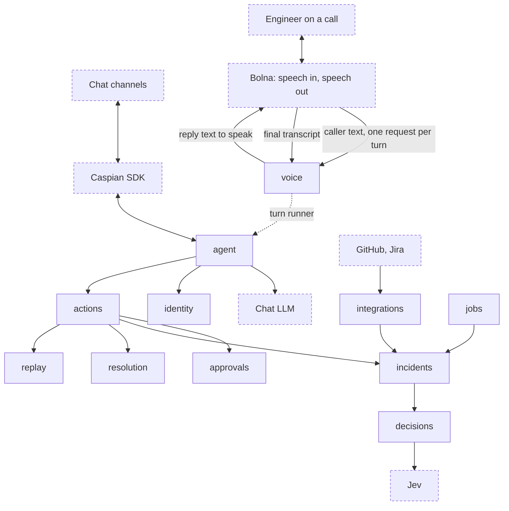
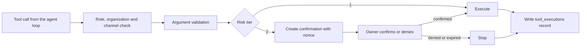
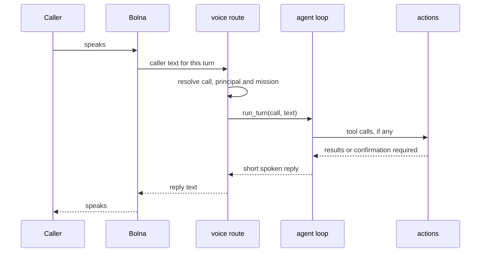
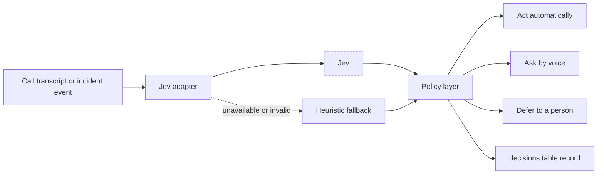

# Plan: Svaar, a voice-enabled agent that reconstructs incidents, verifies claims by phone, and negotiates a validated fix

Target: Bolna Buildathon submission, due Oct 31, 2026. Shortlist interviews run Nov 5 to 7 and the top three pitch in Bengaluru on Nov 20.

Core rule: **Jev decides, deterministic code enforces, Bolna speaks.**

Local working document. Do not commit it and do not place it in `plans/`. Add it to `.git/info/exclude`:

```bash
echo "plan.md" >> .git/info/exclude
```

---

## 1. Goal

Svaar is an agent for engineering incidents. It lives in team chat through the Caspian SDK, knows who people are, uses tools through a model loop, watches CI, and talks to engineers on the phone through Bolna. It reconstructs what happened from recorded events, checks status claims against evidence, negotiates conflicting constraints, and accepts only validated plans.

Svaar has one brain. The same agent, tool registry and approval gate serve chat and voice. Chat arrives through Caspian. Voice arrives through Bolna, which provides telephony, speech input/output and the final transcript. In function mode, Bolna's wrapper model may invoke only the transport bridge `ask_svaar`; it cannot invoke Svaar business tools, authorize actions, or make incident decisions. Svaar supplies the response and all business decisions.

Svaar is a new codebase. Cerebro (pinned at commit `443355a` in its handoff document) is the reference for patterns worth porting and for flaws to avoid. Svaar does not run on top of Cerebro and does not depend on a Cerebro deployment.

One complete loop must work end to end:

1. A GitHub workflow failure reaches Svaar and Svaar alerts the owner in chat.
2. If nobody acknowledges, Svaar calls the owner through Bolna.
3. The engineer asks, in chat or by voice, what happened and hears a timeline rebuilt from recorded events.
4. Status claims ("fix merged") are checked against evidence, and unresolved ones are verified by phone.
5. Conflicting constraints (release freeze, on-call coverage, deploy capacity) are negotiated, and only a validator-approved plan is accepted.
6. The fix is replayed in a sandbox, labelled as simulation.
7. A risky action or exception draft waits for confirmation by the owner, across channels.

Domain: engineering team operations. Nothing outside that domain is in scope.

## 2. Principles

| Principle | Meaning |
|---|---|
| One brain | A single agent loop serves every channel. Transports differ, the loop, tools and policies do not |
| One gate | Every tool call, from chat or from a call, goes through the `actions` dispatcher. No handler is ever called directly |
| Voice is a transport | Bolna supplies telephony, speech in/out and the final transcript. Its function-mode wrapper may call only `ask_svaar`; Svaar owns business decisions and tool execution |
| Jev decides, code enforces | Jev returns typed decisions with confidence. Deterministic code validates, authorizes and acts. Jev never executes anything |
| Observations and simulations never mix | Replay output stays in `replay` tables and never enters `events` |
| Missing evidence is not contradiction | Absent evidence, `no-answer`, `busy` and failed calls never mark a claim `contradicted` |

## 3. Porting Cerebro: what to take, rewrite and drop

Cerebro's handoff says not to copy its code wholesale. Svaar is a new codebase: port selected patterns as new code under Svaar's conventions (synchronous SQL, adapters, docstrings and tests). Several Cerebro modules carry flaws listed in section 4, and copying them would import those flaws.

### Port (adapt to Svaar's rules)

| Piece | Cerebro source | Svaar package | Change |
|---|---|---|---|
| Tool definition and registry (`ToolSpec`) | `src/cerebro/registry.py` | `actions` | Add Pydantic argument validation, enforced risk tiers and per-channel permissions |
| Tool loop with native and JSON modes | `src/cerebro/cortex/loop.py` | `agent` | Fix round-limit behavior, cap calls per round, add a tighter voice profile |
| Prompt assembly from registry | `src/cerebro/cortex/prompts.py` | `agent` | Keep generated tool policy; add Svaar guardrails and a spoken-style variant |
| Chat-completions client | `src/cerebro/cortex/featherless.py` | `agent` | OpenAI-compatible adapter with retry and total deadline |
| Light Markdown to HTML | `src/cerebro/formatting.py` | `agent` | Port as is, with tests |
| Population model (ops, dev, lead, admin) | `src/cerebro/db/models.py` | `identity` | Drop the client population |
| Nonce, action hash, expiry | `src/cerebro/verify/challenge.py`, `executor.py` | `approvals` | Keep the design, make it atomic and actually wired in |
| GitHub App auth and REST adapter | `src/cerebro/github/app_auth.py`, `api.py` | `integrations` | Synchronous httpx, explicit timeouts |
| Webhook HMAC and run normalization | `src/cerebro/github/webhook.py` | `integrations` | Add delivery-ID dedupe and explicit repository mapping |
| Failure fingerprinting | `src/cerebro/github/triage.py` | `incidents` | Keep fingerprinting; drop automatic reruns |
| Jira create and read | `src/cerebro/jira/api.py` | `integrations` | Gate ticket creation behind a risk tier |

### Rewrite (same idea, different design)

| Piece | Why |
|---|---|
| Enrollment and identity binding | Cerebro trusts an asserted email plus a join code that can create orgs. Svaar uses single-use invites |
| Scheduler | Cerebro's has no exception guard and no row locking. Svaar's polling loop has both |
| Notifications | Cerebro's pending nudges have no sender. Svaar uses an outbox with delivery state |

### Drop (not needed for incidents)

Orders, tasks and assignment, gap chases, summaries, meetings and reminders, Zoom and Google Calendar adapters, the population crossing policy and redaction, the client population, nudges, the admin dashboard, the landing site and Redis.

## 4. Cerebro's flaws and Svaar's fixes

| Cerebro flaw (from the handoff) | Svaar design |
|---|---|
| The live tool loop bypasses the confirmation gate, so tier-2 CI actions run immediately | Every tool call goes through the `actions` dispatcher, which enforces risk tiers. There is no direct handler call anywhere |
| Identity is self-asserted (join code plus unverified email); unknown codes create orgs | Admin-issued, single-use, expiring invites. No org creation from chat. Phones are verified by a code read aloud on a call |
| Record IDs are used without ownership checks | All lookups go through organization-scoped repository functions in the owning package |
| CI routing and settings use the "latest active org" heuristic | An explicit `repo_mappings` table maps each repository to one organization |
| Pending nudges are never sent | `outbox_messages` with channel, address, state, attempts and delivery ID; a sender in the gateway process |
| No event log or tool trace | Append-only `events` plus a `tool_executions` row for every tool call |
| Dedupe on the first 20 characters, in memory, unbounded | Unique `(channel, external_message_id)` in the database, state `received`, `processed` or `failed`; a failed message can be retried |
| Tool-round limit raised after side effects had already run | Limit checked before executing; no calls run once the limit is hit |
| Schemas sent to the model but never validated | Pydantic model per tool; validation errors go back to the model as tool errors |
| Naive datetimes | `timestamptz` columns, UTC everywhere |
| Confirmation committed before the action runs, with no concurrency control | One atomic state change (`pending` to `confirmed`) with a unique execution record keyed by confirmation ID |
| Scheduler callback exception can end all jobs | Each job guarded individually; rows claimed with `FOR UPDATE SKIP LOCKED` so two processes never take the same row |
| Duplicate GitHub deliveries repeat side effects | `X-GitHub-Delivery` stored in `webhook_deliveries` with a unique constraint |
| One deployment-wide admin token for everything | A separate operator token only for operator routes; voice, channel and webhook routes have their own credentials |

## 5. Architecture



Dashed boxes are outside Svaar. Solid boxes are Svaar packages. The dotted arrow from `voice` to `agent` is a runtime call through an injected protocol, not an import (see Composition).

Every business action, from chat or from a call, passes through one path in `actions`. Jev confidence and the LLM's proposed tool call never override authorization, mission allowlists or configured risk tiers:



One voice turn:



Decision path inside the `decisions` package:



### Processes

| Process | Runs | Why |
|---|---|---|
| Svaar API (`app` container) | FastAPI: voice routes, GitHub webhook, incident routes, operator routes, and the channel webhook route if Caspian delivers by webhook | Request and response work. Voice turns run the agent loop in this process |
| Svaar gateway (`gateway` container) | Caspian listener, outbox sender, polling loop in `jobs` | Long-running listeners must not live in request handlers |

Add `gateway` to Docker Compose next to `app`, started after the `migrate` container. Only Bolna, GitHub and (in webhook mode) Caspian need to reach Svaar. The tunnel exposes `/api/v1/voice`, `/api/v1/webhooks/github` and, only if required, `/api/v1/channels/caspian`. Everything else, including `/docs`, stays local.

### Composition

`agent` and `voice` never import each other. `voice` defines a `TurnRunner` protocol:

```python
class TurnRunner(Protocol):
    """Runs one conversational turn for a call and returns the text to speak."""

    def run_turn(self, call_id: str, text: str) -> str:
        """Process the caller's words and return the reply to speak.

        Args:
            call_id: Identifier of the Svaar voice call.
            text: The caller's transcribed words for this turn.

        Returns:
            Short spoken-style reply text.
        """
        ...
```

Application startup constructs `agent`'s implementation and injects it into `voice`. Both `agent` and `voice` depend on `actions` and `identity`, never on each other.

### Package ownership

| Package | Status | Owns |
|---|---|---|
| `agent` | new | Channel transports (Caspian, Telegram), inbound dedupe, conversation memory, LLM adapter, tool loop (chat and voice profiles), prompts, outbox sender, `TurnRunner` implementation |
| `identity` | new | Organizations, principals, roles, channel bindings (including verified phones), invites, enrollment |
| `actions` | new | Tool registry, argument validation, authorization, risk tiers, dispatcher, `tool_executions` |
| `incidents` | existing | `events`, `claims`, `evidence`, timelines, incident state machine, failure fingerprints |
| `decisions` | existing | Jev adapter, heuristic fallback, policy layer, `decisions` table |
| `voice` | existing | Bolna client, `voice_calls`, `voice_turns`, `voice_webhook_events`, turn routes, call missions, voice auth |
| `resolution` | existing | `constraints`, `negotiation_rounds`, negotiation agents, validator, exception draft |
| `replay` | existing | Sandbox runs and simulated results (never written to `events`) |
| `approvals` | existing | `confirmations` and confirmation decisions |
| `integrations` | existing | GitHub App adapter and webhook, Jira adapter, `webhook_deliveries`, `repo_mappings` |
| `jobs` | existing | Guarded polling loop for acknowledgement deadlines, outbox retries and stale confirmations |
| `api` | existing | Router composition, infrastructure probes, error conventions |
| `web` | existing | Future operator interface |

The three new packages change the package table in the README, so coordinate with teammates before adding them.

## 6. The agent

### Channels

Define a `ChannelTransport` protocol in `agent`: receive a message (channel, sender address, external message ID, thread or chat ID, text) and send a message. Implementations, in build order:

1. **Caspian SDK.** The channel layer for every chat source Svaar listens on. One transport, many channels.
2. **Telegram** through the Bot API with long polling. Direct, no public endpoint, selectable by configuration. It exists behind the same protocol so the agent never depends on which transport is active.

Email and Discord are cut. Slack is available only if the Caspian account carries it.

The Caspian transport depends on facts that must be confirmed by a smoke check on Oct 18 (section 19). The check decides the transport mode (webhook, polling or socket), whether sender identity is authenticated, and which channels the account carries. If the smoke check fails or is unclear at the end of Oct 19, `SVAAR_CHANNEL_TRANSPORT` is set to `telegram` and the build continues unchanged.

### Identity and enrollment

- An operator creates a single-use invite for a role and organization (`POST /api/v1/invites`, operator token).
- A person redeems the invite in chat by sending its code. Redemption creates the principal and a verified binding for that channel and address, and marks the invite used. A sender identity that the transport does not authenticate never produces a verified binding.
- Roles: `ops`, `dev`, `lead`, `admin`. Role changes are admin-only for the MVP.
- Phone binding: the person registers a number in chat. Svaar generates a six-digit code, shows it in chat, and places a `phone_verify` call that asks the person to read it aloud. The `verify_phone_code` tool compares the spoken digits exactly. Only verified phones are ever called.

### Conversation loop

Port Cerebro's loop with these rules.

| Rule | Chat profile | Voice profile |
|---|---|---|
| Model rounds per turn | 4 | 2 |
| Tool calls per round | 4 | 2 |
| Total turn deadline | 45 seconds | 8 seconds, then a fixed spoken fallback line |
| HTTP timeout and retry | 30 seconds, one retry on timeout or 5xx | 6 seconds, no retry |
| Reply style | Light Markdown | Plain spoken sentences, two at most, no markdown, numbers and IDs read plainly |

Shared rules:

- The round and call limits are checked before any call runs.
- Native tool calls first, JSON-mode parsing as a fallback.
- Arguments are validated against the tool's Pydantic model. A failure is returned to the model as a tool error.
- Conversation memory is per (channel, thread or chat), and per call for voice, with a bounded history window. Tool calls and results are recorded in `tool_executions`, not replayed raw into every prompt.
- Dedupe on the transport's own message ID before any work.
- Chat replies go through the outbox so every outbound message has a delivery state.
- The tool policy in the prompt is generated from the registry for the active channel and mission, so the model is only offered tools it is allowed to call.

### LLM

An OpenAI-compatible chat-completions adapter, configured by base URL, key and model. Run a native-tool-call smoke check against the chosen model on Oct 20 before building on it (Cerebro kept a similar `smoke_tools.py` for this). Voice turns use the same model and adapter with the voice profile, so choose a model whose first-token latency suits a phone call.

## 7. Actions and approvals

### Tool registry

Each tool has: name, description, Pydantic argument model, handler, allowed roles, risk tier and the channels it may be called from. The prompt's tool policy is generated from the registry so prompt and permissions cannot drift.

| Tool | Roles | Tier | Channels |
|---|---|---|---|
| `whoami` | all | 1 | chat, voice |
| `open_incident` | ops, dev, lead, admin | 1 | chat |
| `acknowledge_incident` | ops, dev, lead, admin | 1 | chat, voice |
| `get_timeline` | ops, dev, lead, admin | 1 | chat, voice |
| `list_claims` | ops, dev, lead, admin | 1 | chat, voice |
| `verify_claim` | lead, admin | 2 when the target is not the incident owner, else 1 | chat |
| `record_claim_answer` | called only inside a verified `claim_check` call | 1 | voice |
| `verify_phone_code` | called only inside a `phone_verify` call | 1 | voice |
| `list_ci_runs`, `explain_ci_failure` | dev, lead, admin | 1 | chat |
| `create_jira_ticket` | dev, lead, admin | 2 | chat |
| `rerun_workflow`, `dispatch_workflow`, `cancel_run` | lead, admin | 2 | chat |
| `request_replay` | dev, lead, admin | 1 | chat, voice |
| `start_negotiation` | lead, admin | 1 | chat |
| `approve_exception` | lead, admin | 2 | chat |
| `confirm_action` | the confirmation's owner | n/a | chat, voice |

Tier-2 tools requested during a call do not run. The dispatcher creates a confirmation, and the caller is told, in one short sentence, that a confirmation code was sent to chat.

### Confirmation (tier 2)

1. The dispatcher creates a `confirmations` row: nonce, hash of the action and arguments, requester, expiry (ten minutes), state `pending`.
2. The owner receives the nonce in chat. Confirmation must come from the owner on a different verified channel when they have two (chat plus phone). Confirmation on the same channel is refused unless the operator has enabled it for the demo.
3. When the owner has a verified phone, Svaar places a `confirmation` call. The owner reads the nonce aloud. The agent passes the caller's raw words to `confirm_action`, which compares them exactly in code. A model's "yes" is never enough.
4. `pending` to `confirmed` is a single conditional update. The action then runs once, keyed by the confirmation ID, so a retry cannot run it twice.
5. Denied, expired and failed outcomes are recorded and the action does not run. Failed actions are never retried automatically.
6. Authorization is rechecked at execution time, not only when the confirmation was created.

## 8. Incident features

### Reconstruct

`events` is append-only, with `source` (github, jira, chat, call), `external_id` and `occurred_at` in UTC; unique on `(source, external_id)`. GitHub workflow events arrive through the signed webhook. The timeline orders events by occurrence and marks the source of each. Failure fingerprints (ported from Cerebro: normalize timestamps, paths and PIDs, then hash a log tail) group repeat failures into one incident.

### Verify

Claims come from chat: Jev's `noul` question decides whether a message states verifiable work status. Evidence lookup against events is deterministic. A claim like "fix merged" needs a merge event by query. With no supporting event the claim is `unverified`, and Svaar may place a `claim_check` call. The agent runs the call as a bounded mission with one tool, `record_claim_answer`. After the call completes, Jev classifies the answer from the final transcript and deterministic code writes evidence. Missing evidence, `no-answer`, `busy` and failed calls never produce `contradicted`.

### Negotiate

Three agents with hard constraints in `constraints`: release schedule (freeze windows, required approvals), on-call staffing (minimum coverage, maximum consecutive hours), and deploy and CI capacity (concurrent deploys, environment availability). The demo conflict is a hotfix that violates a freeze, needs an off-shift engineer, and competes for a deploy slot. Agents propose, Jev may rank, and the deterministic validator accepts or rejects each proposal with listed violations.

### Replay and exception draft

`replay` runs the corrected sequence against isolated state with recorded or fake adapters. It never writes to `events` and never calls GitHub, Jira or Bolna. Results are typed `simulated`. `resolution` exports a tracked-change exception draft; it is not legal or compliance advice, and `approve_exception` needs tier-2 confirmation.

## 9. Jev decisions

Jev is a decision model, not a chat model. It takes a state and named, typed questions and returns one typed answer per question, with probabilities and a confidence value. All words Svaar says, in chat or on a call, come from Svaar's chat LLM. Bolna only voices them.

### Decision slots

Keep the runtime decision catalogue small. Each slot has a fixed schema, allowed outputs, a deterministic fallback and an auditable policy outcome. Define the schemas in one `questions.py` file; do not create a separate module for every question.

| Priority | Decision slot | Question type | Allowed outputs | How Svaar uses the result |
|---|---|---|---|---|
| P0 | Voice intent router | `choice` | `investigate`, `verify_claim`, `explain_failure`, `propose_resolution`, `confirm_action`, `other` | Routes a usable utterance to an existing mission or registered tool path. Unknown or low-confidence intent triggers a short clarification, not a risky action. |
| P0 | Transcript usability gate | `choice` | `usable`, `repeat`, `clarify`, `unusable` | Determines whether the transcript is intelligible enough to interpret. Unusable or ambiguous speech cannot create evidence, confirm an action, or change claim status; usability does not establish truth. |
| P0 | Claim-answer classifier | `choice` | `confirmed`, `denied`, `unsure`, `wrong_person`, `callback` | Classifies the completed `claim_check` call transcript only. Deterministic code maps the classification to a provenance-bearing evidence record when appropriate; `unsure`, `wrong_person`, `callback`, unusable transcripts and failed calls do not contradict a claim. |
| P0 | Mission guard | Deterministic code, not Jev | Tools permitted by the active mission | Rejects tools outside the active mission, regardless of what the LLM or Jev proposes. Enforces mission state, principal, incident scope and authorization in code. |
| P1 | CI failure category and flaky-vs-real classification | `choice` | `flaky`, `test`, `dependency`, `infra`, `config`, `unknown` | One classification drives alert severity and the contextual hints shown by `explain_ci_failure`. A `flaky` result may produce a quiet note instead of a high-urgency alert. Failure fingerprinting and deduplication remain deterministic. |
| P1 | Adaptive escalation | `choice` | `wait`, `chat_nudge`, `call_now` | Recommends the next escalation step using incident state, acknowledgement age and failure category. Deterministic code enforces escalation timing, recipient authorization and call limits. |
| P1 | Calibration and outcome evaluation | Evaluation module, not a runtime decision slot | Labelled examples and observed outcomes | Measures accuracy, confidence buckets, fallback rate, latency and downstream outcomes. Thresholds are tuned on a labelled evaluation set rather than assumed from vendor claims. |
| P2 / stretch | Recovery assessment | `choice` | `resolved`, `still_failing`, `uncertain` | Runs only after a confirmed real rerun and evaluates new, real GitHub workflow events. Sandbox replay never proves production recovery. Implement only if all P0/P1 paths are stable. |

The existing claim-verification workflow remains. The claim-answer classifier labels what the caller said; it does not set claim status. Deterministic code maps a usable answer to a persisted evidence record with provenance and an explicit `supports` or `contradicts` stance only when justified. A claim status is derived from persisted evidence and deterministic rules, not from a separate claim-status decision slot.

Do not add a separate investigation-next-step slot, incident-urgency score, action-risk score, or negotiation score to the critical path. Existing workflows and deterministic controls already cover these concerns, and extra calls add latency without improving the core demo.

Never let Jev directly set `contradicted`. That status requires an explicit, persisted evidence record with a `contradicts` stance and provenance. Missing evidence, an unanswered or failed call, a busy line, an unusable transcript, or an uncertain answer leaves the claim `unverified`.

Recovery assessment is optional and must never be a dependency for the submission demo.

### Policy layer

| Outcome | Condition |
|---|---|
| Act automatically | Confidence at or above the high threshold and the action is reversible |
| Ask by voice | Confidence between thresholds, or the action is risky |
| Defer or use fallback | Confidence below the low threshold, Jev unavailable, or response invalid |

Thresholds are configuration, tuned on your own labelled call transcripts. The vendor's calibration claim is not assumed. Send Jev only what a question needs, with phone numbers and names redacted. Confidence may choose between a safe fallback, clarification or deferral; it never grants authorization, changes a tool's configured risk tier, or bypasses the dispatcher or confirmation gate.

### Gateways

Before implementing the adapter, verify the chosen gateway's actual request and response contract using its current documentation and a real or official example. Confirm the accepted question schema, `choice` criteria format, response structure, confidence and probability fields, timeout behavior, and whether multiple named questions can be sent in one request. Do not assume different gateways share an identical payload.

Expose one internal `DecisionEngine` interface so callers remain independent of the provider. Parse and validate each returned answer independently and write a separate audit record for every question. If a batched response contains both valid and invalid answers, preserve valid answers and use the deterministic fallback only for the missing or invalid questions; a transport-level failure may fall back for all questions.

The CI classification and adaptive escalation decisions may be batched only if the selected gateway explicitly supports multiple named questions in one request. Both decisions must be validated and handled independently: an invalid answer must not invalidate a valid answer from the same request.

For malformed responses, timeouts, provider errors and unusable confidence data, use deterministic fallback behavior. Never fabricate a missing answer or confidence value.

Candidate routes: TypeSafe native System One API; NanoGPT `POST https://nano-gpt.com/api/v1/decisions`; Inworld `POST https://api.inworld.ai/alpha/decisions` (alpha); LiteLLM, Portkey or Bifrost `/v1/decisions` routes. Common to all: a `state`, named typed questions (`noul`, `choice`, `score`), and `criteria` on choice questions. Pin the model version (for example `jev-1.13.0`).

### Adapter interface (synchronous)

```python
from dataclasses import dataclass
from typing import Mapping, Protocol, Sequence


@dataclass(frozen=True)
class Decision:
    """A typed decision returned by Jev or the heuristic fallback.

    Attributes:
        name: The question name the answer belongs to.
        value: The chosen label, boolean, or score.
        confidence: Confidence in the range 0.0 to 1.0.
        probabilities: Per-label probabilities when available.
        model_version: The pinned model version that produced the answer.
    """

    name: str
    value: object
    confidence: float
    probabilities: Mapping[str, float]
    model_version: str


class DecisionEngine(Protocol):
    """Interface implemented by the Jev adapter and the heuristic fallback."""

    def decide(
        self, state: str, questions: Mapping[str, dict]
    ) -> Sequence[Decision]:
        """Answer typed questions about a state.

        Args:
            state: Description of the situation, with personal data redacted.
            questions: Named typed questions, keyed by question name.

        Returns:
            One Decision per question, in request order.

        Raises:
            DecisionUnavailableError: If the engine cannot answer within
                the configured timeout or returns an invalid response.
        """
        ...
```

Use `httpx.Client` with explicit connect and read timeouts. A timeout or invalid payload raises `DecisionUnavailableError`, and the policy layer routes to the heuristic fallback.

## 10. Bolna integration

Bolna is the voice layer. Its job on every call is to provide speech/telephony, pass caller text to Svaar through the configured turn mode, speak Svaar's returned text, and report the final transcript. In function mode, the only function exposed to Bolna is the `ask_svaar` transport bridge.

Facts from Bolna's documentation:

- Base URL `https://api.bolna.ai`, Bearer auth. A wrong or missing key returns `401`.
- `GET /user/me` returns wallet balance and concurrency (`max` and `current`). Check it before every test session.
- `POST /v2/agent` creates an agent and returns `201` with `agent_id` and `state`. `toolchain.pipelines` is an array of arrays. The full config is large.
- `webhook_url` is set inside `agent_config`, or in the dashboard Extractions tab.
- `POST /call` takes `agent_id` and `recipient_phone_number` (E.164) and returns `execution_id`. Omit `from_phone_number` to use Bolna's default number. Context goes in `user_data` variables.
- Webhooks send several POSTs per call, distinguished by `status`. `call-disconnected` arrives with empty duration, cost, recording and extractions. Treat `completed` as finished.
- Final statuses: `completed`, `no-answer`, `busy`, `failed`, `canceled`, `stopped`, `error`, `balance-low`.
- Bolna sends webhooks from `13.203.39.153`, `13.126.9.249` and `13.202.133.53`.
- Executions include `transcript`, `extracted_data`, `cost_breakdown` and `latency_data.time_to_first_audio`. The unit is not stated; confirm before quoting it.
- `scheduled_at` needs `+00:00` rather than `Z` and at least two minutes ahead. Only relevant if scheduling is used.

Create the first agent in the dashboard with Auto Build and copy the `agent_id`. Codify the config through the API only if time remains.

### Calls are missions

Svaar only places outbound calls. Each call row in `voice_calls` carries a mission, and the mission limits what the agent can do on that call.

| Mission | Trigger | Tools offered to the agent | Ends when |
|---|---|---|---|
| `escalation` | Acknowledgement deadline expired | `whoami`, `acknowledge_incident`, `get_timeline`, `list_claims`, `confirm_action` | Caller acknowledges or hangs up |
| `claim_check` | A claim is `unverified` | `record_claim_answer` | Answer recorded or caller hangs up |
| `phone_verify` | A person registered a phone | `verify_phone_code` | Code accepted, rejected or caller hangs up |
| `confirmation` | A tier-2 confirmation is pending for a person with a verified phone | `confirm_action` | Nonce accepted, rejected or caller hangs up |

For ordinary missions, the caller is associated with the principal and verified phone binding that Svaar dialled, never by anything the model or caller says. The `phone_verify` mission is the narrow exception: it is bound to a pending phone-verification challenge and intended principal, and may verify only that exact number/challenge. It must not treat the pending number as verified before the code matches. Inbound calls are out of scope.

### How each turn reaches Svaar

Two wiring modes exist. Both call the same `TurnRunner`, and the mode is configuration (`SVAAR_VOICE_TURN_MODE`). Confirm which one the Bolna account supports during the Oct 18 smoke check.

| Mode | How | Notes |
|---|---|---|
| `llm_endpoint` | Bolna's LLM setting points at Svaar's OpenAI-compatible route `POST /api/v1/voice/llm/chat/completions`. Bolna sends the conversation each turn and speaks the reply | Preferred. Bolna's own model is bypassed, so a turn has one LLM hop. Needs streaming or fast non-streaming replies |
| `function` | The Bolna agent prompt tells its wrapper model to call one custom function, `ask_svaar`, with the caller's exact words and to speak the returned text verbatim. This function is only a bridge to Svaar's turn endpoint, not a business tool | Fallback. Uses documented custom functions. Adds one Bolna LLM hop per turn |

The route identifies the call from a high-entropy per-call reference that Svaar passes through `user_data` when it places the call. In `function` mode the reference is a function parameter. In `llm_endpoint` mode it may be read from the system message, so verify the exact delivery contract and ensure the reference is not spoken to the caller or exposed in logs. Treat it as a locator, not a substitute for the bearer token. Confirm on a test call that Bolna delivers the reference in the chosen mode.

Pass-through function definition for `function` mode. The `key` must be exactly `custom_task`.

```json
{
  "name": "ask_svaar",
  "description": "Called on every caller turn. Pass the caller's exact words and speak the returned text verbatim.",
  "pre_call_message": "One moment.",
  "parameters": {
    "type": "object",
    "properties": {
      "utterance": { "type": "string", "description": "The caller's exact words" }
    },
    "required": ["utterance"]
  },
  "key": "custom_task",
  "value": {
    "method": "POST",
    "param": { "call_ref": "%(call_ref)s", "utterance": "%(utterance)s" },
    "url": "https://<tunnel-host>/api/v1/voice/turn",
    "api_token": "Bearer <voice-turn-token>",
    "headers": {}
  }
}
```

### Turn handling

1. Authenticate the bearer token in constant time.
2. Resolve the `voice_calls` row, the principal and the mission from the call reference. Unknown or closed calls get a fixed spoken refusal.
3. Compute the turn index. If `voice_turns` already holds a reply for `(voice_call_id, turn_index)`, return it without running the agent. A retried request never repeats tool calls.
4. Call `TurnRunner.run_turn` with the voice profile and the mission's tool set.
5. Store the reply in `voice_turns`, return it.
6. On timeout, agent error or invalid state, return a fixed spoken line ("I can't check that right now, I will message you"), enqueue the detail to chat through the outbox, and keep the call row open.

### Voice decision pipeline and reliability

The voice path must remain short and predictable. Apply the following sequence inside the shared agent/turn runner:

1. Authenticate the call reference and resolve the principal, incident and active mission.
2. Apply the transcript usability gate before using caller text as a claim, confirmation or tool instruction.
3. If the transcript is unusable or ambiguous, ask the caller to repeat or clarify. Do not run tools or mutate evidence.
4. Use the voice intent router to select an existing mission or registered tool path. If intent is unknown or confidence is insufficient, ask a short clarification.
5. Generate the tool policy from the registry and active mission. The deterministic mission guard rejects any tool not permitted for that call.
6. Validate arguments, authorize the principal, and dispatch all tool calls through `actions`. Jev and the LLM cannot bypass the dispatcher or approval gate.
7. Persist the turn and its audit records idempotently. A retry must return the saved reply rather than repeat tool calls.

The intent router, transcript usability gate and mission guard are P0 voice reliability requirements. Implement and test them before expanding the decision catalogue. The intent router selects an intent within the active call; it cannot change the call's mission or expand its tool allowlist. Starting a different mission requires a separate deterministic server-side transition.

The transcript usability gate is not a truth detector. A usable transcript can still contain a false statement. Claim verification requires evidence and provenance; transcript quality alone must never mark a claim confirmed or contradicted.

Measure per-turn latency and Bolna's `time_to_first_audio` where available. Keep spoken replies concise and retain the existing fixed fallback line for timeouts and provider failures.

### Transcripts

Per-turn caller text and replies are stored in `messages` under the call's conversation so the agent has history. The final transcript from the `completed` webhook feeds Jev classification and the audit trail. Transcripts have a retention limit and are never logged.

### Status handling

| Bolna status | Svaar action |
|---|---|
| `completed` | Parse transcript and extractions, run Jev classification, write evidence, update claim, close the call row |
| `no-answer`, `busy`, `failed`, `canceled`, `stopped`, `error` | Mark the call failed; the claim stays `unverified`; tell the requester in chat through the outbox |
| `balance-low` | Alert the operator in chat; no claim change |
| Anything else | Record and ignore |

### Voice security

- The turn routes require a bearer token (the Bolna agent's `api_token` or LLM key), compared in constant time.
- The status webhook accepts only Bolna's three IPs. Check how the tunnel forwards the client address; if it cannot be trusted, also require a shared secret in the `webhook_url` path or header. Confirm whether turn requests come from the same addresses before relying on an IP check for them.
- Expose only the routes listed in section 5. Keep `/docs` and every other route local.
- Never log transcripts, phone numbers, message text, tokens or payloads.

### Idempotency

1. Commit a `voice_calls` row as `pending` with its mission and the claim, incident or confirmation reference.
2. Place the call. On success store the `execution_id`; on failure mark `failed`. Commit each step.
3. Deduplicate status webhooks on unique `(execution_id, status)` in `voice_webhook_events`.
4. Deduplicate turns on unique `(voice_call_id, turn_index)` in `voice_turns`.
5. Handlers are safe to replay.

## 11. GitHub and Jira

- `POST /api/v1/webhooks/github` verifies HMAC-SHA256 over the raw body (`X-Hub-Signature-256`), then deduplicates on `X-GitHub-Delivery`. Malformed JSON returns 400; unsupported events return 200 with `handled: false`.
- The repository maps to an organization through `repo_mappings`. An unmapped repository is rejected and logged.
- Normalized `workflow_run` events become `events` rows. Svaar never reruns workflows automatically. Rerun, dispatch and cancel are tier-2 tools.
- GitHub App auth: RS256 JWT with a nine-minute lifetime exchanged for an installation token, cached until five minutes before expiry.
- Jira: create and read issues with basic auth (email and API token). Creation is tier 2.

## 12. Data model

Build SQLAlchemy models on `svaar.db.Base` inside the owning package, one Alembic revision per change, explicit constraint names, `timestamptz` columns. Coordinate migration heads before merging. Cross-package references use plain identifiers.

| Table | Package | Key columns |
|---|---|---|
| `orgs` | identity | id, name |
| `principals` | identity | org_id, role in (`ops`, `dev`, `lead`, `admin`), display_name; unique (org_id, email) |
| `channel_bindings` | identity | principal_id, channel (`caspian:<channel type>`, `telegram`, `phone`), address, verified_at; unique (channel, address) |
| `invites` | identity | org_id, role, code_hash, expires_at, used_at |
| `conversations` | agent | channel, thread_id, principal_id; unique (channel, thread_id). For calls, channel is `voice` and thread_id is the call ID |
| `messages` | agent | conversation_id, role, content, created_at |
| `inbound_messages` | agent | channel, external_message_id, state (`received`, `processed`, `failed`); unique (channel, external_message_id) |
| `outbox_messages` | agent | channel, address, body, state (`pending`, `sent`, `failed`), attempts, delivery_id, created_at, sent_at |
| `tool_executions` | actions | principal_id, tool, args_hash, status, risk_tier, channel, correlation_id, created_at |
| `confirmations` | approvals | principal_id, action, action_hash, nonce_hash, state, expires_at, resolved_at, execution_key (unique) |
| `events` | incidents | incident_id, source, external_id, kind, payload (JSONB), occurred_at; unique (source, external_id) |
| `claims` | incidents | incident_id, author, statement, status in (`confirmed`, `contradicted`, `unverified`) |
| `evidence` | incidents | claim_id, event_id (nullable), call_id (nullable), stance in (`supports`, `contradicts`) |
| `decisions` | decisions | incident_id, state_hash, question, answer, confidence, probabilities (JSONB, nullable), model_version, policy_outcome, action_taken, decided_at |
| `voice_calls` | voice | principal_id, mission, incident_id, claim_id, confirmation_id, call_ref (unique), execution_id (unique, nullable until placed), state, created_at |
| `voice_turns` | voice | voice_call_id, turn_index, reply, created_at; unique (voice_call_id, turn_index) |
| `voice_webhook_events` | voice | execution_id, status, received_at; unique (execution_id, status) |
| `webhook_deliveries` | integrations | source, delivery_id, received_at; unique (source, delivery_id) |
| `repo_mappings` | integrations | repository, org_id; unique (repository) |
| `constraints` | resolution | owner_agent, rule (JSONB) |
| `negotiation_rounds` | resolution | negotiation_id, agent, proposal (JSONB), valid, violations (JSONB) |
| `replay_runs` | replay | incident_id, scenario, result (JSONB), kind fixed to `simulated` |

Boundary rules: simulated output stays in `replay` tables and never enters `events`. `decisions` and `voice` hold plain incident, claim and confirmation identifiers, with no imports of `incidents` or `approvals` models.

## 13. API surface

All business routes sit under `/api/v1`. The Caspian listener and the chat loop run in the gateway process and have no HTTP route, unless the smoke check shows Caspian delivers by webhook.

| Method | Route | Package | Auth | Purpose |
|---|---|---|---|---|
| POST | `/invites` | identity | operator token | Create a single-use invite |
| POST | `/incidents` | incidents | operator token | Open an incident manually |
| GET | `/incidents/{id}/timeline` | incidents | operator token | Observed events in order |
| GET | `/incidents/{id}/claims` | incidents | operator token | Claims with status and evidence |
| POST | `/webhooks/github` | integrations | HMAC | Receive workflow events |
| POST | `/channels/caspian` | agent | Caspian credential | Receive chat messages, only in webhook mode |
| POST | `/claims/{id}/verify` | voice | operator token | Place a `claim_check` call |
| POST | `/voice/turn` | voice | voice turn token | One caller turn, `function` mode |
| POST | `/voice/llm/chat/completions` | voice | voice turn token | One caller turn, `llm_endpoint` mode |
| POST | `/voice/status` | voice | Bolna IPs and secret | Bolna status webhook |
| POST | `/incidents/{id}/replay` | replay | operator token | Run a what-if, returned as simulated |
| POST | `/negotiations` | resolution | operator token | Start a negotiation |
| POST | `/negotiations/{id}/validate` | resolution | operator token | Run the deterministic validator |
| GET | `/incidents/{id}/exception-draft` | resolution | operator token | Export the tracked-change draft |

Only the turn route for the selected `SVAAR_VOICE_TURN_MODE` is registered. Use Pydantic request and response models, explicit status codes and the shared error envelope. Add only routes that are implemented. Check for duplicate routes and naming drift before every merge.

## 14. Configuration (planned names, all with the `SVAAR_` prefix)

Validate at application construction; secrets have no defaults and are never logged.

| Area | Names |
|---|---|
| Operator | `SVAAR_OPERATOR_TOKEN` |
| Chat LLM | `SVAAR_LLM_BASE_URL`, `SVAAR_LLM_API_KEY`, `SVAAR_LLM_MODEL` |
| Channels | `SVAAR_CHANNEL_TRANSPORT` (`caspian` or `telegram`), `SVAAR_CASPIAN_API_KEY`, `SVAAR_CASPIAN_BASE_URL`, `SVAAR_CASPIAN_WEBHOOK_SECRET` (webhook mode only), `SVAAR_TELEGRAM_BOT_TOKEN` |
| Jev | `SVAAR_JEV_BASE_URL`, `SVAAR_JEV_API_KEY`, `SVAAR_JEV_MODEL`, `SVAAR_POLICY_HIGH`, `SVAAR_POLICY_LOW` |
| Bolna | `SVAAR_BOLNA_API_KEY`, `SVAAR_BOLNA_AGENT_ID`, `SVAAR_VOICE_TURN_MODE` (`llm_endpoint` or `function`), `SVAAR_VOICE_TURN_TOKEN`, `SVAAR_VOICE_STATUS_SECRET` |
| GitHub | `SVAAR_GITHUB_APP_ID`, `SVAAR_GITHUB_PRIVATE_KEY_B64`, `SVAAR_GITHUB_INSTALLATION_ID`, `SVAAR_GITHUB_WEBHOOK_SECRET` |
| Jira | `SVAAR_JIRA_BASE_URL`, `SVAAR_JIRA_EMAIL`, `SVAAR_JIRA_API_TOKEN`, `SVAAR_JIRA_DEFAULT_PROJECT_KEY` |

## 15. Schedule to Oct 31

Start date Oct 18, 13 days. Target a complete, recorded demo by Oct 30 and submit on the morning of Oct 31. Check the submission form's cutoff time now.

| Dates | Work | Done when |
|---|---|---|
| Oct 18 | Smoke checks: the six Caspian questions (section 19), whether Bolna accepts a custom LLM endpoint, `GET /user/me`, one outbound Bolna test call to your phone. Start `identity` and `actions` | Caspian and Bolna answers are written down; your phone rings from Bolna |
| Oct 19 | `actions` (registry, validation, authorization, tier gate, per-channel permissions, `tool_executions`), `approvals` (atomic confirmations), Jev key, Jev adapter, fallback, policy layer. Transport and turn mode locked at end of day; define the voice intent-router and transcript-usability schemas; implement the deterministic mission-guard interface | Unit tests prove a tier-2 tool never runs without a confirmed confirmation, and Jev failures route to the fallback; `alembic check` is clean; P0 voice decisions have typed schemas and safe fallback behavior; mission-guard tests reject tools outside the active mission |
| Oct 20 to 21 | `agent`: transport protocol, Caspian transport (or Telegram), inbound dedupe, LLM adapter with native-tool smoke check, tool loop with chat and voice profiles, prompts, memory, outbox sender, `TurnRunner`; `gateway` container; integrate the voice intent router and transcript usability gate into `TurnRunner`; test ambiguous speech and fallback behavior | You enroll with an invite in chat, ask `whoami` and a read tool, and get replies; a resent message is processed once; voice turns route clear requests correctly, clarify ambiguous requests, and never invoke tools for unusable transcripts |
| Oct 22 to 23 | `voice`: outbound client, `voice_calls` with missions, turn route, `voice_turns` idempotency, status handler with IP check and dedupe, tunnel, `phone_verify` mission | A real call reaches your phone, the phone verifies, a spoken question is answered by the agent, and `completed` is processed once even if delivered twice |
| Oct 24 to 25 | GitHub webhook (HMAC, delivery dedupe, repo mapping), App adapter, `events`, timeline, failure fingerprints, alerts through the outbox | A failing workflow produces a chat alert, and you hear the ordered timeline by chat and by voice |
| Oct 26 to 27 | Claim detection, evidence lookup, `claim_check` and `escalation` missions, Jev classification, acknowledgement, guarded polling loop in `jobs`, CI failure category plus flaky-vs-real classification, adaptive escalation, labelled Jev evaluation set | An unacknowledged alert becomes a call exactly once, and `no-answer` leaves the claim `unverified`; CI classification and escalation validate independently, fallback behavior is tested, and each decision is auditable; missing or failed calls still leave claims unverified |
| Oct 28 | Negotiation agents, validator, Jev pre-screening, `confirmation` mission, tier-2 tools confirmed across channels, Jira ticket tool | A proposal is rejected, revised, approved; a rerun waits for a nonce read aloud |
| Oct 29 | One replay of a failed pipeline in the sandbox; exception draft export | Replay is labelled simulated; a draft file exports |
| Oct 30 | Rehearse, record the demo, measure turn latency and time to first audio | A clean take under three minutes |
| Oct 31 | Submission write-up and final checks | Submitted |

Cut order if time runs short: exception draft export, Jira tool, replay variety, Jev pre-screening, Slack through Caspian. Never cut: identity, the `actions` gate, one working channel, the Bolna loop, the timeline, the claims flow, the decision audit.

Each milestone ends with `ruff format --check`, `ruff check`, `alembic check` and `pytest` passing.

## 16. Demo script (about 3 minutes)

1. A deploy fails in the demo repository. Svaar alerts the owner in chat. Nobody acknowledges, so Svaar calls them.
2. On the call, the engineer asks what happened. The agent answers from the recorded timeline, in two spoken sentences, naming the failing step.
3. Someone in chat says the fix is merged. Svaar finds no merge event, marks the claim `unverified`, and calls that person. The answer becomes evidence.
4. A hotfix needs a freeze exception, an off-shift engineer and a deploy slot. The three agents negotiate. The validator rejects one arrangement and approves a revised one.
5. The corrected pipeline replays in the sandbox, shown as simulated.
6. The lead asks Svaar in chat to rerun the workflow. Svaar creates a confirmation and posts the nonce in chat. Svaar calls the lead, the lead reads the nonce aloud, and the rerun happens once.

Show the `decisions` and `tool_executions` tables once, to make Jev's role and the audit trail concrete.

## 17. Testing

- **Dispatcher:** no code path calls a tool handler outside `actions`; tier-2 never runs unconfirmed; authorization is rechecked at execution; a confirmation runs at most once under concurrent attempts; a tool not allowed on the active channel or mission is refused.
- **Tool loop:** round limit stops before running calls; invalid arguments become tool errors; the chat and voice turn deadlines hold.
- **Transports:** a contract test suite runs against every `ChannelTransport` implementation; an unauthenticated sender identity never creates a verified binding.
- **Identity:** invites are single-use and expire; no organization is created from chat; an unverified phone is never called.
- **Dedupe:** a resent chat message, a resent GitHub delivery and a retried voice turn each take effect once; a failed message can be retried.
- **Adapter and policy:** mocked Jev for success, invalid payload, timeout and low confidence; boundary tests at each threshold.
- **Voice intent router:** labelled examples for every allowed intent, ambiguous utterances, unrelated requests, low confidence and fallback behavior.
- **Transcript usability gate:** clear speech proceeds; garbled, incomplete or ambiguous speech requests repetition or clarification and cannot create evidence or confirm actions.
- **Mission guard and missions:** each voice mission exposes only its registered tools; requests for tools outside that mission are refused even when proposed by the LLM; a spoken confirmation succeeds only on the exact nonce.
- **Batched Jev decisions:** if gateway batching is supported, valid answers are retained independently when another answer is malformed; every question gets its own audit record.
- **CI classification and escalation:** all allowed labels validate; `flaky` uses the configured low-noise alert path; escalation timing, recipient authorization and call limits remain deterministic.
- **Recovery assessment, if implemented:** only real post-rerun GitHub events can support a recovery result; replay output cannot establish recovery.
- **Voice latency:** record per-turn latency and `time_to_first_audio` where available, verify the fixed fallback is returned within the configured deadline, and report the median with its confirmed unit.
- **Validator:** table-driven tests per hard constraint, including must-reject cases.
- **Trust rules:** absent evidence, `no-answer` and `busy` never produce `contradicted`.
- **Voice security:** wrong token and non-allowlisted IP are rejected; no sensitive data in logs; the fixed fallback line is returned when the agent times out.
- **Polling loop:** two concurrent workers escalate an expired unacknowledged incident exactly once; one job failing does not stop the others.
- **Migrations:** PostgreSQL tests run when `SVAAR_TEST_DATABASE_URL` points at a dedicated disposable database.
- **Calls:** a labelled transcript set for tuning thresholds, plus at least five real end-to-end calls before submission.

## 18. Risks and mitigations

| Risk | Mitigation |
|---|---|
| Building an agent plus voice plus negotiation in 13 days | Fixed cut order; port patterns instead of designing from scratch; one transport at a time |
| Porting Cerebro's flaws | Section 4 fixes are acceptance tests, not suggestions |
| Caspian transport details are unconfirmed | Oct 18 smoke check, Oct 19 decision gate, Telegram behind the same protocol |
| Turn latency on live calls (STT, Svaar LLM, TTS, plus Bolna's model in `function` mode) | Prefer `llm_endpoint` mode, voice profile with two rounds and an 8 second deadline, short spoken replies, `pre_call_message` fillers, measure every turn |
| Chat LLM does not call tools reliably | Native-tool smoke check on Oct 20; JSON-mode fallback |
| Speech-to-text garbles nonces, IDs and codes | Short speakable alphabet, exact compare in code, read back before commit, expiry, deny by default |
| Agent or LLM outage leaves a call silent | Fixed spoken fallback line, detail sent to chat through the outbox |
| Some Jev gateways are alpha and request shapes differ | Adapter interface, pinned version, heuristic fallback |
| Jev calibration is the vendor's claim | Tune on your own transcripts; validator remains final |
| Public endpoints on a young foundation | Voice, GitHub and (if needed) channel routes only; bearer tokens, HMAC, IP check, no sensitive logging |
| Wallet credits, concurrency (max 10), telephony setup | `GET /user/me` before sessions, test number, confirm outbound number early |
| Duplicate or reordered webhooks, messages and turns | Unique dedupe keys, replay-safe handlers |
| New packages disturb teammates' work | Agree the package table change before merging |
| Extra Jev calls increase live voice latency | Prioritize the voice intent router, transcript usability gate and mission guard. Batch alert-time decisions only when the gateway contract supports it. Measure latency before adding optional decisions |

## 19. Open items

Caspian smoke check, answered on Oct 18:

- Authentication: key type and how an app or bot is registered.
- Inbound mode: webhook, polling or socket, which decides whether a public channel route is needed.
- Message shape: stable unique message ID, sender address, thread or chat ID, channel type.
- Sender trust: whether sender identity is authenticated or only asserted.
- Outbound: send API, delivery receipts, rate limits.
- Channels: which channels the account carries.

Other items:

- Confirm whether Bolna accepts a custom LLM endpoint and how it delivers a per-call reference in each turn mode.
- Confirm the Jev gateway, key and exact request/response contract, including per-question partial failures, confidence/probability fields, batching support and timeout behavior. Do not implement against an assumed shared schema.
- Choose the chat LLM and run the native-tool smoke check, including first-token latency for voice.
- Read Bolna's extractions page before fixing the `claim_check` call design.
- Confirm the unit of `time_to_first_audio`.
- Decide whether a Hindi or Hinglish option is in the demo.
- Choose the telephony number for outbound calls.
- Choose the demo repository and pipeline that will produce the failing deploy.
- Agree the three new packages (`agent`, `identity`, `actions`) with teammates.
- Confirm the submission cutoff time.

## 20. Working rules

- Work on feature branches. Never push to main directly unless explicitly decided.
- Never mention Claude as a co-author.
- No agent, roadmap or handoff documents pushed, including this file and the Cerebro handoff.
- Docstrings per each language's standard convention.
- No em dashes and no emoji in documents, comments or code.
- Check for redundant routes, folders and naming issues before every merge.
- Write precise commit messages.