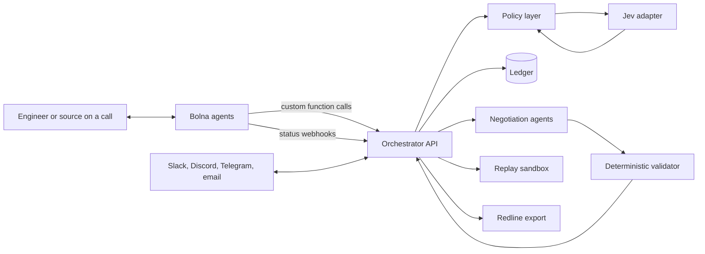

# Plan: Voice-operated incident resolution system that reconstructs what happened, verifies claims by phone, and negotiates a validated fix

Target: Bolna Buildathon submission, due Oct 31, 2026. Shortlist interviews run Nov 5 to 7 and the top three pitch in Bengaluru on Nov 20.

Core rule: **Jev decides, deterministic code enforces, Bolna speaks.**

This is a working plan. Keep it out of the repository (for example, add it to `.git/info/exclude`).

---

## 1. Goal

Extend Cerebro's multi-channel agent (Slack, Discord, Telegram, email) with voice, and give it a decision engine that is typed, auditable and bounded. The system must demonstrate one complete incident loop:

1. Reconstruct what happened from recorded events.
2. Verify human and system claims by calling authorized sources.
3. Negotiate a resolution between conflicting services.
4. Accept only what a deterministic validator approves.
5. Replay the fix in a sandbox, labelled as simulation.
6. Export a redline for human approval.

Domain: a commerce backend with payment, inventory and carrier services. Nothing outside that domain is in scope.

## 2. Roles of the three components

| Component | Role | Does not do |
|---|---|---|
| Bolna | Voice interface: inbound and outbound calls, speech, telephony, call transcripts | Make policy decisions |
| Jev | Typed decisions with confidence: choices, scores, yes/no probabilities | Generate language, or act as final authority on hard constraints |
| Orchestrator and validator (our code) | State machine, ledger, constraint enforcement, actions | Guess when evidence is missing |

Jev is a decision model, not a chat model. It takes a state and named, typed questions and returns one typed answer per question, with probabilities and a confidence value. All spoken words come from the LLM configured inside the Bolna agent.

## 3. Architecture



### Components

- **Orchestrator API (FastAPI):** owns the incident state machine: investigate, verify, negotiate, validate, replay, approve.
- **Jev adapter:** one internal interface in front of whichever Jev gateway is used, so the gateway can change without touching callers.
- **Policy layer:** converts a Jev answer plus confidence into one of three outcomes: act automatically, ask a human by voice, or defer.
- **Heuristic fallback:** deterministic rules that run when Jev is unreachable, errors, or returns low confidence.
- **Ledger (Postgres):** shared state for every module.
- **Validator:** plain code that checks proposals against hard constraints. No model in the loop.
- **Sandbox:** disposable Docker services for replay and fault injection.

## 4. Jev integration

### What Jev is used for

| Decision slot | Question type | Code that acts on the result |
|---|---|---|
| Classify a call answer (confirmed, denied, unsure, wrong person, callback) | choice | Writes an evidence record |
| Propose a claim status | choice | Only an explicit contradicting evidence record can set `contradicted`; otherwise `unverified` |
| Pick the next source or question to ask | choice | Triggers a verification call |
| Escalate to a phone call now | noul (yes/no) | Threshold check, then outbound call |
| Is a requested action risky or irreversible | noul | Requires spoken confirmation before acting |
| Pre-screen a negotiation proposal | score | Ranking only; the validator decides validity |

### Policy thresholds

| Outcome | Condition |
|---|---|
| Act automatically | Confidence at or above the high threshold and the action is reversible |
| Ask by voice | Confidence between the thresholds, or the action is risky |
| Defer or use fallback | Confidence below the low threshold, Jev unavailable, or response invalid |

Thresholds start as configuration values and are tuned on a small labelled set of real call transcripts. The vendor's calibration claim is not assumed.

### Gateway options

Jev is reachable through several routes with different request shapes. Verify the exact body for the chosen route before coding.

- TypeSafe's native System One API
- NanoGPT: `POST https://nano-gpt.com/api/v1/decisions`
- Inworld: `POST https://api.inworld.ai/alpha/decisions` (alpha)
- LiteLLM, Portkey or Bifrost `/v1/decisions` routes

Common to all: a `state`, a map of named questions, question types `noul`, `choice` and `score`, and `criteria` required on choice questions. Pin the model version (for example `jev-1.13.0`) so decisions are reproducible.

### Adapter interface

```python
from dataclasses import dataclass
from typing import Mapping, Protocol, Sequence


@dataclass(frozen=True)
class Decision:
    """A typed decision returned by the decision engine.

    Attributes:
        name: The question name the answer belongs to.
        value: The chosen label, boolean, or score.
        confidence: Confidence in the range 0.0 to 1.0.
        probabilities: Per-label probabilities when available.
        model_version: The pinned model version that produced the answer.
    """

    name: str
    value: object
    confidence: float
    probabilities: Mapping[str, float]
    model_version: str


class DecisionEngine(Protocol):
    """Interface implemented by the Jev adapter and the heuristic fallback."""

    async def decide(
        self, state: str, questions: Mapping[str, dict]
    ) -> Sequence[Decision]:
        """Answer typed questions about a state.

        Args:
            state: Unstructured description of the situation.
            questions: Named typed questions, keyed by question name.

        Returns:
            One Decision per question, in request order.

        Raises:
            DecisionUnavailableError: If the engine cannot produce an answer.
        """
        ...
```

### Audit trail

Every decision is written to a `decisions` table: state hash, question, answer, confidence, model version, policy outcome and the action taken. This makes behavior replayable and reviewable.

## 5. Bolna integration

Findings from Bolna's documentation:

- Base URL `https://api.bolna.ai`, Bearer authentication. A wrong or missing key returns `401`.
- `POST /v2/agent` creates an agent and returns `201`. The response field is `state`. `toolchain.pipelines` is an array of arrays, for example `[["transcriber","llm","synthesizer"]]`.
- `POST /call` takes `agent_id` and `recipient_phone_number` in E.164 format, and returns an `execution_id`. Context can be passed through `user_data` variables.
- Wait for the `completed` status, not `call-disconnected`. At disconnect, duration, cost, recording and extracted data are still empty.
- Webhooks send several POSTs per call and are distinguished by `status`. Bolna sends them from three fixed IPs that must be allowlisted: `13.203.39.153`, `13.126.9.249`, `13.202.133.53`.
- `scheduled_at` must use `+00:00` rather than `Z`, at least two minutes ahead. Only relevant if scheduling is used.
- Executions include `transcript`, `extracted_data`, `cost_breakdown` and `latency_data.time_to_first_audio`.

### Mid-call tools as custom functions

Each tool is a custom function that calls our API. The `key` must be exactly `custom_task`.

```json
{
  "name": "get_timeline",
  "description": "Called when the engineer asks what happened in an incident or why a payment failed.",
  "pre_call_message": "One moment while I pull the timeline.",
  "parameters": {
    "type": "object",
    "properties": {
      "incident_id": {
        "type": "string",
        "description": "The incident identifier"
      }
    },
    "required": ["incident_id"]
  },
  "key": "custom_task",
  "value": {
    "method": "GET",
    "param": { "incident_id": "%(incident_id)s" },
    "url": "https://<public-host>/incidents/timeline",
    "api_token": "Bearer <token>",
    "headers": {}
  }
}
```

Planned tools:

| Tool | Purpose |
|---|---|
| `get_timeline` | Read observed events for an incident |
| `list_claims` | Read claims and their evidence status |
| `record_claim_answer` | Store a source's answer as evidence |
| `confirm_action` | Capture spoken confirmation for a risky action |
| `request_replay` | Start a sandbox replay |

Notes:

- Custom function calls run inside the live conversation, so endpoints must respond quickly. Use `pre_call_message` to cover short waits.
- The pre-call webhook is fire-and-forget and never blocks the call.
- A graph agent (node-based call flow) is a candidate for the verification script, to keep outbound questions bounded. Read its documentation before committing to it.
- Sarvam is available as an Indian-language transcriber and voice if Hindi or Hinglish is added.

## 6. Data model

```sql
-- Observed history only. Never mixed with simulated rows.
CREATE TABLE events (
  id BIGSERIAL PRIMARY KEY,
  incident_id UUID NOT NULL,
  service TEXT NOT NULL,
  kind TEXT NOT NULL,
  payload JSONB NOT NULL,
  occurred_at TIMESTAMPTZ NOT NULL,
  trace_id TEXT
);

-- A statement made by a person or system.
CREATE TABLE claims (
  id UUID PRIMARY KEY,
  incident_id UUID NOT NULL,
  source TEXT NOT NULL,
  statement TEXT NOT NULL,
  status TEXT NOT NULL CHECK (status IN ('confirmed','contradicted','unverified'))
);

-- Provenance: what supports or contradicts a claim.
CREATE TABLE evidence (
  id UUID PRIMARY KEY,
  claim_id UUID NOT NULL REFERENCES claims(id),
  event_id BIGINT REFERENCES events(id),
  call_id TEXT,
  stance TEXT NOT NULL CHECK (stance IN ('supports','contradicts'))
);

-- Hard rules the validator enforces.
CREATE TABLE constraints (
  id UUID PRIMARY KEY,
  owner_service TEXT NOT NULL,
  rule JSONB NOT NULL
);

CREATE TABLE negotiation_rounds (
  id UUID PRIMARY KEY,
  negotiation_id UUID NOT NULL,
  agent TEXT NOT NULL,
  proposal JSONB NOT NULL,
  valid BOOLEAN,
  violations JSONB
);

-- Audit trail for every decision-engine answer.
CREATE TABLE decisions (
  id UUID PRIMARY KEY,
  incident_id UUID,
  state_hash TEXT NOT NULL,
  question TEXT NOT NULL,
  answer JSONB NOT NULL,
  confidence DOUBLE PRECISION,
  model_version TEXT NOT NULL,
  policy_outcome TEXT NOT NULL,
  action_taken TEXT,
  decided_at TIMESTAMPTZ NOT NULL DEFAULT now()
);
```

## 7. API surface

| Method | Route | Purpose |
|---|---|---|
| POST | `/incidents` | Open an incident |
| GET | `/incidents/{id}/timeline` | Observed events in order |
| POST | `/incidents/{id}/replay` | Run a what-if in the sandbox, returned as simulated |
| GET | `/incidents/{id}/claims` | Claims with status and evidence |
| POST | `/claims/{id}/verify` | Trigger an outbound verification call |
| POST | `/voice/status` | Receive Bolna status webhooks |
| POST | `/voice/tools/{tool}` | Receive Bolna custom function calls |
| POST | `/negotiations` | Start a negotiation |
| POST | `/negotiations/{id}/validate` | Run the deterministic validator |
| GET | `/incidents/{id}/redline` | Export the draft for approval |

Keep route names consistent and avoid duplicates. One folder per module under a single package.

## 8. Trust guarantees

Enforced in code, not left to prompts.

- Observed history and simulation are stored and displayed as different types.
- Missing evidence leaves a claim `unverified`. The system never implies that a person lied.
- The validator, not Jev, decides whether a proposal satisfies hard constraints.
- Risky or irreversible actions need spoken confirmation.
- Outbound calls go only to authorized sources and use bounded questions.
- Contract drafts are redlines for human approval. They are not legal advice.

## 9. Schedule to Oct 31

| Dates | Work | Done when |
|---|---|---|
| Oct 17 to 18 | Obtain a Jev key, build the adapter, `decisions` table, policy layer and heuristic fallback | A unit-tested adapter returns typed decisions and falls back cleanly |
| Oct 19 to 20 | Create the Bolna agent through the API, outbound `/call`, public webhook with IP allowlist, status handling | A real test call reaches your own number and `completed` is processed |
| Oct 21 to 23 | Custom functions (`get_timeline`, `list_claims`, `record_claim_answer`, `confirm_action`), event instrumentation of the demo backend, timeline reconstruction | You can ask by voice why a payment failed and hear the ordered events |
| Oct 24 to 26 | Claims and evidence flow with Jev classification, verification call script, evidence-aware follow-ups | A call to a source produces evidence and updates claim status correctly |
| Oct 27 to 28 | Negotiation agents, deterministic validator, Jev pre-screening | A proposal is rejected, revised, then approved |
| Oct 29 | Sandbox replay with one fault type, redline export | Replay is labelled simulated; a redline file exports |
| Oct 30 | Demo script, rehearsal, recording, measure time to first audio | A clean take under three minutes |
| Oct 31 | Submission write-up and final checks | Submitted before the deadline |

Cut order if time runs short: redline export, then sandbox fault variety, then Jev pre-screening of proposals. The ledger, validator, claims flow and voice loop are never cut.

## 10. Demo script (about 3 minutes)

1. Ask by voice why an order's payment failed. The timeline shows the event order and a retry bug.
2. Operations reports the shipment as dispatched, but no warehouse scan exists. The agent calls the warehouse. Jev classifies the answer, the policy layer applies it, and the claim is confirmed or left unverified.
3. Payment, inventory and carrier services hold conflicting constraints. Their agents negotiate aloud. The validator rejects one proposal and approves a revised one.
4. The corrected sequence replays in the sandbox, shown as simulated.
5. A redline of the SLA exception is exported for approval.

Show the decisions table on screen once, with confidence values and the policy outcome for each decision. It makes the "decision engine" claim concrete.

## 11. Testing

- **Adapter:** mocked gateway responses, invalid responses, timeouts and low confidence all route to the fallback.
- **Validator:** table-driven tests for each hard constraint, including cases that must be rejected.
- **Trust rules:** a test proving that absent evidence can never produce `contradicted`.
- **Calls:** a labelled set of transcripts for tuning thresholds, plus at least five real end-to-end calls before submission.
- **Latency:** record `time_to_first_audio` from executions and report the median.

## 12. Risks and mitigations

| Risk | Mitigation |
|---|---|
| Some Jev gateways are alpha and request shapes differ | Adapter interface, pinned model version, heuristic fallback |
| Jev has documented failure modes and the calibration claim is the vendor's | Tune thresholds on your own labelled transcripts; validator remains final |
| Custom function latency inside live calls | Fast endpoints, `pre_call_message`, no heavy work in the request path |
| Wallet credits and telephony setup | Check balance with `GET /user/me`, use a test number, confirm the telephony number early |
| Webhook delivery failures | Public HTTPS endpoint, allowlist Bolna's three IPs, idempotent handlers |
| Scope too wide for 14 days | Fixed cut order in section 9 |
| Voice agent drifts off script | Tight prompts, bounded tools, graph agent for outbound scripts if suitable |

## 13. Open items

- Confirm which Jev gateway and key will be used, and the exact request body for it.
- Read Bolna's graph agent and extractions pages before choosing the verification call design.
- Decide whether a Hindi or Hinglish option is included in the demo.
- Choose the telephony number for outbound calls.

## 14. Working rules

- Work on feature branches. Never push to main directly unless explicitly decided.
- No agent, roadmap or handoff documents in the repository, including this file.
- Write docstrings per each language's standard convention.
- Check for redundant routes, folders and naming issues before every merge.
- Write precise commit messages.
