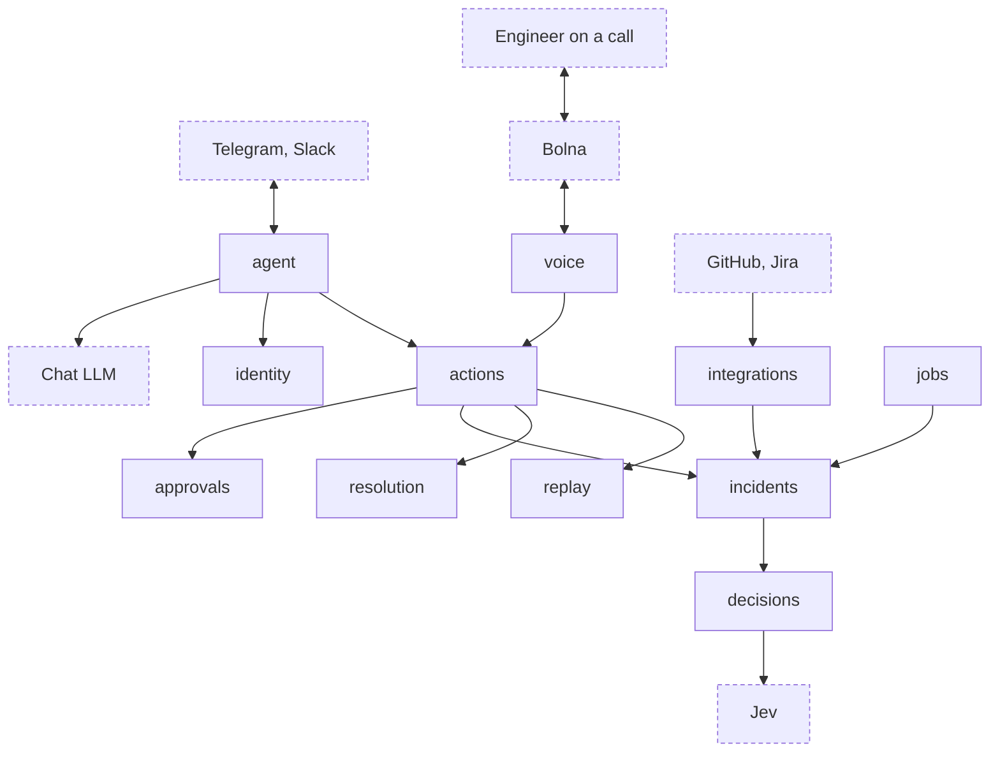
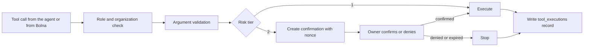
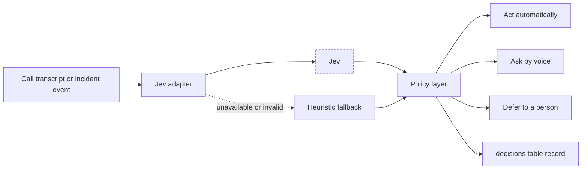

# Plan: Build Svaar, a voice-enabled agent that reconstructs incidents, verifies claims by phone, and negotiates a validated fix

Target: Bolna Buildathon submission, due Oct 31, 2026. Shortlist interviews run Nov 5 to 7 and the top three pitch in Bengaluru on Nov 20.

Core rule: **Jev decides, deterministic code enforces, Bolna speaks.**

Local working document. Do not commit it and do not place it in `plans/`. Add it to `.git/info/exclude`:

```bash
echo "plan.md" >> .git/info/exclude
```

---

## 1. Goal

Svaar is its own agent. Like Cerebro, it lives in team chat, knows who people are, uses tools through a model loop, and watches CI. Unlike Cerebro, it is built around incidents and adds Bolna voice, Jev decisions and verifiable resolution.

Svaar does not run on top of Cerebro and does not depend on a Cerebro deployment. Cerebro (pinned at commit `443355a` in its handoff document) is the reference for patterns worth porting and for flaws to avoid.

One complete loop must work end to end:

1. A GitHub workflow failure reaches Svaar and Svaar alerts the owner in chat.
2. If nobody acknowledges, Svaar calls the owner through Bolna.
3. The engineer asks, in chat or by voice, what happened and hears a timeline rebuilt from recorded events.
4. Status claims ("fix merged") are checked against evidence, and unresolved ones are verified by phone.
5. Conflicting constraints (release freeze, on-call coverage, deploy capacity) are negotiated, and only a validator-approved plan is accepted.
6. The fix is replayed in a sandbox, labelled as simulation.
7. A risky action or exception draft waits for confirmation by the owner, across channels.

Domain: engineering team operations. Nothing outside that domain is in scope.

## 2. Porting Cerebro: what to take, rewrite and drop

Cerebro's handoff tells an agent not to copy its code. You own both projects and decided Svaar's agent is built from Cerebro's code, so this plan ports patterns as new code under Svaar's conventions (synchronous SQL, adapters, docstrings, tests) instead of copying files wholesale. Several Cerebro modules carry flaws listed in section 3, and copying them would import those flaws.

### Port (adapt to Svaar's rules)

| Piece | Cerebro source | Svaar package | Change |
|---|---|---|---|
| Tool definition and registry (`ToolSpec`) | `src/cerebro/registry.py` | `actions` | Add Pydantic argument validation and enforced risk tiers |
| Tool loop with native and JSON modes | `src/cerebro/cortex/loop.py` | `agent` | Fix round-limit behavior, cap calls per round |
| Prompt assembly from registry | `src/cerebro/cortex/prompts.py` | `agent` | Keep generated tool policy; Svaar-specific guardrails |
| Chat-completions client | `src/cerebro/cortex/featherless.py` | `agent` | OpenAI-compatible adapter with retry and total deadline |
| Light Markdown to HTML | `src/cerebro/formatting.py` | `agent` | Port as is, with tests |
| Population model (ops, dev, lead, admin) | `src/cerebro/db/models.py` | `identity` | Drop the client population |
| Nonce, action hash, expiry | `src/cerebro/verify/challenge.py`, `executor.py` | `approvals` | Keep the design, make it atomic and actually wired in |
| GitHub App auth and REST adapter | `src/cerebro/github/app_auth.py`, `api.py` | `integrations` | Synchronous httpx, explicit timeouts |
| Webhook HMAC and run normalization | `src/cerebro/github/webhook.py` | `integrations` | Add delivery-ID dedupe and explicit repository mapping |
| Failure fingerprinting | `src/cerebro/github/triage.py` | `incidents` | Keep fingerprinting; drop automatic reruns |
| Jira create and read | `src/cerebro/jira/api.py` | `integrations` | Gate ticket creation behind a risk tier |

### Rewrite (same idea, different design)

| Piece | Why |
|---|---|
| Enrollment and identity binding | Cerebro trusts an asserted email plus a join code that can create orgs. Svaar uses single-use invites |
| Scheduler | Cerebro's has no exception guard and no row locking. Svaar's polling loop has both |
| Notifications | Cerebro's pending nudges have no sender. Svaar uses an outbox with delivery state |

### Drop (not needed for incidents)

Orders, tasks and assignment, gap chases, summaries, meetings and reminders, Zoom and Google Calendar adapters, the population crossing policy and redaction, the client population, nudges, the admin dashboard, the landing site and Redis.

## 3. Cerebro's flaws and Svaar's fixes

| Cerebro flaw (from the handoff) | Svaar design |
|---|---|
| The live tool loop bypasses the confirmation gate, so tier-2 CI actions run immediately | Every tool call goes through the `actions` dispatcher, which enforces risk tiers. There is no direct handler call anywhere |
| Identity is self-asserted (join code plus unverified email); unknown codes create orgs | Admin-issued, single-use, expiring invites. No org creation from chat. Phones are verified by a code read aloud on a call |
| Record IDs are used without ownership checks | All lookups go through organization-scoped repository functions in the owning package |
| CI routing and settings use the "latest active org" heuristic | An explicit `repo_mappings` table maps each repository to one organization |
| Pending nudges are never sent | `outbox_messages` with channel, address, state, attempts and delivery ID; a sender in the gateway process |
| No event log or tool trace | Append-only `events` plus a `tool_executions` row for every tool call |
| Dedupe on the first 20 characters, in memory, unbounded | Unique `(channel, external_message_id)` in the database, state `received`, `processed` or `failed`; a failed message can be retried |
| Tool-round limit raised after side effects had already run | Limit checked before executing; no calls run once the limit is hit |
| Schemas sent to the model but never validated | Pydantic model per tool; validation errors go back to the model as tool errors |
| Naive datetimes | `timestamptz` columns, UTC everywhere |
| Confirmation committed before the action runs, with no concurrency control | One atomic state change (`pending` to `confirmed`) with a unique execution record keyed by confirmation ID |
| Scheduler callback exception can end all jobs | Each job guarded individually; rows claimed with `FOR UPDATE SKIP LOCKED` so two processes never take the same row |
| Duplicate GitHub deliveries repeat side effects | `X-GitHub-Delivery` stored in `webhook_deliveries` with a unique constraint |
| One deployment-wide admin token for everything | A separate operator token only for operator routes; voice and webhook routes have their own credentials |

## 4. Architecture



Dashed boxes are outside Svaar. Solid boxes are Svaar packages.

Every action, from the chat agent or from a Bolna call, passes through one path in `actions`:



Decision path inside the `decisions` package:



### Processes

| Process | Runs | Why |
|---|---|---|
| Svaar API (`app` container) | FastAPI: voice routes, GitHub webhook, incident routes, operator routes | Request and response work |
| Svaar gateway (new `gateway` container) | Channel listeners, tool loop, outbox sender, polling loop in `jobs` | Long-running listeners must not live in request handlers |

Add `gateway` to Docker Compose next to `app`, started after the `migrate` container. Telegram long polling and Slack Socket Mode need no public endpoint. Only Bolna and GitHub need to reach Svaar, so only `/api/v1/voice` and `/api/v1/webhooks/github` go through the tunnel.

### Package ownership

| Package | Status | Owns |
|---|---|---|
| `agent` | new | Channel transports, inbound dedupe, conversation memory, LLM adapter, tool loop, prompts, outbox sender |
| `identity` | new | Organizations, principals, roles, channel bindings (including verified phones), invites, enrollment |
| `actions` | new | Tool registry, argument validation, authorization, risk tiers, dispatcher, `tool_executions` |
| `incidents` | existing | `events`, `claims`, `evidence`, timelines, incident state machine, failure fingerprints |
| `decisions` | existing | Jev adapter, heuristic fallback, policy layer, `decisions` table |
| `voice` | existing | Bolna client, `voice_calls`, `voice_webhook_events`, custom function endpoints, voice auth |
| `resolution` | existing | `constraints`, `negotiation_rounds`, negotiation agents, validator, exception draft |
| `replay` | existing | Sandbox runs and simulated results (never written to `events`) |
| `approvals` | existing | `confirmations` and confirmation decisions |
| `integrations` | existing | GitHub App adapter and webhook, Jira adapter, `webhook_deliveries`, `repo_mappings` |
| `jobs` | existing | Guarded polling loop for acknowledgement deadlines, outbox retries and stale confirmations |

The three new packages change the package table in the README, so coordinate with teammates before adding them. `voice` and `agent` both depend on `actions` and never on each other.

## 5. The agent

### Channels

Define a `ChannelTransport` protocol in `agent`: receive a message (channel, sender address, external message ID, thread or chat ID, text) and send a message. Implementations, in build order:

1. **Telegram** through the Bot API with long polling. Simplest, needs no public endpoint, works on a phone for the demo.
2. **Slack** through Socket Mode, if time allows.
3. **Caspian SDK**, only if your Caspian account works. Cerebro delegates all four channels to it, but the handoff could not confirm its transport details, so it is a bonus, not a dependency.

Email and Discord are cut.

### Identity and enrollment

- An operator creates a single-use invite for a role and organization (`POST /api/v1/invites`, operator token).
- A person redeems the invite in chat by sending its code. Redemption creates the principal and a verified binding for that channel and address, and marks the invite used.
- Roles: `ops`, `dev`, `lead`, `admin`. Role changes are admin-only for the MVP.
- Phone binding: the person registers a number in chat. Svaar generates a six-digit code, shows it in chat, and places a Bolna call that asks the person to read it aloud. The `verify_phone_code` function checks it. Only verified phones are ever called.

### Conversation loop

Port Cerebro's loop with these rules:

- At most four model rounds and four tool calls per round. The limit is checked before any call runs.
- Native tool calls first, JSON-mode parsing as a fallback.
- Arguments validated against the tool's Pydantic model. A failure is returned to the model as a tool error.
- An HTTP timeout of 30 seconds, one retry on timeout or 5xx, and a 45-second total deadline per turn.
- Conversation memory per (channel, thread or chat) with a bounded history window. Tool calls and results are recorded in `tool_executions`, not replayed raw into every prompt.
- Dedupe on the transport's own message ID before any work.
- Replies go through the outbox so every outbound message has a delivery state.

### LLM

An OpenAI-compatible chat-completions adapter, configured by base URL, key and model. Run a native-tool-call smoke check against the chosen model on Oct 20 before building on it (Cerebro kept a similar `smoke_tools.py` for this).

## 6. Actions and approvals

### Tool registry

Each tool has: name, description, Pydantic argument model, handler, allowed roles, risk tier and a flag for whether it may be called by voice. The prompt's tool policy is generated from the registry so prompt and permissions cannot drift.

| Tool | Roles | Tier | Voice |
|---|---|---|---|
| `whoami` | all | 1 | yes |
| `open_incident` | ops, dev, lead, admin | 1 | no |
| `acknowledge_incident` | ops, dev, lead, admin | 1 | yes |
| `get_timeline` | ops, dev, lead, admin | 1 | yes |
| `list_claims` | ops, dev, lead, admin | 1 | yes |
| `verify_claim` | lead, admin | 2 when the target is not the incident owner, else 1 | no |
| `record_claim_answer` | called by Svaar from a verified call only | 1 | yes |
| `list_ci_runs`, `explain_ci_failure` | dev, lead, admin | 1 | no |
| `create_jira_ticket` | dev, lead, admin | 2 | no |
| `rerun_workflow`, `dispatch_workflow`, `cancel_run` | lead, admin | 2 | no |
| `request_replay` | dev, lead, admin | 1 | yes |
| `start_negotiation` | lead, admin | 1 | no |
| `approve_exception` | lead, admin | 2 | no |
| `confirm_action` | the confirmation's owner | n/a | yes |

### Confirmation (tier 2)

1. The dispatcher creates a `confirmations` row: nonce, hash of the action and arguments, requester, expiry (ten minutes), state `pending`.
2. The owner receives the nonce in chat. Confirmation must come from the owner on a different verified channel when they have two (chat plus phone). Confirmation on the same channel is refused unless the operator has enabled it for the demo.
3. On a call, the engineer confirms by reading the nonce aloud. Svaar compares it exactly; a model's "yes" is never enough.
4. `pending` to `confirmed` is a single conditional update. The action then runs once, keyed by the confirmation ID, so a retry cannot run it twice.
5. Denied, expired and failed outcomes are recorded and the action does not run. Failed actions are never retried automatically.
6. Authorization is rechecked at execution time, not only when the confirmation was created.

## 7. Incident features

### Reconstruct

`events` is append-only, with `source` (github, jira, chat, call), `external_id` and `occurred_at` in UTC; unique on `(source, external_id)`. GitHub workflow events arrive through the signed webhook. The timeline orders events by occurrence and marks the source of each. Failure fingerprints (ported from Cerebro: normalize timestamps, paths and PIDs, then hash a log tail) group repeat failures into one incident.

### Verify

Claims come from chat: Jev's `noul` question decides whether a message states verifiable work status. Evidence lookup against events is deterministic. A claim like "fix merged" needs a merge event by query. With no supporting event the claim is `unverified`, and Svaar may call the person through Bolna with a bounded script. The answer is classified by Jev and written as evidence. Missing evidence, `no-answer`, `busy` and failed calls never produce `contradicted`.

### Negotiate

Three agents with hard constraints in `constraints`: release schedule (freeze windows, required approvals), on-call staffing (minimum coverage, maximum consecutive hours), and deploy and CI capacity (concurrent deploys, environment availability). The demo conflict is a hotfix that violates a freeze, needs an off-shift engineer, and competes for a deploy slot. Agents propose, Jev may rank, and the deterministic validator accepts or rejects each proposal with listed violations.

### Replay and exception draft

`replay` runs the corrected sequence against isolated state with recorded or fake adapters. It never writes to `events` and never calls GitHub, Jira or Bolna. Results are typed `simulated`. `resolution` exports a tracked-change exception draft; it is not legal or compliance advice, and `approve_exception` needs tier-2 confirmation.

## 8. Jev decisions

Jev is a decision model, not a chat model. It takes a state and named, typed questions and returns one typed answer per question, with probabilities and a confidence value. All spoken words come from the LLM configured inside the Bolna agent, and all chat replies come from Svaar's chat LLM.

### Decision slots

| Slot | Question type | Code that acts on it |
|---|---|---|
| Is a chat message a verifiable status claim | noul | Creates a claim |
| Classify a call answer (confirmed, denied, unsure, wrong person, callback) | choice | Writes an evidence record |
| Propose a claim status | choice | Only an explicit contradicting evidence record can set `contradicted` |
| Pick the next source or question | choice | Triggers a verification call |
| Escalate to a phone call now | noul | Threshold check, then outbound call |
| Is a requested action risky or irreversible | noul | Raises the tool's tier to 2 if it was lower |
| Pre-screen a negotiation proposal | score | Ranking only; the validator decides validity |

### Policy layer

| Outcome | Condition |
|---|---|
| Act automatically | Confidence at or above the high threshold and the action is reversible |
| Ask by voice | Confidence between thresholds, or the action is risky |
| Defer or use fallback | Confidence below the low threshold, Jev unavailable, or response invalid |

Thresholds are configuration, tuned on your own labelled call transcripts. The vendor's calibration claim is not assumed. Send Jev only what a question needs, with phone numbers and names redacted.

### Gateways

Verify the exact request body for the chosen route before coding: TypeSafe native System One API; NanoGPT `POST https://nano-gpt.com/api/v1/decisions`; Inworld `POST https://api.inworld.ai/alpha/decisions` (alpha); LiteLLM, Portkey or Bifrost `/v1/decisions` routes. Common to all: a `state`, named typed questions (`noul`, `choice`, `score`), and `criteria` on choice questions. Pin the model version (for example `jev-1.13.0`).

### Adapter interface (synchronous)

```python
from dataclasses import dataclass
from typing import Mapping, Protocol, Sequence


@dataclass(frozen=True)
class Decision:
    """A typed decision returned by Jev or the heuristic fallback.

    Attributes:
        name: The question name the answer belongs to.
        value: The chosen label, boolean, or score.
        confidence: Confidence in the range 0.0 to 1.0.
        probabilities: Per-label probabilities when available.
        model_version: The pinned model version that produced the answer.
    """

    name: str
    value: object
    confidence: float
    probabilities: Mapping[str, float]
    model_version: str


class DecisionEngine(Protocol):
    """Interface implemented by the Jev adapter and the heuristic fallback."""

    def decide(
        self, state: str, questions: Mapping[str, dict]
    ) -> Sequence[Decision]:
        """Answer typed questions about a state.

        Args:
            state: Description of the situation, with personal data redacted.
            questions: Named typed questions, keyed by question name.

        Returns:
            One Decision per question, in request order.

        Raises:
            DecisionUnavailableError: If the engine cannot answer within
                the configured timeout or returns an invalid response.
        """
        ...
```

Use `httpx.Client` with explicit connect and read timeouts. A timeout or invalid payload raises `DecisionUnavailableError`, and the policy layer routes to the heuristic fallback.

## 9. Bolna integration

Facts from Bolna's documentation:

- Base URL `https://api.bolna.ai`, Bearer auth. A wrong or missing key returns `401`.
- `GET /user/me` returns wallet balance and concurrency (`max` and `current`). Check it before every test session.
- `POST /v2/agent` creates an agent and returns `201` with `agent_id` and `state`. `toolchain.pipelines` is an array of arrays. The full config is large.
- `webhook_url` is set inside `agent_config`, or in the dashboard Extractions tab.
- `POST /call` takes `agent_id` and `recipient_phone_number` (E.164) and returns `execution_id`. Omit `from_phone_number` to use Bolna's default number. Context goes in `user_data` variables.
- Webhooks send several POSTs per call, distinguished by `status`. `call-disconnected` arrives with empty duration, cost, recording and extractions. Treat `completed` as finished.
- Final statuses: `completed`, `no-answer`, `busy`, `failed`, `canceled`, `stopped`, `error`, `balance-low`.
- Bolna sends webhooks from `13.203.39.153`, `13.126.9.249` and `13.202.133.53`.
- Executions include `transcript`, `extracted_data`, `cost_breakdown` and `latency_data.time_to_first_audio`. The unit is not stated; confirm before quoting it.
- `scheduled_at` needs `+00:00` rather than `Z` and at least two minutes ahead. Only relevant if scheduling is used.

Create the first agent in the dashboard with Auto Build and copy the `agent_id`. Codify the config through the API only if time remains.

### Status handling

| Bolna status | Svaar action |
|---|---|
| `completed` | Parse transcript and extractions, run Jev classification, write evidence, update claim |
| `no-answer`, `busy`, `failed`, `canceled`, `stopped`, `error` | Mark the call failed; the claim stays `unverified`; tell the requester in chat through the outbox |
| `balance-low` | Alert the operator in chat; no claim change |
| Anything else | Record and ignore |

### Mid-call tools

Each Bolna custom function calls a Svaar route that maps to a registry tool flagged for voice. The `key` must be exactly `custom_task`.

```json
{
  "name": "get_timeline",
  "description": "Called when the engineer asks what happened in an incident or why a deploy failed.",
  "pre_call_message": "One moment while I pull the timeline.",
  "parameters": {
    "type": "object",
    "properties": {
      "incident_id": { "type": "string", "description": "The incident identifier" }
    },
    "required": ["incident_id"]
  },
  "key": "custom_task",
  "value": {
    "method": "GET",
    "param": { "incident_id": "%(incident_id)s" },
    "url": "https://<tunnel-host>/api/v1/voice/tools/get_timeline",
    "api_token": "Bearer <voice-tool-token>",
    "headers": {}
  }
}
```

Voice tools: `whoami`, `acknowledge_incident`, `get_timeline`, `list_claims`, `record_claim_answer`, `request_replay`, `confirm_action` and `verify_phone_code`. The caller is identified by the verified phone number bound to the call, not by anything the model says. Calls run inside the live conversation, so handlers must be fast; use `pre_call_message` for short waits. A graph agent (node-based call flow) is a candidate for the outbound verification script; read its docs before committing.

### Voice security

- Tool routes require a bearer token (the custom function's `api_token`), compared in constant time.
- The status webhook accepts only Bolna's three IPs. Check how the tunnel forwards the client address; if it cannot be trusted, also require a shared secret in the `webhook_url` path or header.
- Expose only `/api/v1/voice` and `/api/v1/webhooks/github`. Keep `/docs` and every other route local.
- Never log transcripts, phone numbers, message text, tokens or payloads.

### Idempotency

1. Commit a `voice_calls` row as `pending` with the claim or incident reference.
2. Place the call. On success store the `execution_id`; on failure mark `failed`. Commit each step.
3. Deduplicate webhooks on unique `(execution_id, status)` in `voice_webhook_events`.
4. Handlers are safe to replay.

## 10. GitHub and Jira

- `POST /api/v1/webhooks/github` verifies HMAC-SHA256 over the raw body (`X-Hub-Signature-256`), then deduplicates on `X-GitHub-Delivery`. Malformed JSON returns 400; unsupported events return 200 with `handled: false`.
- The repository maps to an organization through `repo_mappings`. An unmapped repository is rejected and logged.
- Normalized `workflow_run` events become `events` rows. Svaar never reruns workflows automatically. Rerun, dispatch and cancel are tier-2 tools.
- GitHub App auth: RS256 JWT with a nine-minute lifetime exchanged for an installation token, cached until five minutes before expiry.
- Jira: create and read issues with basic auth (email and API token). Creation is tier 2.

## 11. Data model

Build SQLAlchemy models on `svaar.db.Base` inside the owning package, one Alembic revision per change, explicit constraint names, `timestamptz` columns. Coordinate migration heads before merging. Cross-package references use plain identifiers.

| Table | Package | Key columns |
|---|---|---|
| `orgs` | identity | id, name |
| `principals` | identity | org_id, role in (`ops`, `dev`, `lead`, `admin`), display_name; unique (org_id, email) |
| `channel_bindings` | identity | principal_id, channel (telegram, slack, phone), address, verified_at; unique (channel, address) |
| `invites` | identity | org_id, role, code_hash, expires_at, used_at |
| `conversations` | agent | channel, thread_id, principal_id; unique (channel, thread_id) |
| `messages` | agent | conversation_id, role, content, created_at |
| `inbound_messages` | agent | channel, external_message_id, state (`received`, `processed`, `failed`); unique (channel, external_message_id) |
| `outbox_messages` | agent | channel, address, body, state (`pending`, `sent`, `failed`), attempts, delivery_id, created_at, sent_at |
| `tool_executions` | actions | principal_id, tool, args_hash, status, risk_tier, correlation_id, created_at |
| `confirmations` | approvals | principal_id, action, action_hash, nonce_hash, state, expires_at, resolved_at, execution_key (unique) |
| `events` | incidents | incident_id, source, external_id, kind, payload (JSONB), occurred_at; unique (source, external_id) |
| `claims` | incidents | incident_id, author, statement, status in (`confirmed`, `contradicted`, `unverified`) |
| `evidence` | incidents | claim_id, event_id (nullable), call_id (nullable), stance in (`supports`, `contradicts`) |
| `decisions` | decisions | incident_id, state_hash, question, answer, confidence, model_version, policy_outcome, action_taken, decided_at |
| `voice_calls` | voice | incident_id, claim_id, execution_id (unique, nullable until placed), state, created_at |
| `voice_webhook_events` | voice | execution_id, status, received_at; unique (execution_id, status) |
| `webhook_deliveries` | integrations | source, delivery_id, received_at; unique (source, delivery_id) |
| `repo_mappings` | integrations | repository, org_id; unique (repository) |
| `constraints` | resolution | owner_agent, rule (JSONB) |
| `negotiation_rounds` | resolution | negotiation_id, agent, proposal (JSONB), valid, violations (JSONB) |
| `replay_runs` | replay | incident_id, scenario, result (JSONB), kind fixed to `simulated` |

Boundary rules: simulated output stays in `replay` tables and never enters `events`. `decisions` and `voice` hold plain incident and claim identifiers, with no imports of `incidents` models.

## 12. API surface

All business routes sit under `/api/v1`. The agent's chat loop runs in the gateway process and has no HTTP route.

| Method | Route | Package | Auth | Purpose |
|---|---|---|---|---|
| POST | `/invites` | identity | operator token | Create a single-use invite |
| POST | `/incidents` | incidents | operator token | Open an incident manually |
| GET | `/incidents/{id}/timeline` | incidents | operator token | Observed events in order |
| GET | `/incidents/{id}/claims` | incidents | operator token | Claims with status and evidence |
| POST | `/webhooks/github` | integrations | HMAC | Receive workflow events |
| POST | `/claims/{id}/verify` | voice | operator token | Place an outbound verification call |
| POST | `/voice/status` | voice | Bolna IPs | Bolna status webhook |
| GET, POST | `/voice/tools/{tool}` | voice | voice token | Bolna custom functions |
| POST | `/incidents/{id}/replay` | replay | operator token | Run a what-if, returned as simulated |
| POST | `/negotiations` | resolution | operator token | Start a negotiation |
| POST | `/negotiations/{id}/validate` | resolution | operator token | Run the deterministic validator |
| GET | `/incidents/{id}/exception-draft` | resolution | operator token | Export the tracked-change draft |

Use Pydantic request and response models, explicit status codes and the shared error envelope. Add only routes that are implemented. Check for duplicate routes and naming drift before every merge.

## 13. Configuration (planned names, all with the `SVAAR_` prefix)

Validate at application construction; secrets have no defaults and are never logged.

| Area | Names |
|---|---|
| Operator | `SVAAR_OPERATOR_TOKEN` |
| Chat LLM | `SVAAR_LLM_BASE_URL`, `SVAAR_LLM_API_KEY`, `SVAAR_LLM_MODEL` |
| Channels | `SVAAR_TELEGRAM_BOT_TOKEN`, `SVAAR_SLACK_BOT_TOKEN`, `SVAAR_SLACK_APP_TOKEN` |
| Jev | `SVAAR_JEV_BASE_URL`, `SVAAR_JEV_API_KEY`, `SVAAR_JEV_MODEL`, `SVAAR_POLICY_HIGH`, `SVAAR_POLICY_LOW` |
| Bolna | `SVAAR_BOLNA_API_KEY`, `SVAAR_BOLNA_AGENT_ID`, `SVAAR_VOICE_TOOL_TOKEN` |
| GitHub | `SVAAR_GITHUB_APP_ID`, `SVAAR_GITHUB_PRIVATE_KEY_B64`, `SVAAR_GITHUB_INSTALLATION_ID`, `SVAAR_GITHUB_WEBHOOK_SECRET` |
| Jira | `SVAAR_JIRA_BASE_URL`, `SVAAR_JIRA_EMAIL`, `SVAAR_JIRA_API_TOKEN`, `SVAAR_JIRA_DEFAULT_PROJECT_KEY` |

## 14. Schedule to Oct 31

Start date Oct 18, 13 days. Target a complete, recorded demo by Oct 30 and submit on the morning of Oct 31. Check the submission form's cutoff time now.

| Dates | Work | Done when |
|---|---|---|
| Oct 18 to 19 | `identity` (invites, principals, bindings), `actions` (registry, validation, authorization, tier gate, `tool_executions`), `approvals` (atomic confirmations), Jev key, Jev adapter, fallback, policy layer | Unit tests prove a tier-2 tool never runs without a confirmed confirmation, and Jev failures route to the fallback; `alembic check` is clean |
| Oct 20 to 21 | `agent`: Telegram transport, inbound dedupe, LLM adapter with native-tool smoke check, tool loop, prompts, memory, outbox sender; `gateway` container | You enroll with an invite on Telegram, ask `whoami` and a read tool, and get replies; a resent message is processed once |
| Oct 22 to 23 | Bolna dashboard agent, outbound client, `voice_calls`, status handler with IP check and dedupe, tunnel, phone verification by read-aloud code, voice tools through `actions` | A real call reaches your phone, the phone verifies, and `completed` is processed once even if delivered twice |
| Oct 24 to 25 | GitHub webhook (HMAC, delivery dedupe, repo mapping), App adapter, `events`, timeline, failure fingerprints, alerts through the outbox | A failing workflow produces a Telegram alert, and you hear the ordered timeline by chat and by voice |
| Oct 26 to 27 | Claim detection, evidence lookup, verification call script, Jev classification, acknowledgement, guarded polling loop in `jobs` | An unacknowledged alert becomes a call exactly once, and `no-answer` leaves the claim `unverified` |
| Oct 28 | Negotiation agents, validator, Jev pre-screening, tier-2 tools confirmed across channels, Jira ticket tool | A proposal is rejected, revised, approved; a rerun waits for a nonce read aloud |
| Oct 29 | One replay of a failed pipeline in the sandbox; exception draft export | Replay is labelled simulated; a draft file exports |
| Oct 30 | Rehearse, record the demo, measure time to first audio | A clean take under three minutes |
| Oct 31 | Submission write-up and final checks | Submitted |

Cut order if time runs short: exception draft export, Jira tool, replay variety, Jev pre-screening, Slack. Never cut: identity, the `actions` gate, one working channel, the Bolna loop, the timeline, the claims flow, the decision audit.

Each milestone ends with `ruff format --check`, `ruff check`, `alembic check` and `pytest` passing.

## 15. Demo script (about 3 minutes)

1. A deploy fails in the demo repository. Svaar alerts the owner on Telegram. Nobody acknowledges, so Svaar calls them.
2. Ask by voice what happened. The timeline shows the order and the failing step.
3. Someone in chat says the fix is merged. Svaar finds no merge event, marks the claim `unverified`, and calls that person. The answer becomes evidence.
4. A hotfix needs a freeze exception, an off-shift engineer and a deploy slot. The three agents negotiate aloud. The validator rejects one arrangement and approves a revised one.
5. The corrected pipeline replays in the sandbox, shown as simulated.
6. The lead asks Svaar in chat to rerun the workflow. Svaar creates a confirmation, the lead reads the nonce on the call, and the rerun happens once.

Show the `decisions` and `tool_executions` tables once, to make Jev's role and the audit trail concrete.

## 16. Testing

- **Dispatcher:** no code path calls a tool handler outside `actions`; tier-2 never runs unconfirmed; authorization is rechecked at execution; a confirmation runs at most once under concurrent attempts.
- **Tool loop:** round limit stops before running calls; invalid arguments become tool errors; the turn deadline holds.
- **Identity:** invites are single-use and expire; no organization is created from chat; an unverified phone is never called.
- **Dedupe:** a resent Telegram message and a resent GitHub delivery each take effect once; a failed message can be retried.
- **Adapter and policy:** mocked Jev for success, invalid payload, timeout and low confidence; boundary tests at each threshold.
- **Validator:** table-driven tests per hard constraint, including must-reject cases.
- **Trust rules:** absent evidence, `no-answer` and `busy` never produce `contradicted`.
- **Voice security:** wrong token and non-allowlisted IP are rejected; no sensitive data in logs.
- **Polling loop:** two concurrent workers escalate an expired unacknowledged incident exactly once; one job failing does not stop the others.
- **Migrations:** PostgreSQL tests run when `SVAAR_TEST_DATABASE_URL` points at a dedicated disposable database.
- **Calls:** a labelled transcript set for tuning thresholds, plus at least five real end-to-end calls before submission.
- **Latency:** record `time_to_first_audio` and report the median with its confirmed unit.

## 17. Risks and mitigations

| Risk | Mitigation |
|---|---|
| Building an agent plus voice plus negotiation in 13 days | Fixed cut order; Telegram only; port patterns instead of designing from scratch |
| Porting Cerebro's flaws | Section 3 fixes are acceptance tests, not suggestions |
| Chat LLM does not call tools reliably | Native-tool smoke check on Oct 20; JSON-mode fallback |
| Some Jev gateways are alpha and request shapes differ | Adapter interface, pinned version, heuristic fallback |
| Jev calibration is the vendor's claim | Tune on your own transcripts; validator remains final |
| Public endpoints on an unauthenticated foundation | Voice and GitHub routes only, bearer token, HMAC, IP check, no sensitive logging |
| Custom function latency inside live calls | Fast sync handlers, `pre_call_message`, no heavy work in the request path |
| Wallet credits, concurrency (max 10), telephony setup | `GET /user/me` before sessions, test number, confirm outbound number early |
| Duplicate or reordered webhooks and messages | Unique dedupe keys, replay-safe handlers |
| Spoken confirmation misheard | Exact nonce comparison, short alphabet, expiry, deny by default |
| New packages disturb teammates' work | Agree the package table change before merging |

## 18. Open items

- Confirm the Jev gateway, key and exact request body.
- Choose the chat LLM and run the native-tool smoke check.
- Confirm whether the Caspian SDK works for you or Telegram and Slack go direct.
- Read Bolna's graph agent and extractions pages before fixing the verification call design.
- Confirm the unit of `time_to_first_audio`.
- Decide whether a Hindi or Hinglish option is in the demo.
- Choose the telephony number for outbound calls.
- Choose the demo repository and pipeline that will produce the failing deploy.
- Agree the three new packages (`agent`, `identity`, `actions`) with teammates.
- Confirm the submission cutoff time.

## 19. Working rules

- Work on feature branches. Never push to main directly unless explicitly decided.
- Never mention Claude as a co-author.
- No agent, roadmap or handoff documents pushed, including this file and the Cerebro handoff.
- Docstrings per each language's standard convention.
- No em dashes and no emoji in documents, comments or code.
- Check for redundant routes, folders and naming issues before every merge.
- Write precise commit messages.
