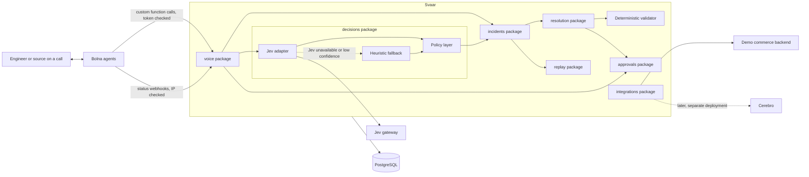

# Plan: Voice-operated incident resolution system that reconstructs what happened, verifies claims by phone, and negotiates a validated fix

Target: Bolna Buildathon submission, due Oct 31, 2026. Shortlist interviews run Nov 5 to 7 and the top three pitch in Bengaluru on Nov 20.

Core rule: **Jev decides, deterministic code enforces, Bolna speaks.**

Local working document. Do not commit it and do not place it in `plans/`. Add it to `.git/info/exclude`:

```bash
echo "plan.md" >> .git/info/exclude
```

---

## 1. Goal

Voice-enable an incident workflow for a commerce backend in Svaar, with Jev as the typed, auditable source of decisions. One complete loop must work end to end:

1. Reconstruct what happened from recorded events.
2. Verify human and system claims by calling authorized sources.
3. Negotiate a resolution between conflicting services.
4. Accept only what a deterministic validator approves.
5. Replay the fix in a sandbox, labelled as simulation.
6. Export a redline for human approval.

Domain: a commerce backend with payment, inventory and carrier services. Nothing outside that domain is in scope.

Cerebro is not on the critical path. Svaar is an independent service with no Cerebro code. A Cerebro adapter, if time allows, lives in `integrations` and is built last.

## 2. Starting point: the Svaar foundation

Already in place (do not rebuild): FastAPI modular monolith, `app.py` composition, `config.py`, `db.py`, `logging.py`, `/health` and `/ready` probes, error envelope, JSON logging, Alembic with an empty `0001` baseline, Docker Compose with PostgreSQL, Ruff, pytest and CI.

Existing packages: `incidents`, `decisions`, `voice`, `resolution`, `replay`, `approvals`, `integrations`, `web`, `jobs`, `api`.

Rules inherited from Svaar's foundation:

- Feature packages may import shared utilities. Shared utilities never import feature packages. Domain code never imports `app.py`.
- Each feature exposes its own `APIRouter`, included in `api/router.py`. Business routes inherit `/api/v1`.
- Use `def` for handlers and dependencies that touch SQL. Never run blocking SQL inside `async def`.
- Use `Depends(get_session)`. The caller owns the transaction and commits explicitly.
- Models inherit `svaar.db.Base`. Import each model module in `migrations/env.py` before autogenerating. Name every check constraint explicitly.
- External SDKs and HTTP contracts stay behind adapters, mocked in tests.
- Logs use fixed event names. Never log request bodies, headers, URLs with credentials, transcripts or phone numbers.

## 3. Roles of the three components

| Component | Role | Does not do |
|---|---|---|
| Bolna | Voice interface: inbound and outbound calls, speech, telephony, transcripts | Make policy decisions |
| Jev | Typed decisions with confidence: choices, scores, yes/no probabilities | Generate language, or act as final authority on hard constraints |
| Svaar | State machine, ledger, constraint enforcement, actions | Guess when evidence is missing |

Jev is a decision model, not a chat model. It takes a state and named, typed questions and returns one typed answer per question, with probabilities and a confidence value. All spoken words come from the LLM configured inside the Bolna agent.

## 4. Architecture



### Package ownership

| Package | Owns |
|---|---|
| `incidents` | `events`, `claims`, `evidence`, timelines, incident state machine |
| `decisions` | Jev adapter, heuristic fallback, policy layer, `decisions` table |
| `voice` | Bolna client, `voice_calls`, `voice_webhook_events`, custom function endpoints, auth |
| `resolution` | `constraints`, `negotiation_rounds`, negotiation agents, validator, redline draft |
| `replay` | Sandbox runs, simulated results (never written to `events`) |
| `approvals` | Human approval records and spoken-confirmation records |
| `integrations` | Replaceable adapters (Cerebro last, demo commerce backend) |

## 5. Jev decisions

### Decision slots

| Slot | Question type | Code that acts on it |
|---|---|---|
| Classify a call answer (confirmed, denied, unsure, wrong person, callback) | choice | Writes an evidence record |
| Propose a claim status | choice | Only an explicit contradicting evidence record can set `contradicted`; otherwise `unverified` |
| Pick the next source or question | choice | Triggers a verification call |
| Escalate to a phone call now | noul (yes/no) | Threshold check, then outbound call |
| Is a requested action risky or irreversible | noul | Requires spoken confirmation |
| Pre-screen a negotiation proposal | score | Ranking only; the validator decides validity |

### Policy layer

| Outcome | Condition |
|---|---|
| Act automatically | Confidence at or above the high threshold and the action is reversible |
| Ask by voice | Confidence between thresholds, or the action is risky |
| Defer or use fallback | Confidence below the low threshold, Jev unavailable, or response invalid |

Thresholds are configuration values, tuned on a small labelled set of your own call transcripts. The vendor's calibration claim is not assumed.

Data minimization: send Jev only what the question needs. Redact phone numbers and personal data from `state`.

### Gateways

Jev is reachable through several routes with different request shapes. Verify the exact body for the chosen route before coding.

- TypeSafe native System One API
- NanoGPT: `POST https://nano-gpt.com/api/v1/decisions`
- Inworld: `POST https://api.inworld.ai/alpha/decisions` (alpha)
- LiteLLM, Portkey or Bifrost `/v1/decisions` routes

Common to all: a `state`, named typed questions (`noul`, `choice`, `score`), and `criteria` on choice questions. Pin the model version (for example `jev-1.13.0`).

### Adapter interface (synchronous, to match Svaar's thread-pool model)

```python
from dataclasses import dataclass
from typing import Mapping, Protocol, Sequence


@dataclass(frozen=True)
class Decision:
    """A typed decision returned by Jev or the heuristic fallback.

    Attributes:
        name: The question name the answer belongs to.
        value: The chosen label, boolean, or score.
        confidence: Confidence in the range 0.0 to 1.0.
        probabilities: Per-label probabilities when available.
        model_version: The pinned model version that produced the answer.
    """

    name: str
    value: object
    confidence: float
    probabilities: Mapping[str, float]
    model_version: str


class DecisionEngine(Protocol):
    """Interface implemented by the Jev adapter and the heuristic fallback."""

    def decide(
        self, state: str, questions: Mapping[str, dict]
    ) -> Sequence[Decision]:
        """Answer typed questions about a state.

        Args:
            state: Description of the situation, with personal data redacted.
            questions: Named typed questions, keyed by question name.

        Returns:
            One Decision per question, in request order.

        Raises:
            DecisionUnavailableError: If the engine cannot answer within
                the configured timeout or returns an invalid response.
        """
        ...
```

Use `httpx.Client` with explicit connect and read timeouts. A timeout or invalid payload raises `DecisionUnavailableError`, and the policy layer routes to the heuristic fallback.

## 6. Bolna integration

Facts from Bolna's documentation:

- Base URL `https://api.bolna.ai`, Bearer auth. A wrong or missing key returns `401`.
- `GET /user/me` returns wallet balance and concurrency (`max` and `current`). Check it before every test session.
- `POST /v2/agent` creates an agent and returns `201` with `agent_id` and `state`. `toolchain.pipelines` is an array of arrays. The full config is large.
- `webhook_url` is set inside `agent_config`, or in the dashboard Extractions tab ("Push all execution data to webhook").
- `POST /call` takes `agent_id` and `recipient_phone_number` (E.164) and returns `execution_id`. Omit `from_phone_number` to use Bolna's default number. Context goes in `user_data` variables.
- Webhooks send several POSTs per call, distinguished by `status`. `call-disconnected` arrives with empty duration, cost, recording and extractions. Treat `completed` as finished.
- Final statuses: `completed`, `no-answer`, `busy`, `failed`, `canceled`, `stopped`, `error`, `balance-low`.
- Bolna sends webhooks from `13.203.39.153`, `13.126.9.249` and `13.202.133.53`.
- Executions include `transcript`, `extracted_data`, `cost_breakdown` and `latency_data.time_to_first_audio`. The unit of the latency value is not stated in the docs; confirm before quoting it.
- `scheduled_at` needs `+00:00` rather than `Z` and at least two minutes ahead. Only relevant if scheduling is used.

### Create the first agent in the dashboard

Use Auto Build in the dashboard, then copy the `agent_id`. This is the fastest route and avoids the large API config on day one. Codify the config through the API later only if time remains.

### Status handling

| Bolna status | Svaar action |
|---|---|
| `completed` | Parse transcript and extractions, run Jev classification, write evidence, update claim |
| `no-answer`, `busy`, `failed`, `canceled`, `stopped`, `error` | Mark the call outcome failed; the claim stays `unverified` |
| `balance-low` | Alert the operator; no claim change |
| Anything else | Record and ignore |

A failed or unanswered call never produces `contradicted`.

### Mid-call tools as custom functions

Each tool is a custom function that calls Svaar. The `key` must be exactly `custom_task`.

```json
{
  "name": "get_timeline",
  "description": "Called when the engineer asks what happened in an incident or why a payment failed.",
  "pre_call_message": "One moment while I pull the timeline.",
  "parameters": {
    "type": "object",
    "properties": {
      "incident_id": { "type": "string", "description": "The incident identifier" }
    },
    "required": ["incident_id"]
  },
  "key": "custom_task",
  "value": {
    "method": "GET",
    "param": { "incident_id": "%(incident_id)s" },
    "url": "https://<tunnel-host>/api/v1/voice/tools/get_timeline",
    "api_token": "Bearer <voice-tool-token>",
    "headers": {}
  }
}
```

| Tool | Purpose |
|---|---|
| `get_timeline` | Read observed events for an incident |
| `list_claims` | Read claims and evidence status |
| `record_claim_answer` | Store a source's answer as evidence |
| `confirm_action` | Capture spoken confirmation for a risky action |
| `request_replay` | Start a sandbox replay |

Calls run inside the live conversation, so handlers must be fast. Use `pre_call_message` to cover short waits. A graph agent (node-based call flow) is a candidate for the outbound verification script; read its docs before committing.

### Voice security

Svaar has no general authentication, and Bolna needs a public HTTPS endpoint. Compensate on the voice surface only:

- Tool endpoints require a bearer token (the custom function's `api_token`), compared in constant time.
- The status webhook accepts only Bolna's three IPs. Check how the tunnel forwards the client address before trusting it; if it cannot be trusted, also require a shared secret in the `webhook_url` path or header.
- Expose only `/api/v1/voice` through the tunnel. Keep `/docs` and every other route local.
- Never log transcripts, phone numbers, tokens or payloads.

### Idempotency and transactions

External calls are not atomic with database commits.

1. Commit a `voice_calls` row with state `pending` and the claim reference.
2. Place the call. On success, store the `execution_id` and commit. On failure, mark `failed` and commit.
3. Webhooks are deduplicated on unique `(execution_id, status)` in `voice_webhook_events`. Reprocessing a duplicate is a no-op.
4. Handlers are safe to replay.

## 7. Data model

Build SQLAlchemy models on `svaar.db.Base` inside the owning package, one Alembic revision per change, explicit constraint names. Coordinate migration heads before merging.

| Table | Package | Key columns |
|---|---|---|
| `events` | incidents | incident_id, service, kind, payload (JSONB), occurred_at, trace_id |
| `claims` | incidents | incident_id, source, statement, status in (`confirmed`, `contradicted`, `unverified`) |
| `evidence` | incidents | claim_id, event_id (nullable), call_id (nullable), stance in (`supports`, `contradicts`) |
| `decisions` | decisions | incident_id (plain UUID, no cross-package FK), state_hash, question, answer, confidence, model_version, policy_outcome, action_taken, decided_at |
| `voice_calls` | voice | claim_id (plain UUID), execution_id (unique, nullable until placed), state, created_at |
| `voice_webhook_events` | voice | execution_id, status, received_at; unique (execution_id, status) |
| `constraints` | resolution | owner_service, rule (JSONB) |
| `negotiation_rounds` | resolution | negotiation_id, agent, proposal (JSONB), valid, violations (JSONB) |
| `approvals` | approvals | subject_type, subject_id, decision, decided_by, decided_at |

Boundary rules:

- Simulated output lives in `replay` tables and is never inserted into `events`.
- Cross-package references use plain identifiers, not imports of another package's models, so `decisions` stays independent of `incidents`.

## 8. API surface

All business routes sit under `/api/v1`.

| Method | Route | Package | Purpose |
|---|---|---|---|
| POST | `/incidents` | incidents | Open an incident |
| GET | `/incidents/{id}/timeline` | incidents | Observed events in order |
| GET | `/incidents/{id}/claims` | incidents | Claims with status and evidence |
| POST | `/claims/{id}/verify` | voice | Place an outbound verification call |
| POST | `/voice/status` | voice | Bolna status webhook (IP checked) |
| GET/POST | `/voice/tools/{tool}` | voice | Bolna custom functions (token checked) |
| POST | `/incidents/{id}/replay` | replay | Run a what-if, returned as simulated |
| POST | `/negotiations` | resolution | Start a negotiation |
| POST | `/negotiations/{id}/validate` | resolution | Run the deterministic validator |
| GET | `/incidents/{id}/redline` | resolution | Export the draft for approval |
| POST | `/approvals` | approvals | Record a human approval |

Use Pydantic request and response models, explicit status codes, and the shared error envelope. Add only routes that are implemented. Check for duplicate routes and naming drift before every merge.

## 9. Trust guarantees

Enforced in code and covered by tests.

- Observed history and simulation are stored and displayed as different types.
- Missing evidence leaves a claim `unverified`. A failed, unanswered or ambiguous call never produces `contradicted`, and Svaar never implies a person lied.
- The validator, not Jev, decides whether a proposal satisfies hard constraints.
- Risky or irreversible actions need spoken confirmation, recorded in `approvals`.
- Outbound calls go only to authorized sources and use bounded questions.
- Contract drafts are redlines for human approval. They are not legal advice.

## 10. Schedule to Oct 31

Start date Oct 18, 13 days. Target a complete, recorded demo by Oct 30 and submit on the morning of Oct 31. Check the submission form's cutoff time now.

| Dates | Work | Done when |
|---|---|---|
| Oct 18 to 19 | Obtain a Jev key; build the sync adapter, heuristic fallback, policy layer and `decisions` model and migration; add voice auth dependency | Adapter tests pass for success, timeout, invalid payload and low confidence; `alembic check` is clean |
| Oct 20 to 21 | Dashboard agent, outbound client, `voice_calls` and `voice_webhook_events`, status handler with IP check and dedupe, tunnel | A real call reaches your phone and `completed` is processed once, even if delivered twice |
| Oct 22 to 24 | `incidents` models, demo commerce backend instrumentation, timeline endpoint, `get_timeline` and `list_claims` tools | You ask by voice why a payment failed and hear ordered events |
| Oct 25 to 26 | Claims and evidence flow, verification script, Jev classification, `record_claim_answer` | A verification call produces evidence and the correct claim status, including `no-answer` staying `unverified` |
| Oct 27 to 28 | Negotiation agents, validator, Jev pre-screening, `confirm_action` and `approvals` | A proposal is rejected, revised, then approved; a risky action waits for spoken confirmation |
| Oct 29 | One replay fault type in the sandbox; redline export | Replay is labelled simulated; a redline file exports |
| Oct 30 | Rehearse, record the demo, measure time to first audio | A clean take under three minutes |
| Oct 31 | Submission write-up and final checks | Submitted |

Cut order if time runs short: Cerebro adapter, redline export, replay fault variety, Jev pre-screening of proposals. The ledger, validator, claims flow, voice loop and decision audit are never cut.

Each milestone ends with `ruff format --check`, `ruff check`, `alembic check` and `pytest` passing.

## 11. Demo script (about 3 minutes)

1. Ask by voice why an order's payment failed. The timeline shows the event order and a retry bug.
2. Operations reports the shipment as dispatched, but no warehouse scan exists. The agent calls the warehouse. Jev classifies the answer, the policy layer applies it, and the claim is confirmed or left unverified.
3. Payment, inventory and carrier services hold conflicting constraints. Their agents negotiate aloud. The validator rejects one proposal and approves a revised one.
4. The corrected sequence replays in the sandbox, shown as simulated.
5. A redline of the SLA exception is exported for approval.

Show the `decisions` table once, with confidence values and policy outcomes, to make Jev's role concrete.

## 12. Testing

- **Adapter:** mocked gateway for success, invalid payload, timeout and low confidence; all failures route to the fallback.
- **Policy:** boundary tests at each threshold, including risky-action override.
- **Validator:** table-driven tests per hard constraint, including must-reject cases.
- **Trust rules:** absent evidence, `no-answer` and `busy` can never produce `contradicted`.
- **Voice security:** missing or wrong token is rejected; a request from a non-allowlisted IP is rejected; no sensitive data appears in logs.
- **Idempotency:** a duplicate `(execution_id, status)` webhook changes nothing; a failed call placement leaves a recoverable `voice_calls` row.
- **Migrations:** PostgreSQL tests run when `SVAAR_TEST_DATABASE_URL` points at a dedicated disposable database.
- **Calls:** a labelled transcript set for tuning thresholds, plus at least five real end-to-end calls before submission.
- **Latency:** record `time_to_first_audio` from executions and report the median with its confirmed unit.

## 13. Risks and mitigations

| Risk | Mitigation |
|---|---|
| Some Jev gateways are alpha and request shapes differ | Adapter interface, pinned model version, heuristic fallback |
| Jev has documented failure modes; calibration is the vendor's claim | Tune on your own transcripts; validator remains final |
| Public endpoint on an unauthenticated app | Voice-only exposure, bearer token, IP check, no sensitive logging |
| Custom function latency inside live calls | Fast sync handlers, `pre_call_message`, no heavy work in the request path |
| Wallet credits, concurrency (max 10), telephony setup | `GET /user/me` before sessions, test number, confirm outbound number early |
| Duplicate or reordered webhooks | Unique dedupe key, replay-safe handlers |
| Scope too wide for 13 days | Fixed cut order in section 10 |
| Voice agent drifts off script | Tight prompts, bounded tools, graph agent for outbound scripts if suitable |

## 14. Open items

- Confirm the Jev gateway, key and exact request body.
- Read Bolna's graph agent and extractions pages before fixing the verification call design.
- Confirm the unit of `time_to_first_audio`.
- Decide whether a Hindi or Hinglish option is in the demo.
- Choose the telephony number for outbound calls.
- Confirm the submission cutoff time.

## 15. Working rules

- Work on feature branches. Never push to main directly unless explicitly decided.
- Never mention Claude as a co-author.
- No agent, roadmap or handoff documents pushed, including this file.
- Docstrings per each language's standard convention.
- No em dashes and no emoji in documents, comments or code.
- Check for redundant routes, folders and naming issues before every merge.
- Write precise commit messages.
